# vCommunity-Observability

> [!WARNING]
> **Warning: this software is under development. Do not use in a production environment.**

An open-source framework that collects data from **vCenter** and **VCF Operations**, stores it locally in SQLite, and makes it useful in two ways:

- **Custom dashboards** served by the app itself, styled after VCF Operations (Clarity look, light and dark theme). No Grafana and no CDN, so it works at dark sites.
- **REST endpoints for VCF Operations Management Pack Builder**, so MP Builder can pull the data back into VCF Operations.
- **vCommunity Ask**, a second container with a chat prompt in the same look, answered by your local **Ollama** only from knowledge sources you choose (for example a GitHub repository of markdown files). See [vCommunity Ask](#vcommunity-ask-local-ai-chat).

The core stays small. Every feature is an **add-on module** that can be written in **Python or PowerShell**, switched on or off, and patched on its own.

> Status: prototype (v0.1.0). Seven modules are included. Every module has been tested with built-in sample data; live collection against a lab vCenter has not been verified for every module yet. See [What's next](#whats-next).

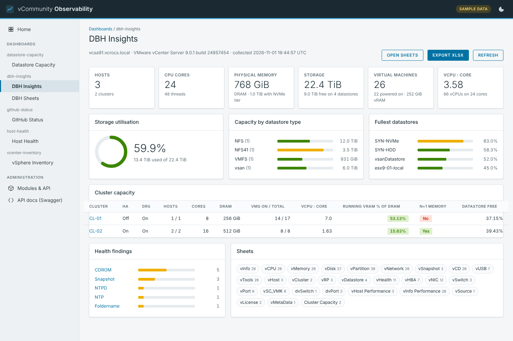

## Contents

- [Requirements and design goals](#requirements-and-design-goals)
- [How it fits together](#how-it-fits-together)
- [Data storage (SQLite)](#data-storage-sqlite)
- [Getting started](#getting-started)
- [Using the web UI](#using-the-web-ui)
- [Modules included](#modules-included)
- [vCommunity Ask (local AI chat)](#vcommunity-ask-local-ai-chat)
- [Configuration reference](#configuration-reference)
- [Docker image and runtime](#docker-image-and-runtime)
- [Using it from MP Builder](#using-it-from-mp-builder)
- [Core API](#core-api)
- [Writing a module](#writing-a-module)
- [Security](#security)
- [Patching and updates](#patching-and-updates)
- [Dark sites](#dark-sites)
- [Troubleshooting](#troubleshooting)
- [Testing](#testing)
- [Repository layout](#repository-layout)
- [What's next](#whats-next)

## Requirements and design goals

| Goal | How it is met |
| --- | --- |
| Cross-platform | One container image (amd64 and arm64, including Apple Silicon), or run directly with Python 3.11+ on Windows, macOS or Linux |
| No Grafana | Dashboards are server-rendered HTML from the app itself |
| Works offline / at dark sites | No CDN links or runtime downloads; Swagger UI is vendored; images can be saved as tarballs |
| Open source | FastAPI, SQLite, APScheduler, pyVmomi, Jinja2, PowerShell 7 (PowerCLI is the one accepted non-open-source exception) |
| Easy to patch | Locked, hashed dependencies; layered Dockerfile; each module is a folder that can be replaced on its own |
| Language choice | Modules can be Python **or** PowerShell; the core never forces one |

## How it fits together

```
 vCenter / VCF Operations / any REST source
            │  (pyVmomi, PowerCLI, REST)
            ▼
 ┌──────────────────── vCommunity-Observability container ────────────────────┐
 │  Scheduler ──runs──▶ module collectors (.py or .ps1) ──JSON──▶ SQLite      │
 │      │                                                       (1 db/module) │
 │      └──runs──▶ scheduled exports (XLSX/CSV) ──▶ /app/exports              │
 │  FastAPI ──▶ /api/<module>/...      REST for MP Builder (token auth)       │
 │          ├─▶ /dash/<module>/...     dashboards (server-rendered HTML)      │
 │          ├─▶ /export/<module>/...   file downloads                         │
 │          └─▶ /settings, /modules, /docs                                    │
 └────────────────────────────────────────────────────────────────────────────┘
```

- **One container, one job.** Uvicorn (FastAPI) is the single main process. The scheduler runs inside it, and collectors and exports are short-lived child processes that start, write JSON and exit. SQLite is one file per module, so a single container avoids cross-container locking and keeps dark-site installs to one image. Split it only if you move to Postgres, need HA on Kubernetes, or want PowerCLI in its own image.
- **Collectors** are plain scripts. The core passes connection details in environment variables and reads one JSON object back. That is the whole contract, which is why a module can be Python or PowerShell.
- **Storage** is one SQLite file per module in `data/`, plus `data/_core.db` for core state (run history, module switches and order, settings saved in the UI, export schedules). See [Data storage (SQLite)](#data-storage-sqlite).

## Data storage (SQLite)

SQLite is the only data store. It runs inside the Python process, so there is no database server to install, patch or secure, which suits offline and dark-site installs. Everything lives in the `data/` folder (the `/app/data` volume in Docker).

**One database file per module.** Each module gets its own file, for example `data/vcenter-inventory.db` or `data/host-health.db`. Modules stay isolated, and deleting a module's file removes its data.

- Tables come from the `tables:` section of the module's `module.yaml`. The core creates them on start, and when a module update adds columns, the core adds them with `ALTER TABLE`. Columns are only ever added, never dropped, so there are no migration scripts to write.
- Collectors (Python or PowerShell) only print rows as JSON. The core writes them and stamps every row with `collected_at` (UTC).
- Each table has a `mode`:

| Mode | What a collector run does | Use it for |
| --- | --- | --- |
| `snapshot` | Deletes all rows, then inserts the new ones | Current state, such as inventory |
| `append` | Inserts the new rows and deletes rows older than `retention_days` (default 90) | History and trends |

**`data/_core.db` holds the app's own state:**

| Table | Contents |
| --- | --- |
| `runs` | Collector run history (status, row count, error message), trimmed to the last 1000 runs |
| `module_state`, `module_order` | Module on/off switches and menu order set in the UI or API |
| `connection_settings`, `collector_settings` | Connections and collector intervals edited on the Settings page; they win over `config.yaml` and `.env` |
| `vcenter_instances` | The vCenter list managed on the Settings page (multi-vCenter). When it has any rows, it wins over `config.yaml` for vCenter |
| `export_schedules` | Scheduled export definitions and their last result |

Passwords saved on the Settings page are stored **unencrypted** in `_core.db`, so protect `data/` as you would `.env`.

**Reads are read-only.** Dashboards and the REST endpoints that MP Builder calls open module databases with a read-only connection (`mode=ro`), and manifest queries must be `SELECT`. Only collectors write.

**vCommunity Ask has its own database**, `ask.db` in its own volume, completely separate from these files. See [The Ask database](#the-ask-database-askdb).

To back up or move everything, stop the container and copy `data/`. Any SQLite tool, such as DB Browser for SQLite, can open the files.

The databases are never committed to git: `.gitignore` excludes `data/` and `ask-data/`, plus any `*.db` file and SQLite's `*.db-wal` and `*.db-shm` side files wherever they are, as a safety net for a test run with a different data path. They hold unencrypted passwords, customer inventory and chat history, and they are rebuilt automatically.

## Getting started

These steps take a fresh clone to both containers running: the dashboards on port **8080** and vCommunity Ask on port **8081**. Each step has bash (macOS, Linux) and PowerShell (Windows) commands.

### Prerequisites

| What | macOS | Windows | Linux |
| --- | --- | --- | --- |
| Container engine | Rancher Desktop (Container Engine `dockerd (moby)`) or Docker Desktop | Docker Desktop (WSL 2 backend) or Rancher Desktop | Docker Engine with the Compose plugin |
| git | Xcode command line tools or Homebrew | Git for Windows | distro package |
| Ollama (only for Ask) | ollama.com app | ollama.com app | ollama.com install script |
| Models (only for Ask) | `nomic-embed-text` plus a chat model | same | same |
| Memory for the chat model | A 27B model needs roughly 20 GB free; 8B models run in roughly 6–8 GB | same | same |
| vCenter (optional) | Reachable from the container, with a read-only account | same | same |

No vCenter yet? Set `VCO_MOCK=1` in `.env` and every dashboard runs on built-in sample data. No Ollama? The dashboards work without it; only Ask needs it.

### 1. Get the code

```bash
git clone https://github.com/dalehassinger/vCommunity-Observability.git
cd vCommunity-Observability
```

### 2. Create your config and secrets

```bash
cp config/config.example.yaml config/config.yaml
cp .env.example .env
openssl rand -hex 32          # run twice: one token for VCO_API_TOKEN_MPBUILDER, one for ASK_API_TOKEN
```

```powershell
Copy-Item config/config.example.yaml config/config.yaml
Copy-Item .env.example .env
[Convert]::ToHexString([Security.Cryptography.RandomNumberGenerator]::GetBytes(32))   # run twice, one per token
```

Copy `config/config.yaml` **before** the first `docker compose up`. If it is missing, Docker creates a folder with that name and the `vco` container fails to start.

In `config/config.yaml`, change only what applies to you (the example uses the author's lab names):

| Key | Set it to |
| --- | --- |
| `connections.vcenter.host`, `user` | Your vCenter FQDN and a read-only account (or leave them and set the vCenter on the **Settings** page later) |
| `connections.vcenter.verify_ssl` | `true` if vCenter has a trusted certificate |
| `connections.vcfops.*` | Your VCF Operations, or leave it if you don't use it |
| `modules.dbh-*.settings.vcenter_name` | Your vCenter name (shown in the DBH sheets) |
| `modules.github-status.enabled` | `false` if the machine has no internet |

In `.env`, set:

| Variable | Value |
| --- | --- |
| `VCO_VCENTER_PASSWORD` | The vCenter password (`VCO_VCFOPS_PASSWORD` for VCF Operations) |
| `VCO_API_TOKEN_MPBUILDER` | The first token. Needed for saves on the Settings page and for the REST API |
| `ASK_API_TOKEN` | The second token. Needed to change Ask's Settings and Knowledge sources |
| `VCO_MOCK` | Uncomment `VCO_MOCK=1` for sample data instead of a live vCenter |
| `ASK_CHAT_MODEL` | Only if you won't use the default `qwen3.8:27b-mlx` (see step 4) |

Never commit `.env` or `config/config.yaml`; both are in `.gitignore`.

### 3. Create the data folders

The containers run as non-root users (`vco` uid 10001 and `ask` uid 10002), so they need folders they can write to.

```bash
mkdir -p data exports extra-modules ask-data ask-knowledge ask-sources
# Linux only: give the folders to the container users
sudo chown -R 10001 data exports extra-modules
sudo chown -R 10002 ask-data
# macOS: Docker Desktop and Rancher Desktop map ownership for you; if a scheduled export can't write, run: chmod 777 exports
```

```powershell
New-Item -ItemType Directory -Force data, exports, extra-modules, ask-data, ask-knowledge, ask-sources | Out-Null
```

### 4. Set up Ollama (for Ask)

Ollama runs on the host, not in a container, so it can use the GPU. Two things are needed: Ollama must accept connections from containers, and the models must be pulled.

| OS | Let containers reach Ollama |
| --- | --- |
| macOS | `launchctl setenv OLLAMA_HOST 0.0.0.0`, then quit and reopen Ollama. Details and how to keep it after a reboot: [Start it on Rancher Desktop](#start-it-on-rancher-desktop) |
| Windows | `setx OLLAMA_HOST 0.0.0.0` in PowerShell, then quit Ollama from the tray and start it again |
| Linux | `sudo systemctl edit ollama`, add `[Service]` and `Environment="OLLAMA_HOST=0.0.0.0"`, then `sudo systemctl restart ollama`. Also uncomment the `extra_hosts` lines under `vco-ask` in `docker-compose.yml` |

Then pull the models:

```bash
ollama pull nomic-embed-text      # embeddings (search); required
ollama pull qwen3.8:27b-mlx       # default chat model on an Apple Silicon Mac with enough memory
```

The `-mlx` tags are built for Apple Silicon. On Windows, Linux or a smaller Mac, pull a chat model that fits your memory, for example `ollama pull qwen3:8b` or `ollama pull llama3.1:8b`, and set `ASK_CHAT_MODEL` to it in `.env` (or pick it on Ask's Settings page later). Check that a container can reach Ollama:

```bash
docker run --rm curlimages/curl -s http://host.docker.internal:11434/api/tags   # lists your models
```

With Rancher Desktop's `containerd` engine, set `ASK_OLLAMA_URL=http://host.lima.internal:11434` in `.env` instead.

### 5. Build and start

```bash
docker context use rancher-desktop     # Rancher Desktop only
docker compose up -d --build           # builds and starts both containers (first build takes several minutes)
docker compose ps                      # both should show "healthy" after a minute
```

The commands are the same in PowerShell. With the `containerd` engine use `nerdctl compose up -d --build`. To start only one container, name it: `docker compose up -d --build vco` or `... vco-ask`. If PowerShell fails to build with `Illegal instruction`, see [Troubleshooting](#troubleshooting).

Quick health checks: http://localhost:8080/api/core/health and http://localhost:8081/api/health.

### 6. First steps

**Dashboards (http://localhost:8080)**

1. Open **Settings**. Under Connections, check the vCenter address and user, enter the password if it isn't in `.env`, and press **Save and test**. Paste `VCO_API_TOKEN_MPBUILDER` into the card's token field when asked.
2. Open **Modules & API** and press **Run collectors now** on a module, or wait for its first scheduled run.
3. Open a dashboard from the sidebar. If it shows "collector failed", the message says why; `docker compose logs -f vco` shows more.
4. Optional: turn off modules you don't need, and set collection intervals on **Settings**.

**vCommunity Ask (http://localhost:8081)**

1. Paste `ASK_API_TOKEN` into the token bar at the top (kept in that browser only).
2. Open **Settings** and press **Test connection**. It should show the Ollama version and fill the model lists. Pick your chat model if it isn't the default.
3. Open **Knowledge sources**. The example `isvara` source (a public GitHub repository of vSphere metric docs) starts syncing about 5 seconds after the first start, which needs internet. Indexing about 200 files takes a few minutes. Don't want it? Turn its switch off; deleting it isn't enough, because sources from `ask.yaml` are added back on the next start unless you use your own `ask.yaml` (see [Ask configuration](#ask-configuration)).
4. **Add source** for your own GitHub markdown repository, local folder (copied into `./ask-knowledge`) or blog.
5. Open **New chat** and ask one of the example questions.

### Try it with sample data without Docker

For a quick look on a laptop with Python 3.11+ and no container engine:

```bash
python3 -m venv .venv && source .venv/bin/activate
pip install -r requirements.txt
cp config/config.example.yaml config/config.yaml
VCO_MOCK=1 uvicorn core.app:create_app --factory --port 8080
```

```powershell
python -m venv .venv; .venv\Scripts\Activate.ps1
pip install -r requirements.txt
Copy-Item config/config.example.yaml config/config.yaml
$env:VCO_MOCK = '1'
uvicorn core.app:create_app --factory --port 8080
```

Open http://localhost:8080. A **Sample data** badge shows in the header while mock mode is on. The `host-health` module needs PowerShell 7 (`pwsh`) on the PATH; PowerCLI is only needed for live data. To run Ask without Docker, see [Start it on Rancher Desktop](#start-it-on-rancher-desktop).

## Using the web UI

The left sidebar lists every enabled module's dashboards (in the order set on the Modules page), then **Modules & API**, **Settings** and **API docs (Swagger)**. The moon icon in the header switches light and dark theme; the choice is remembered in the browser.

### Home

A tile for every dashboard of every enabled module, in menu order.

### Modules & API

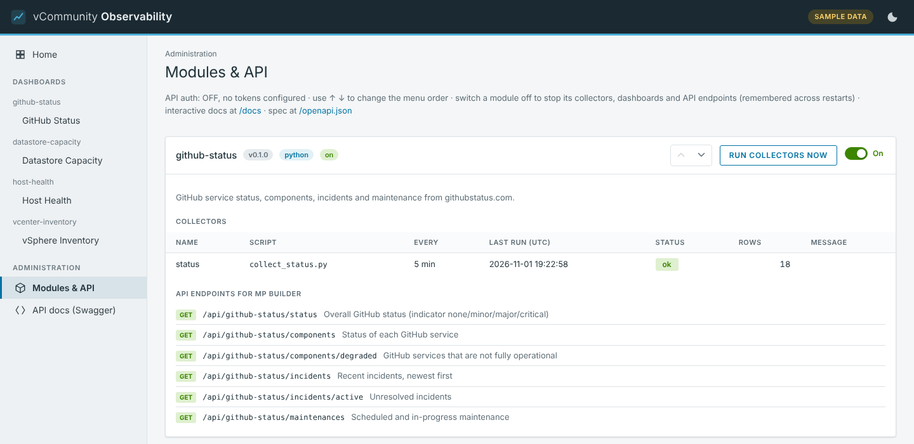

- Every module with its version, language, collectors, last run, row count and any error.
- **On/Off switch** per module. Off stops its collectors and hides its dashboards and API endpoints (they return 404). Saved in `data/_core.db`, so it survives restarts and upgrades.
- **↑ ↓** buttons set the menu order used by the sidebar, home page and this page. New modules appear at the bottom.
- **Run collectors now** runs a module's collectors immediately (dashboards have a **Refresh** button that does the same).
- The full list of each module's REST endpoints and downloads.

### Settings

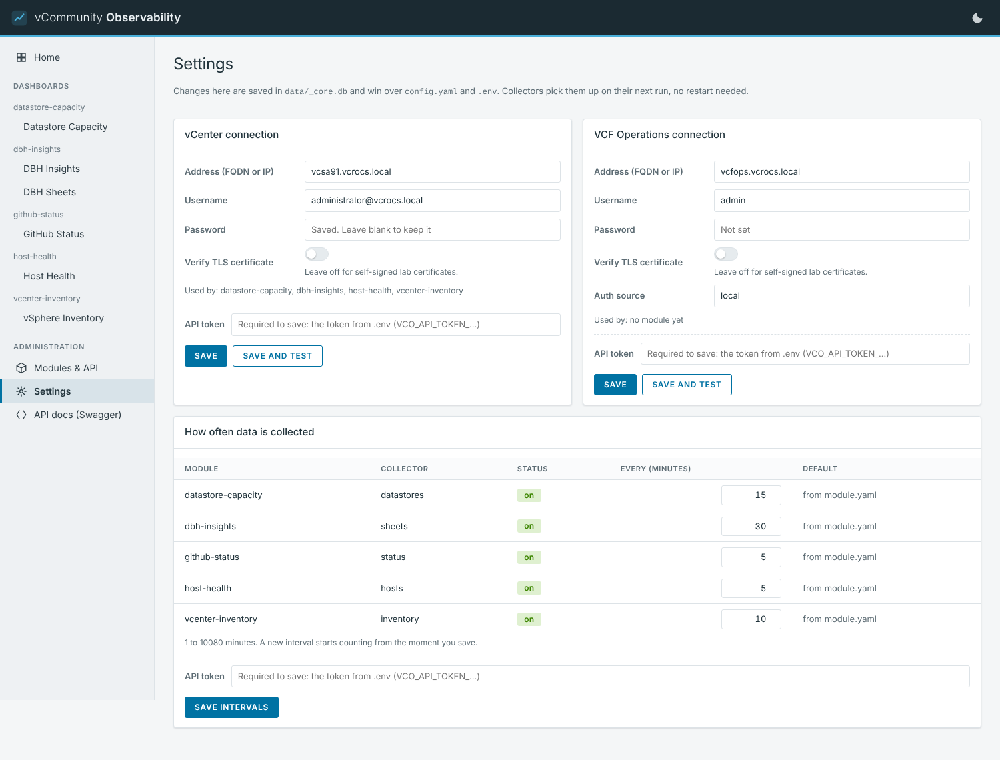

**Connections.** Edit the vCenter and VCF Operations address, username, password and TLS check. **Save and test** saves and checks the login straight away. Values saved here are stored in `data/_core.db`, win over `config.yaml` and `.env`, and apply from the next collection without a restart. **Reset to config.yaml** drops them. Leaving the password blank keeps the current one.

**Collection intervals.** How often each collector runs, 1 to 10080 minutes. A new interval starts counting from the moment you save.

**Scheduled export.** One schedule that runs a module export (for example the DBH Insights XLSX, or one sheet as CSV) and writes it to a folder:

- **Daily, weekly or monthly** (day of week, or day of month 1 to 28 or the last day), at a time and time zone you pick. The default time zone comes from `TZ`.
- **Folder** under `/app/exports`, which Compose maps to `./exports` next to `docker-compose.yml`. **Browse…** opens a folder picker where you can open folders, go up a level and create a new folder. (A browser can't hand a web app a real path on your computer, and the container only sees the exports folder, so the picker browses that folder.)
- **Keep newest N** files; older ones made by this schedule are deleted. 0 keeps all.
- Once saved, the card shows a summary (schedule, export, folder, next run, last run) with **Edit**, **Run now**, **Pause** and **Remove**. **Edit** opens the form filled in with the current values; **Save changes** updates the same schedule.
- Every save is **verified**: the schedule is read back from the database and compared with what you entered, the folder is write-tested, and the scheduler is checked for the job. A green **Schedule saved and verified** box lists those checks and the next run. If anything fails, a red message in the card says what, and the form keeps what you typed.
- Files are written as `.part` and renamed when complete, so a half-written file never appears.

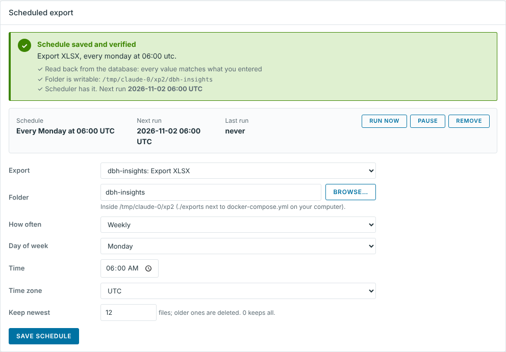

When API tokens are configured, every save on this page needs one of them (there is no UI login yet). The token field sits at the bottom of each card.

### API docs

`/docs` is Swagger UI (vendored, works offline) for every endpoint. `/openapi.json` is the machine-readable spec.

### About

**About** (last item in the sidebar, `/about`) shows what the project is, its version, how many modules are available, the number of dashboards, whether PowerShell is in the image, live or sample data, and the Python version, with links to GitHub, vcrocs.info and the API docs. Below that is this README, rendered in the app: an **On this page** list (h2 and h3 headings, the current section highlighted), a **Filter sections** box that hides sections that don't mention the text, working `#` links, screenshots served from the image (`/about/screenshots/<file>`) and links to repository files that open on GitHub. GitHub callouts such as the development warning show as alert boxes.

The README and `docs/screenshots/` are copied into both images at build time, so the page always matches the code you built, works offline, and needs no change when the README changes (rebuild to pick up a new README). Rendering is done in the browser by the vendored marked and DOMPurify (`core/static/vendor/`), with `core/static/about.js` and `about.css` shared by both containers. Ask has the same page, with its own version, models and index counts at the top.

## Modules included

| Module | Language | What it collects and shows | API endpoints (`/api/<module>...`) |
| --- | --- | --- | --- |
| `datastore-capacity` | Python (pyVmomi) | Capacity, free, provisioned and VM count per datastore, with 90 days of history for a runway estimate (appears after an hour of history). Widget dashboard | `/datastores`, `/datastores/critical`, `/runway` |
| `host-health` | PowerShell (PowerCLI) | Host status, alarms, maintenance mode, CPU and memory %, uptime, version. Widget dashboard with VCF Operations-style KPI cards | `/hosts`, `/hosts/unhealthy`, `/clusters` |
| `vcenter-inventory` | Python (pyVmomi) | Clusters, hosts and VMs (config, usage, disks, NICs, IPs, snapshots, notes) in a vCenter-style inventory browser with a tree, object pages and tabs | `/vms`, `/vms/powered-off`, `/vms/with-snapshots`, `/hosts`, `/clusters` |
| `github-status` | Python (requests) | GitHub service status from githubstatus.com (any Atlassian Statuspage site via the `url` setting): summary cards, one status card per service, open and recent incidents, maintenance. Needs internet or `HTTPS_PROXY` | `/status`, `/components`, `/components/degraded`, `/incidents`, `/incidents/active`, `/maintenances` |
| `dbh-insights` | Python (pyVmomi) | The [DBH Insights](https://github.com/DBH-Insights/DBH-Insights) inventory: 27 sheets plus Cluster Capacity. Insights and Sheets pages, **Export XLSX** and CSV per sheet | `/<sheet>` for every sheet (`/vinfo`, `/vhost`, `/cluster-capacity`...), `/sheets`, `/vhealth/by-type`, `/export/xlsx`, `/export/csv?sheet=vInfo` |
| `dbh-topology` | Python (pyVmomi) | DBH Insights **Topology**: hosts by cluster, datastores and every mount between them, with **Download HTML** | `/hosts`, `/datastores`, `/mounts`, `/single-host-datastores` |
| `dbh-impact` | Python (pyVmomi) | DBH Insights **Impact**: what stops if one host or datastore fails, and whether HA could restart it | `/hosts`, `/datastores`, `/critical`, `/single-points-of-failure` |

All vCenter modules use the shared `vcenter` connection. Configure one or many vCenters in `config.yaml` (`connections.vcenter` flat form, or `instances:`) or on the Settings page. Collectors receive every enabled instance as `VCO_VCENTERS` (JSON) and stamp rows with a `vcenter` id so names and morefs do not collide. A module can limit itself with settings `vcenters: [id, ...]`.

### vSphere Inventory

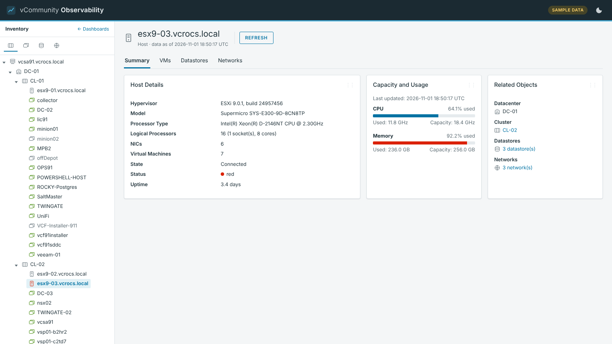

A tree of datacenter, clusters, hosts and VMs on the left; object pages with summary cards and tabs (Hosts, VMs, Datastores, Networks, Snapshots) on the right. Tags and storage policies are not collected yet (they need the vSphere REST API).

### Host Health

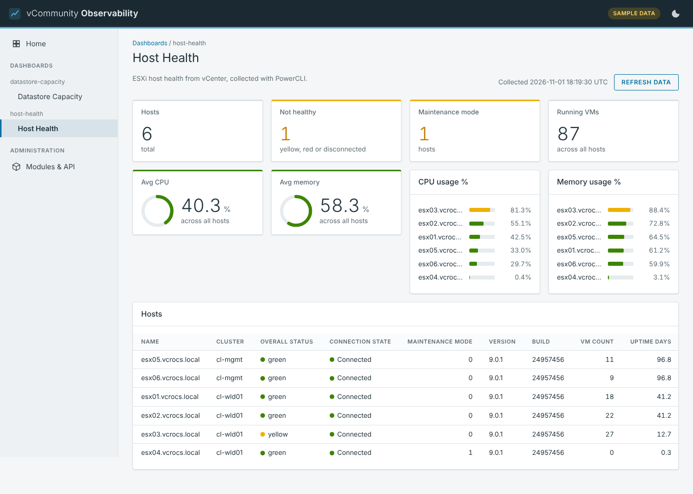

The reference PowerShell module: `Collect-HostHealth.ps1` uses PowerCLI and shows how a `.ps1` collector follows the same contract as a Python one.

### GitHub Status

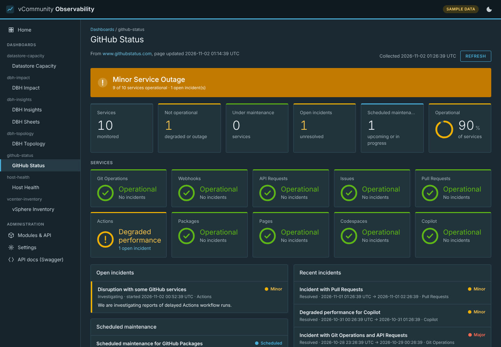

An overall status banner, a summary row (services, not operational, under maintenance, open incidents, maintenance windows, operational %), then a card per service with a coloured top edge and status ring. A service with an open incident links to it. Open and recent incidents are listed below.

### DBH Insights

`modules/dbh-insights` is a Python port of the DBH Insights website's query and export code (`collect/js/sheets.js`, `vim.js`, `xlsx.js`). The same columns, units, rounding and rules (vCLS VMs left out, "not reported" stays blank rather than 0) are used, but the data is collected on a schedule by the container with pyVmomi instead of from the browser through the desktop helper, so no helper app is needed and it works at dark sites.

- **Sheets:** vInfo, vCPU, vMemory, vDisk, vPartition, vNetwork, vSnapshot, vCD, vUSB, vTools, vHost, vCluster, vRP, vDatastore, vHealth, vHBA, vNIC, vSwitch, vPort, vSC_VMK, dvSwitch, dvPort, vHost Performance, vInfo Performance, vSource, vLicense, vMetaData, plus Cluster Capacity.
- **Insights** page: hosts, cores, DRAM, storage, VMs, vCPU:core ratio, storage utilisation, capacity by datastore type, fullest datastores, cluster capacity with the N+1 memory check, and vHealth findings.
- **Sheets** page: every sheet with sort, filter, paging, the **totals row** (sums, averages and ratios worked out the same way as the website) and **Group by**.

  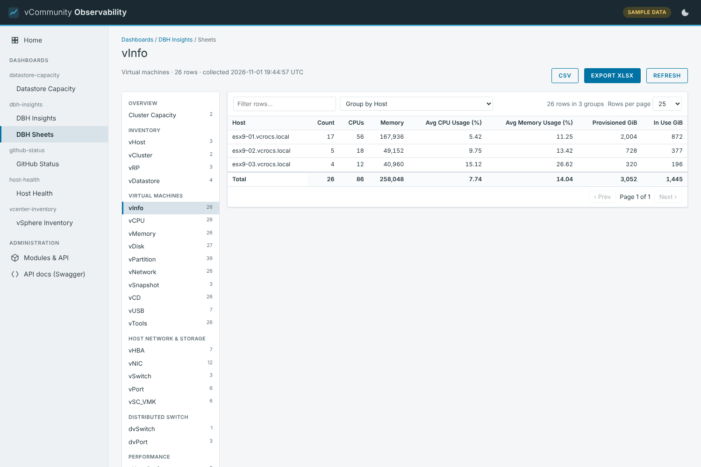

- **Export XLSX:** one workbook with every sheet, Verdana 9pt, black header row, frozen first row and column, AutoFilter, real Excel dates, in the inventory tool's sheet order. Also at `/api/dbh-insights/export/xlsx` (token required) and as a scheduled export.
- Large inventories are read with the PropertyCollector and continuation tokens, so nothing is silently truncated. A property an older vCenter doesn't know is dropped and logged, and its column stays empty.
- The website's API Explorer is not ported. Multi-vCenter collection is supported here (Settings / `VCO_VCENTERS`); the website's combined multi-VC UI chrome is not replicated sheet-for-sheet.

To change a sheet, edit `sheets.py`, then run `python sheets.py --tables` in the module folder and paste the output over the `tables:` section of `module.yaml`. The smoke test fails if they don't match.

### DBH Topology

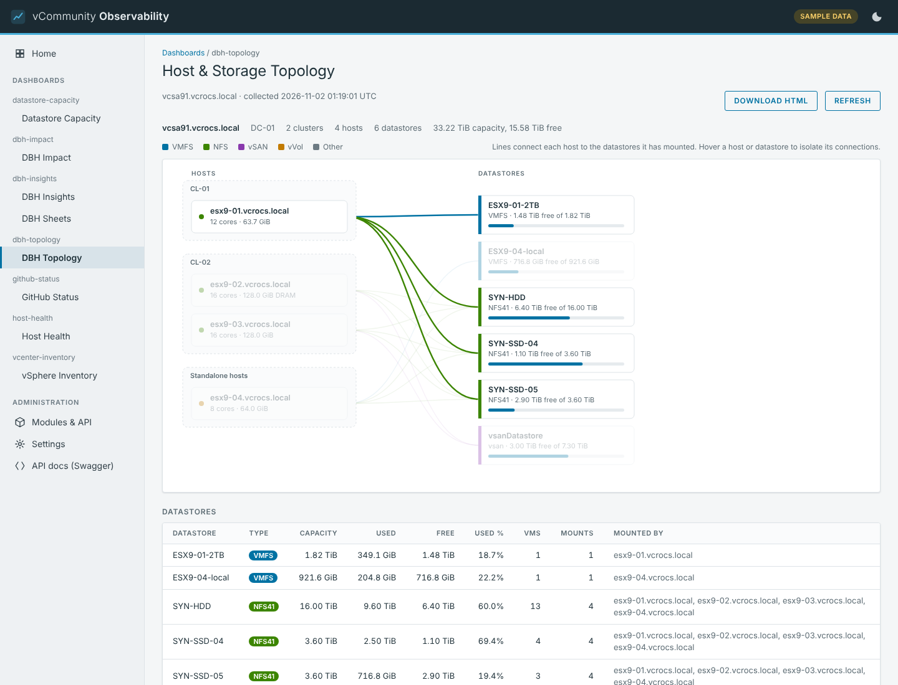

Port of the Topology view (`collect/js/insights.js` and `report.js`). Hosts are grouped by cluster (plus standalone hosts) on the left, datastores on the right with a capacity bar, and a line for each mount, coloured by datastore type (VMFS, NFS, vSAN, vVol, other). Hover a host or datastore to isolate its connections. Datastore and host tables sit below the map. **Download HTML** saves a standalone report, in the website's dark style, for emailing or archiving.

### DBH Impact

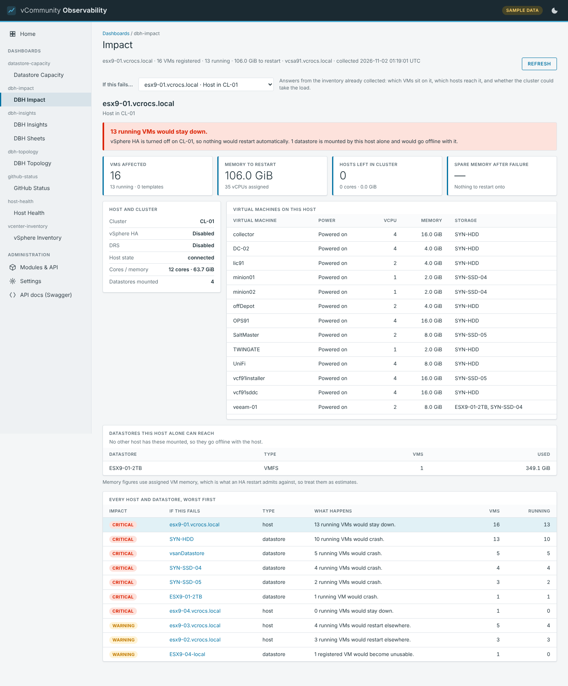

Port of the Impact view (`collect/js/impact.js`). Pick a host or datastore under **If this fails…**:

- **Host:** how many running VMs stop, whether vSphere HA would restart them (standalone host, HA off, no surviving hosts, or not enough uncommitted memory all mean they stay down), memory and vCPUs to restart, hosts left in the cluster, spare memory after the failure, datastores only that host can reach, and VMs on other hosts that use that storage.
- **Datastore:** how many running VMs crash, which have every file there versus split across datastores, which hosts mount it, and the capacity that goes offline.
- A table of **every host and datastore, worst first** (critical, warning, low).

Each collection answers the question for every host and datastore, so the answers are also REST endpoints for MP Builder (`/api/dbh-impact/hosts` gives severity, VMs running, memory to restart and headroom per host). Memory figures use assigned VM memory, which is what an HA restart admits against, so they are estimates.

`dbh-topology` and `dbh-impact` share one collector library, `fabric.py`. Each module keeps an identical copy so it stays self-contained; the smoke test fails if the copies drift. HA and DRS state come from the same vSphere session (`configuration.dasConfig.enabled`), so no extra credentials are needed.

## vCommunity Ask (local AI chat)

A second container, `vco-ask`, gives you a chat prompt in the same VCF Operations look (same header, left sidebar and light/dark theme). You ask questions and it answers **only from knowledge sources you point it at**: the markdown files of a GitHub repository, the posts of a web site or blog (optionally only a date range), or spreadsheets such as RVTools or the dashboards' DBH Insights export. For spreadsheets it can also answer counting and totals questions ("how many VMs are powered on per cluster?") with a read-only SQL query that it shows you. Your local **Ollama** writes the answers, so nothing leaves your machine.

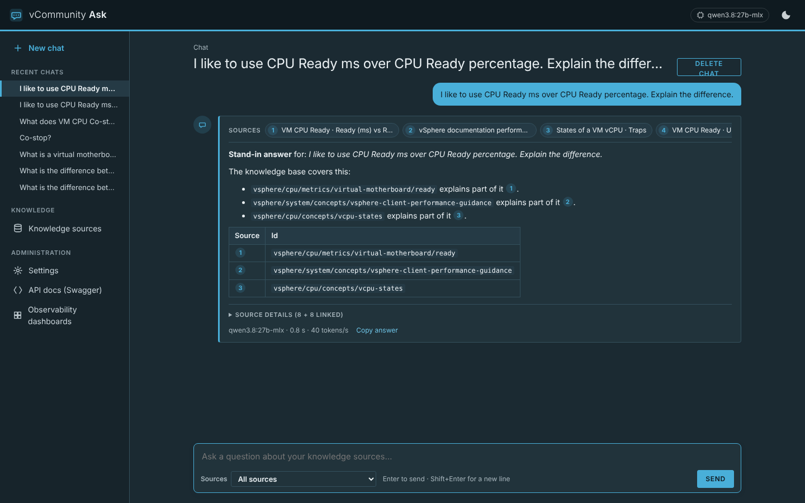

> Status: v0.1.0 (phase 1). Tested end to end against the [isvara-2](https://github.com/e1-rahabok/isvara-2) knowledge base (198 files, 1,095 chunks) with a stand-in for Ollama (`ask/scripts/fake_ollama.py`); the screenshots show that stand-in's answers. Answers from a real model on your Mac have not been tested here.

### How it works

The model is **not trained or fine-tuned**. It uses retrieval-augmented generation (RAG):

```
 GitHub repo / local folder ──▶ source plug-in (.py or .ps1) ──JSON documents──▶
 ┌──────────────────────────── vco-ask container ─────────────────────────────┐
 │ Indexer: split by "## " heading ─▶ Ollama /api/embed (nomic-embed-text)    │
 │          ─▶ data/ask.db: FTS5 keyword index + sqlite-vec vector index      │
 │ Chat:    question ─▶ hybrid search ─▶ follow links ─▶ numbered sources     │
 │          ─▶ Ollama /api/chat (streamed) ─▶ answer with [n] citations       │
 │ FastAPI: /chat  /sources  /settings  /doc  /api/*  /docs                   │
 └────────────────────────────────────────────────────────────────────────────┘
                     │ http://host.docker.internal:11434
              Ollama on the Mac (uses the GPU there)
```

1. **Sync.** A source plug-in clones or pulls the repository and prints its markdown files as JSON. Only files whose content changed since the last sync are re-embedded.
2. **Index.** Each file is split at `## ` headings (long sections on blank lines). Each chunk is embedded together with the file title and id, so a chunk makes sense on its own. Everything lives in one SQLite file, `data/ask.db`: documents, chunks, the FTS5 keyword index, the sqlite-vec vector index, chats and settings.
3. **Retrieve.** A question is embedded and searched two ways, by meaning (sqlite-vec, cosine) and by keyword (FTS5, BM25). The two rankings are merged with reciprocal rank fusion, with at most two chunks per file.
4. **Follow links.** Files that the matches link to in their metadata are added: `same_name` first (it stops the model mixing the VM and ESXi meaning of the same metric label), then `internal_derive`, `same_meaning` and `related`. They show as **Linked files** under the answer.
5. **Answer.** The numbered sources, the last few turns of the chat and the question go to the Ollama chat model with the system prompt (answer only from the sources, cite them as `[n]`, say when the sources don't cover it, flag `status: draft` content, follow diagnosis steps in order). The answer streams back word by word.

The sections [The Ask database](#the-ask-database-askdb), [From prompt to answer](#from-prompt-to-answer), [How Ollama and the chat model are used](#how-ollama-and-the-chat-model-are-used) and [Tuning the answers](#tuning-the-answers) below go into each step in detail.

### Start it on Rancher Desktop

Ollama stays on the Mac, not in a container: Docker on macOS has no GPU passthrough, so Ollama inside a container would run on CPU only.

1. **Let containers reach Ollama** (once). Rancher Desktop runs containers in a VM, so Ollama must listen on all addresses, not only `127.0.0.1`:
   ```bash
   launchctl setenv OLLAMA_HOST 0.0.0.0     # then quit and reopen Ollama
   lsof -nP -iTCP:11434 -sTCP:LISTEN        # should show *:11434
   ```
   `launchctl setenv` is lost at reboot. To keep it, add a LaunchAgent (`~/Library/LaunchAgents/setenv.OLLAMA_HOST.plist` running `launchctl setenv OLLAMA_HOST 0.0.0.0` at load) or run the command again after a restart. Ollama now accepts connections from your network without a password, so keep the macOS firewall on when you are away from home.
2. **Pull the models** (once): `ollama pull nomic-embed-text` for search; the default chat model is `qwen3.8:27b-mlx` (any installed chat model can be picked on the Settings page). The `-mlx` tags are for Apple Silicon; on another machine pull a model that fits its memory, such as `qwen3:8b`, and set `ASK_CHAT_MODEL`.
3. **Check that a container can reach Ollama:**
   ```bash
   docker run --rm curlimages/curl -s http://host.docker.internal:11434/api/tags   # lists your models
   ```
4. **Set a token and start it:**
   ```bash
   # in .env (see .env.example):  ASK_API_TOKEN=<long random string>
   docker context use rancher-desktop            # container engine: dockerd (moby)
   docker compose up -d --build vco-ask          # or "docker compose up -d --build" for both containers
   ```
5. Open http://localhost:8081. On first start the `isvara` source (from `ask.example.yaml`) syncs by itself after about 5 seconds: watch it on **Knowledge sources**. Indexing ~200 files with `nomic-embed-text` takes a few minutes. This first sync clones from GitHub, so it needs internet. To skip it, turn the source's switch off (deleting it is not enough: sources from `ask.yaml` are added back on the next start unless you mount your own `ask.yaml` without them).

On **Windows or Linux**, the Ollama steps differ: see [Getting started, step 4](#4-set-up-ollama-for-ask).

With the `containerd` engine use `nerdctl compose up -d --build vco-ask` and set `ASK_OLLAMA_URL=http://host.lima.internal:11434` in `.env`.

Run it without Docker (from the `ask/` folder, Python 3.11+, git on the PATH):

```bash
cd ask && python3 -m venv .venv && source .venv/bin/activate
pip install -r requirements.txt
ASK_OLLAMA_URL=http://127.0.0.1:11434 uvicorn app.main:create_app --factory --port 8081
```

### Using the chat UI

- **New chat** shows example questions (set per source) and how much is indexed. Type a question; **Enter** sends, **Shift+Enter** adds a line. **Sources** picks all sources or just one. **Stop** ends an answer early (what was written so far is kept).
- Each answer starts with a compact **Sources** strip: one numbered pill per matching section (title · heading), plus a **+N linked** pill for files added by link expansion. It stays small while the answer streams, so the answer is what you read.
- Numbered **citation chips** `[n]` in the answer, and the pills in the strip, open **Source details** and jump to the matching card. **Source details** (folded by default) holds the full cards: title, section, file id, `draft`/`reviewed` badge, a snippet, linked diagrams, **Open** (the full file in the app, with its images and metadata) and **View on GitHub**, then a **Linked files** group showing what link expansion added and why.
- While an answer streams the page follows it to the bottom. Scroll up to read something and it stops following; scroll back to the bottom and it follows again.
- The footer shows the model, the time and tokens per second, and **Copy answer**. With **Show model thinking** on (Settings), thinking models show their reasoning above the answer.
- Chats are saved: **Recent chats** in the sidebar reopens them, **Delete chat** removes one. Follow-up questions see the last turns (Settings → Chat history).
- **Reports** in the sidebar lists the HTML reports and dashboards Ask has made (see [HTML reports and dashboards](#html-reports-and-dashboards)).
- **About** in the sidebar shows Ask's version, chat and embedding models, sources, documents, chunks and chats, then the full project README (the same page as the dashboards' [About](#about)).

### Knowledge sources page

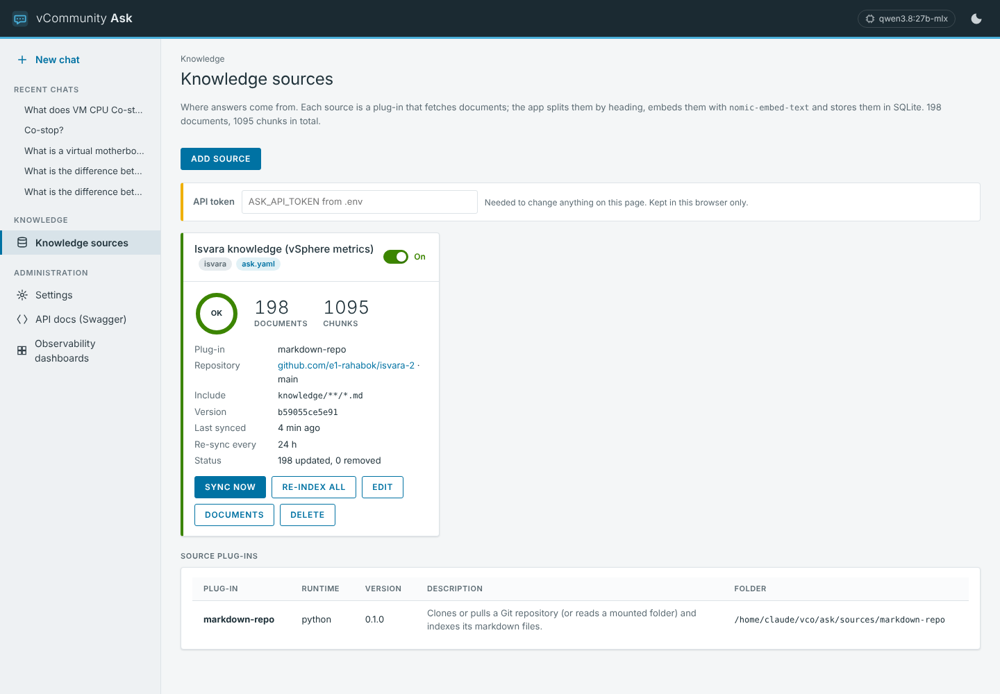

One card per source with a status ring (green OK, blue syncing, red error, amber new), document and chunk counts, repository and branch (or site and date range), the commit it indexed (or page count and newest post), last sync, re-sync interval and progress while it runs.

- **Sync now** pulls and re-embeds what changed. **Re-index all** re-embeds every file. **Documents** lists every indexed file (with a filter), and each opens in the document view. **Edit** changes options. **Delete** removes the source and its index (not the repository itself). The switch turns a source off without deleting it.
- **Add source** opens a form built from the chosen plug-in's options. For **Markdown repository**: repository URL and branch (or a local folder), include and exclude globs, metadata format, link base and a token env var for private repositories. For **Web site (blog crawler)**: site URL, where to find pages, URL include/exclude globs, **Published from / Published to** dates or **last N days**, what to do with undated pages, max pages and delay. Every source also has a name, title, re-sync interval (**Re-sync every (hours)**, `0` = never) and up to six example questions.
- Sources are re-synced automatically when their interval has passed (checked every 10 minutes); the plug-in reports "no changes" cheaply when the commit hasn't moved. Set **Re-sync every (hours)** to `0` to never re-sync on a schedule: the card shows "never (Sync now only)", the source keeps its index, and it changes only when you press **Sync now** or **Re-index all**. A new source still gets its first sync. The smallest other value is 0.25 (15 minutes).
- Sources from `ask.yaml` are seeded into the database on first start (badge **ask.yaml**); after that the page owns them.

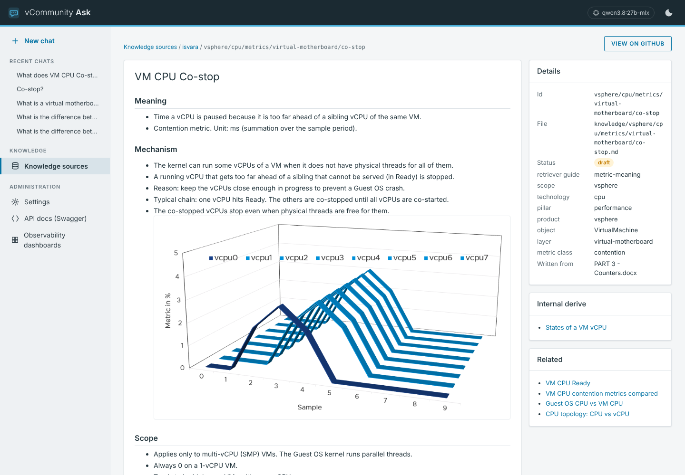

### Settings page

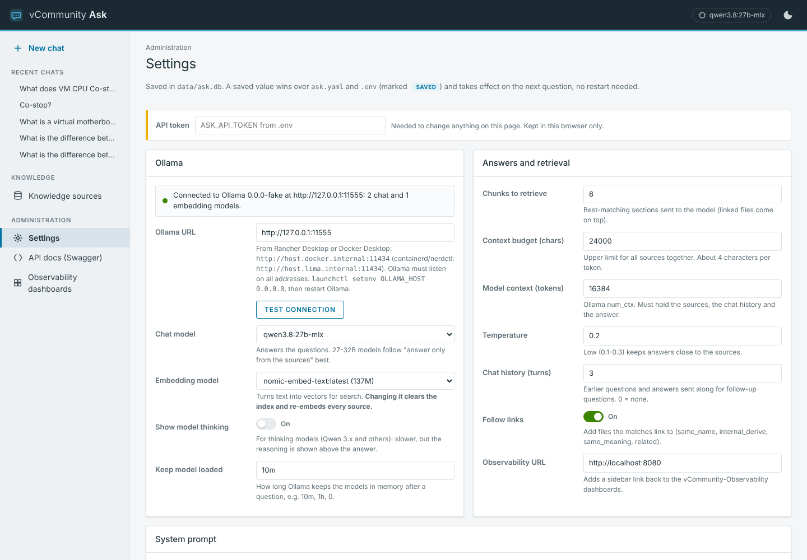

| Setting | Default | Notes |
| --- | --- | --- |
| Ollama URL | `http://host.docker.internal:11434` | **Test connection** shows the Ollama version and fills the model lists |
| Chat model | `qwen3.8:27b-mlx` | Only models whose capabilities include `completion` are listed |
| Embedding model | `nomic-embed-text` | Only `embedding` models are listed. **Changing it clears the index and re-embeds every source** (vectors from two models can't be compared) |
| Show model thinking | off | Sends `think: true` to Ollama |
| Keep model loaded | `10m` | Ollama `keep_alive` |
| Chunks to retrieve | 8 | Direct matches; linked files are added on top |
| Context budget (chars) | 24000 | Cap for all sources together (about 4 characters per token) |
| Model context (tokens) | 16384 | Ollama `num_ctx`; must hold the sources, history and answer |
| Temperature | 0.2 | Low keeps answers close to the sources |
| Chat history (turns) | 3 | 0 = every question stands alone |
| Follow links | on | Link expansion (step 4 above) |
| Data questions | on | Counting and totals questions about spreadsheet sources are answered with a read-only SQL query (see [Spreadsheets and data questions](#spreadsheets-and-data-questions)) |
| Observability URL | `http://localhost:8080` | Sidebar link back to the dashboards |
| System prompt | built in | Editable; **Reset to the default** restores it |

Saved values live in `data/ask.db` and win over `ask.yaml` and environment variables; they apply on the next question. Saving needs the API token when `ASK_API_TOKEN` is set (enter it in the bar at the top; it is kept in that browser only). The first container's sidebar shows an **Ask (AI chat)** link (set `VCO_ASK_URL`, default `http://localhost:8081`, empty hides it).

### The Ask database (`ask.db`)

Ask keeps everything in one SQLite file, `data/ask.db` (the `./ask-data` volume). It is both the document store and the search engine, so no separate vector database is needed and nothing has to be downloaded at run time.

| Table | Contents |
| --- | --- |
| `settings` | Values saved on the Settings page (Ollama URL, models, top_k and the rest). They win over `ask.yaml` and environment variables |
| `sources` | Each knowledge source: plug-in, title, options, re-sync interval, example questions, on/off switch, and whether it came from `ask.yaml` or the UI |
| `source_state` | Per source: status, progress, last start/end/success, last error and the version indexed (commit or page count) |
| `documents` | One row per markdown file or web page: title, path, URL, `status` (draft/reviewed), metadata, links to other documents, images, full text and a content hash |
| `chunks` | Each document split into sections. These are what get searched |
| `chunks_fts` | SQLite FTS5 full-text index over the chunks (`porter unicode61` tokenizer, so "datastores" also matches "datastore"); ranked with BM25 |
| `chunks_vec` | sqlite-vec `vec0` table with one embedding per chunk, compared by cosine distance. Its size is set by the embedding model |
| `chats`, `messages` | Chat history. An answer is saved with its source cards, the model used, timing stats and (with thinking on) the model's reasoning |

**Indexing.** The source plug-in clones the repository or crawls the site and returns documents as JSON. Each document's content hash is compared with the stored one, so unchanged files are skipped. A changed file is split at `## ` headings (long sections are split again on blank lines), each chunk is embedded through Ollama `/api/embed` with the file title and id in front of it, and both indexes are updated. Deleting a source removes its documents, chunks and index entries.

- The database runs in WAL mode, so a sync can write while you keep chatting.
- To back up Ask, copy `ask.db`. To start over, stop the container and delete it; the sources in `ask.yaml` are seeded again and re-indexed on the next start (chat history, saved settings and sources added in the UI are lost).
- Vectors from two embedding models can't be compared. Changing the embedding model on the Settings page clears the index and re-embeds every source.

### From prompt to answer

What happens between pressing **Send** and the finished answer:

```
 YOU (browser, ask.js)
   │  type a question, press Send
   ▼
 [1] POST /ui/chat  { question, chat_id, scope }        (REST clients: POST /api/ask)
   ▼
 [2] FastAPI (main.py) creates the chat if it is new, loads its history,
   │  and saves your question in ask.db (messages)
   ▼
 [3] EMBED THE QUESTION ──────────────▶ Ollama /api/embed (nomic-embed-text)
   │                    ◀──────────────  one vector
   ▼
 [4] SEARCH ask.db (two searches)
   │   a) sqlite-vec: chunks closest in MEANING to the vector
   │   b) FTS5/BM25:  chunks containing the KEYWORDS (stop words removed)
   ▼
 [5] MERGE with reciprocal rank fusion
   │   at most 2 chunks per document, keep the best top_k (default 8)
   ▼
 [6] FOLLOW LINKS (expand_links)
   │   add the first section of linked documents:
   │   same_name, internal_derive, same_meaning, related
   ▼
 [7] FIT TO context_chars (24000), number the sources [1] [2] ...
   │   browser gets a "meta" event: the source cards appear
   ▼
 [8] BUILD THE MESSAGES
   │   system prompt + last history_turns Q&A pairs + (numbered sources + question)
   ▼
 [9] GENERATE ────────────────────────▶ Ollama /api/chat (chat model, stream: true)
   │              ◀─────────────────────  "thinking" and "token" events
   ▼
 [10] Browser renders the markdown live (marked + DOMPurify, vendored);
   │   [n] citations open the matching source card
   ▼
 [11] Answer + source cards + model + stats saved to ask.db
      (also when you press Stop half way)
```

1. **Send.** The browser posts the question, the current chat id and the source scope (all sources or one) as a server-sent event (SSE) stream request.
2. **Save.** A new chat is created if needed. The earlier messages are loaded for history, then your question is stored.
3. **Embed.** The question goes to the Ollama embedding model (with the `search_query: ` prefix that nomic-embed-text expects) and comes back as a vector, a list of numbers that represents its meaning.
4. **Search.** The vector search finds sections that mean the same thing even in other words. The keyword search finds exact terms such as metric names or error codes. Each search returns up to `max(30, top_k × 4)` candidates.
5. **Merge.** Reciprocal rank fusion combines the two rankings. A chunk found by both searches rises to the top. At most two chunks come from one file, and the best `top_k` are kept.
6. **Follow links.** Documents the hits link to in their metadata are added, `same_name` first. This is what keeps, for example, the VM and ESXi meanings of the same metric label apart. These show as **Linked files**.
7. **Fit and number.** Direct hits go first, then linked files, until `context_chars` is used up. The sources are numbered and sent to the browser, which shows the **Sources** strip.
8. **Build the messages.** See the next section for exactly what the model receives.
9. **Generate.** Ollama streams the answer back in small pieces, and Ask passes each one to the browser as it arrives.
10. **Display.** The answer appears as formatted markdown with numbered citation chips.
11. **Save.** The answer, its sources, the model and the stats (tokens, tokens per second, seconds) are stored, so the chat is there when you come back.

Nothing leaves your network. The only calls out of the container go to your own Ollama: one embedding and one chat request per question.

### How Ollama and the chat model are used

Ollama runs two models with separate jobs:

| Model (default) | Job | When it runs |
| --- | --- | --- |
| `nomic-embed-text` (embedding model) | Turns text into vectors so search works by meaning | For every chunk during indexing, and once per question |
| `qwen3.8:27b-mlx` (chat model) | Reads the numbered sources and writes the answer | Once per question |

The chat model does not search and never sees the whole knowledge base or the internet, only the handful of sources picked for that question. That is why answers carry citations, and why "the sources don't cover this" is a valid answer.

Ask calls Ollama's native REST API with `requests` (no SDK), by default at `http://host.docker.internal:11434`, which is the Ollama on your Mac reached from inside Docker. The chat call is `POST /api/chat` with `stream: true`, and the messages are, in order:

1. The **system prompt**: answer only from the numbered sources, cite every fact as `[n]`, say so plainly when the sources don't cover the question, keep VM, host and cluster metrics apart, quote thresholds only when a source states them, flag `status: draft` sources, and follow diagnosis steps in order. It can be edited on the Settings page.
2. Up to `history_turns` earlier questions and answers from this chat, as plain text (their old sources are not resent).
3. One user message with the numbered sources, then the question.

Ollama options sent with every question: `temperature`, `num_ctx`, `think` and `keep_alive`. `keep_alive` (default `10m`) keeps the model loaded after a question so follow-ups don't wait for a 27B model to load again.

**Swapping models.** The Settings page lists the models installed in Ollama, split into chat and embedding models. Any chat model (Llama, Gemma, a smaller Qwen) can be picked with no code change, or set `ASK_CHAT_MODEL` in `.env`. A new chat model applies on the next question. Only a new embedding model needs a re-index.

### Tuning the answers

#### Temperature

Temperature controls how adventurous the model is when it picks each next word. These ranges are general guidance for LLMs, not measured on this app:

| Temperature | Effect |
| --- | --- |
| 0.0–0.2 (default 0.2) | Picks the most likely words. The same question gives nearly the same answer, close to the wording of the sources. Best for metric definitions, thresholds and procedures |
| 0.5–0.7 | More natural, varied wording and more examples. Mostly still grounded, but paraphrases more loosely and repeat questions give different answers |
| 0.8 and above | Much more creative, and riskier: it may blend in general training knowledge, mix up similar terms (such as the VM and ESXi versions of a metric), change exact names or numbers, or cite a source for a claim the source doesn't make |

Temperature has no effect on which sources are found, because retrieval happens before the model runs. It can't fix a "not found" answer. If answers miss information, raise `top_k` or `context_chars` instead. Keep 0.1–0.3 for technical questions; try 0.5–0.6 if answers feel stiff, for example for a blog-style summary.

#### Chat history (`history_turns`)

One turn is one question plus its answer. The default of 3 sends your last 3 questions and the last 3 answers (6 messages) with the new question.

- History is what makes follow-ups like "explain that more simply" or "give me a PowerShell example of that" work.
- **0** makes every question stand alone: the most predictable, and the least use of `num_ctx`.
- **Higher values** help long conversations, but old answers take room in `num_ctx` (16384 tokens) away from the sources, make each answer slower, and can let earlier topics bleed into new answers.
- **History goes only to the model, not to the search.** Retrieval uses only the new question. After "What is CPU Ready?", the follow-up "what about on ESXi?" searches only for those words and may find weak sources. Make follow-ups self-contained ("What is CPU Ready on ESXi?") for the best results.
- **New chat** starts with no history. Each chat keeps its own.

#### Thinking (`think`)

Qwen 3.x and some other models can reason step by step before they answer. The **Show model thinking** setting sends `think` to Ollama.

- **Off (default).** The model goes straight to the answer: the first words appear much sooner and the whole answer takes less time. That is enough for most look-it-up questions, since the sources already hold the answer.
- **On.** The model reasons first, then answers. Ask streams the reasoning separately (the `thinking` event), shows it above the answer and saves it with the message. It helps multi-step questions such as comparing two metrics or a troubleshooting walk-through. It costs a slower start and many more tokens, and the reasoning uses up `num_ctx`, which can crowd out sources or cut the answer short. Consider raising `num_ctx` if you use it often.
- Thinking does not find new sources. It reasons over the same retrieved sources.
- Ask always sends the flag, even when it is off, because Ollama lets thinking models think by default when `think` is missing. Models without thinking ignore it.

### Spreadsheets and data questions

The `spreadsheet` source plug-in reads `.xlsx` and `.csv` files, for example an RVTools export or the dashboards' **DBH Insights** XLSX export. It can read them in two ways (the **Files from** option):

- **folder (default).** A folder inside the container. Compose mounts the dashboards' `./exports` folder read-only at `/exports`, so a scheduled DBH Insights export is picked up automatically: Ask re-checks the folder on the source's **Re-sync every** interval (as low as 0.25 h, 15 minutes) and re-indexes only when a matching file is new or changed (name, size and modified time). With `0` (never) a new export is not picked up until you press **Sync now**.
- **upload.** Drag a file onto the source's card on the **Knowledge sources** page (or click **choose a file**). Ask saves it under `data/uploads/<source>/` and re-indexes. By default a new upload replaces the earlier files (**When a file is uploaded again** = `replace`); `keep` keeps them all. **Remove** deletes an uploaded file. Uploading needs the API token when `ASK_API_TOKEN` is set. Only `.xlsx` and `.csv` are accepted, up to `ASK_UPLOAD_MAX_MB` (default 50).

**Add a spreadsheet source.** On **Knowledge sources** press **Add source**, pick **Spreadsheet (xlsx / csv)**, keep the defaults to read the newest `dbh-insights-*.xlsx` from `/exports` (or set **Files from** to `upload`), and save. Spreadsheet sources are not created automatically. If you have both a spreadsheet source and other sources, pick the spreadsheet source in the chat's sources menu when you ask data questions, so Ask knows which tables you mean.

Each sheet is used in two ways:

1. **Search (normal answers).** Rows of the main sheets become documents (one per row, such as one per VM in `vInfo`), plus a summary per cluster (or per host) and an overview of each sheet with its columns and row count. They are chunked, embedded and searched like any other source, which suits "tell me about vm-web-01" or "what is on host esx03?".
2. **Data questions (counts, totals, top N).** Every sheet is also loaded into a small SQLite database, one table per sheet, at `data/sources/<source>/tables.db`. The plug-in writes it to a temporary file and swaps it in, so a question never sees a half-written table. A column becomes a number column when all of its values are numbers, otherwise text. A `source_file` column records which file each row came from.

How a data question is answered:

1. **Is it a data question?** Counting and totals words (*how many*, *total*, *average*, *top 10*, *per cluster*, *more than*), listing phrases (*show all hosts*, *list the VMs*, *which datastores*, *every snapshot*), the words *sheet*, *table* or *column*, or the name of one of the source's sheets (one typo allowed, so *vHosst* finds `vHost`) send the question down this path (when **Data questions** is on and a spreadsheet source is selected or included).
2. **Pick the tables.** Ask matches the question against table and column names (with RVTools synonyms, so "VM" finds `vinfo`) and describes up to 5 tables to the model (a sheet named in the question always comes first): column names and types, what common RVTools columns mean, and 3 sample rows.
3. **The model writes one SQL query.** A separate, short call to the chat model with temperature 0 and thinking off. If the query fails, the error goes back to the model once for a corrected query.
4. **Checks before it runs.** Only a single `SELECT` (or `WITH ... SELECT`); no `ATTACH`, `PRAGMA`, `INSERT`, `UPDATE`, `DELETE`, `DROP`, `load_extension` and similar; the database is opened read-only; SQLite's internal tables are blocked; a query is stopped after 5 seconds; at most 500 rows come back.
5. **The answer.** The query and its result (up to 60 rows) go to the model as source [1], and the model writes the answer from it. The chat shows a **Query and result** card with the SQL (**Copy SQL**) and the complete result table (up to 500 rows, scrollable, **Download CSV**), so you can check the numbers. For a long list the model summarizes it instead of copying it, because the full table is right there.
6. **Fallback.** If the model can't write a valid query, or the checks refuse it, Ask answers with the normal search instead; the answer's stats show `data_error`.

**Charts.** Ask for a chart and the result is also drawn with [Apache ECharts](https://echarts.apache.org/) (Apache-2.0, vendored, works offline) at the top of the **Query and result** card:

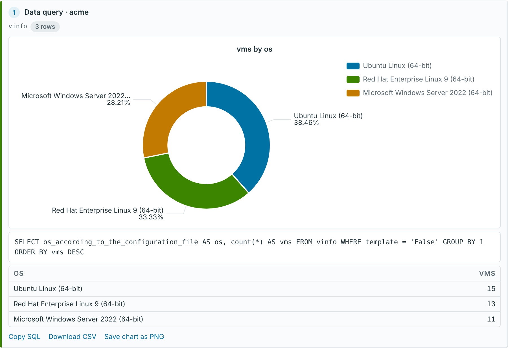

- **Which chart.** *pie* gives a pie chart, *donut* or *doughnut* a donut, *line*, *trend* or *over time* a line chart, and any other *chart*, *graph* or *plot* a bar chart. A chart word also makes the question a data question. Examples: "Pie chart of VMs per cluster", "Donut chart of VMs by OS", "Bar chart of vCPUs and memory per host".
- **How it is built.** The SQL prompt tells the model to return one label column and the value column(s), one row per category. Ask then builds the chart from the result itself: the first text column gives the labels, the numeric columns the values (pie and donut use one value column, bar and line up to four). The model never writes chart code, and nothing it returns is run in the browser.
- **Limits.** Pie and donut show the 11 largest slices plus an **Other (n)** slice; bar and line draw the first 50 categories. A note under the chart says when something was grouped or cut.
- **In the card.** The chart follows the light/dark theme and the window width, has tooltips and a legend (along the bottom, scrollable), and **Save chart as PNG** downloads it (2x resolution). Pie and donut slices under 3% get no label (the legend and tooltip still name them), long names are shortened with "..." and labels that would still collide are hidden, so text never overlaps.
- **Enlarge.** The button at the top right of the chart (or **Enlarge chart** under the card) opens it in a panel that fills the window: the whole legend, full-length labels lined up at the edges, labels down to 1% slices, and its own **Save as PNG**. **Esc**, the close button or a click outside closes it.
- **Saved.** The chart is saved with the chat and redrawn when you reopen it. The library (about 1 MB) is loaded only when the first chart is drawn.
- If the result has no number column (for example a list of names), no chart is drawn and you still get the table.

| Option | Default | Meaning |
| --- | --- | --- |
| `location` (Files from) | `folder` | `folder` or `upload` |
| `path` (Folder) | `/exports` | Folder inside the container (folder mode only) |
| `pattern` (File names) | `dbh-insights-*.xlsx` | Globs, one per line, e.g. `*.xlsx` or `RVTools*.xlsx` (folder mode only) |
| `pick` (Which files) | `newest` | `newest` = only the newest file of each name (a trailing timestamp is ignored, so "Keep newest N" exports aren't counted twice); `all` = every matching file |
| `sheets` | (all) | Sheets to include, one per line |
| `embed_sheets` (Searchable sheets) | automatic | Sheets that get one document per row. Automatic = the main RVTools / DBH Insights sheets (`vInfo`, `vHost`, `vDatastore`, `vCluster`, `vSnapshot`, `vRP`, `vSource`, `vLicense`, `vHealth`, `dvSwitch`, cluster capacity), or every sheet for other workbooks. Every sheet is always loaded for data questions |
| `max_embed_rows` | `5000` | Larger sheets are used for data questions only (embedding every row takes time) |
| `uploads` | `replace` | `replace` or `keep` earlier uploads (upload mode only) |

The header row is the first row with at least two filled cells. Column names are made SQL-friendly (`# CPUs` becomes `num_cpus`, `Provisioned MiB` becomes `provisioned_mib`); the model sees the original header next to each name. [openpyxl](https://openpyxl.readthedocs.io/) (MIT) reads the `.xlsx` files (values only, formulas and macros are never run).

Tips for good data answers:

- Ask for lists the same way: "Show all hosts from the vHost sheet" returns every host row in the card. Search alone can't list a whole sheet, because it only retrieves the best few matches (**Chunks to retrieve**).
- Ask about columns that exist: "How many VMs are powered on per cluster?", "Top 10 VMs by provisioned MiB", "Which datastores have less than 20% free?". The **Data tables** row on the source card lists each table and its row count.
- Use a chat model that is good at SQL; Qwen 3.x models are. Smaller models write wrong queries more often, and you see it in the query card.
- Turn **Data questions** off on the Settings page to send every question through the normal search.

### HTML reports and dashboards

Ask a data question with the word *report* or *dashboard* and, besides the normal answer, Ask writes a modern, self-contained HTML page you can open, print, download and email.

| You ask | You get |
| --- | --- |
| "HTML report of VMs by OS using the vInfo sheet" | **Report.** One query. KPI cards (rows, number of categories, total, largest share), the chart (a donut for 8 or fewer categories, otherwise a bar chart, or the chart type you name), a ranked bar version of a pie or donut, and the full result as a sortable table |
| "Dashboard of the vInfo sheet", "Create a dashboard of VM capacity per cluster" | **Dashboard.** The model plans up to 8 panels (KPI tiles, donut, pie, bar and line charts, top-N tables), each with its own query, and Ask lays them out like a VCF Operations dashboard |

How it works:

1. **Detect.** *report*, *reports*, *html page* or *web report* makes it a report; *dashboard* makes it a dashboard. Both are data questions, so they need a spreadsheet source (pick it in the sources menu when you have several).
2. **Report: one query.** Same path as any data question (model-written SQL, the same checks, read-only run). When you didn't name a chart type Ask picks one from the result.
3. **Dashboard: a plan.** A separate call with temperature 0 asks the model for a JSON list of panels, each `{title, chart, sql}`, where `chart` is `kpi`, `donut`, `pie`, `bar`, `line` or `table`. Every panel's SQL goes through the same checks and read-only connection as a single data question. A panel whose query fails or is refused is left out and named under the dashboard (**Left out**), the others still show. A KPI must return one number, otherwise it is shown as a table. Each panel keeps at most 200 rows.
4. **Summary.** The model writes the answer in the chat as usual; for a dashboard it is asked for a short executive summary (3 to 6 bullets). That text becomes the report's **Summary** card.
5. **Build.** Ask fills the fixed template `ask/app/templates/report.html` with the results. The model only wrote the SQL and the summary; the charts are built from the results (as in the chat) and the summary is markdown that DOMPurify cleans when the page opens.

What is in the page:

- Header with the title (taken from your question: "HTML report of VMs by OS using the vInfo sheet" becomes **VMs by OS using the vInfo sheet**), source, files and sheets used, the time it was made and the model.
- KPI cards with colored edges, the summary, then the panels in a responsive grid; tables are full width, sortable (click a column header) and have a **Filter rows** box when they have more than 8 rows.
- **Queries** (folded) lists every SQL query, so the numbers can be checked; a footer says the numbers are a snapshot of the spreadsheet at the time it was indexed.
- Light/dark switch (the charts redraw) and a **Print** button. The print layout drops the buttons and keeps panels whole on a page, so **Print → Save as PDF** gives a clean PDF.

**One file, works offline.** Everything is inlined: the stylesheet, Apache ECharts, marked, DOMPurify, the chart and report scripts, and the data as JSON. A report is about 1.2 MB, needs no network and nothing from Ask, so it opens from a file share, an email attachment or a dark site laptop. When Ask shows it, it is sent with a strict Content-Security-Policy (no network requests at all, no forms, inline scripts only) and `X-Content-Type-Options: nosniff`.

**Where to find them.**

- Under the answer: **Open HTML report** (or **Open dashboard**), **Download .html** and **All reports**. A dashboard also shows a small version in the chat (KPI tiles, the charts with **Enlarge**, top 10 rows of each table).
- **Reports** in the sidebar: every report with its type, source, age and size, plus **Open**, **Download**, **Chat** (back to the chat that made it) and **Delete** (needs the API token when `ASK_API_TOKEN` is set).
- On disk: `data/reports/<id>.html` with a `<id>.json` file holding the title, type, source, question and chat (the `./ask-data` volume). Delete files there to clean up; the page lists whatever is in the folder.
- API: `GET /api/reports` lists them; `GET /reports/<id>.html` opens one and `?download=1` downloads it as `ask-report-<title>.html`.

Tips: name the sheet ("using the vInfo sheet") and what to group by ("by OS", "per cluster"). For dashboards a model that is good at SQL and JSON matters even more, since it writes up to 8 queries; Qwen 3.x models are. Open **Queries** to check anything that looks wrong.

### Ask configuration

`ask/config/ask.example.yaml` is built into the image as `/app/config/ask.yaml`. To use your own, copy it to `ask/config/ask.yaml` and uncomment the volume line in `docker-compose.yml`.

| Key | Meaning |
| --- | --- |
| `data_dir` | Where `ask.db` and cloned repositories live (`/app/data`, the `./ask-data` volume) |
| `sources_dirs` | Folders scanned for source plug-ins; later wins, so a plug-in in `/sources` (`./ask-sources`) overrides the built-in one |
| `settings.*` | Defaults for every Settings page value (table above) |
| `api.tokens` | `token_env` names the variable holding the token (`ASK_API_TOKEN`) |
| `sources` | Sources seeded on first start: `name`, `plugin`, `title`, `interval_hours` (default 24, `0` = never re-sync), `options`, `examples` |

| Environment variable | Meaning |
| --- | --- |
| `ASK_API_TOKEN` | Token for changing Settings and Sources and for `/api/*` (header `X-API-Key` or `Authorization: Bearer`) |
| `ASK_OLLAMA_URL`, `ASK_CHAT_MODEL`, `ASK_EMBED_MODEL` | Override the yaml defaults (the Settings page still wins) |
| `ASK_OBSERVABILITY_URL` | Sidebar link to the dashboards |
| `ASK_CONFIG`, `ASK_DATA_DIR`, `ASK_SHARED_DIR` | Config file, data folder, folder holding the shared `app.css` (set in the image) |
| `ASK_GITHUB_TOKEN` (any name) | Read-only token for a private repository; put the variable's **name** in the source's "Token env var" |
| `ASK_UPLOAD_MAX_MB` | Largest spreadsheet upload in MB (default 50) |
| `VCO_ASK_URL` | First container: sidebar link to Ask |

### Source plug-ins

A source plug-in is a folder with `source.yaml` and a script in **Python or PowerShell**, the same idea as collector modules. The core runs the script with:

| Variable | Content |
| --- | --- |
| `ASK_SOURCE_OPTIONS` | The source's options as JSON (fields declared under `options:` in `source.yaml`, which also build the Add source form) |
| `ASK_SOURCE_WORKDIR` | A private folder under `data/sources/<name>` (for clones or caches) |
| `ASK_SOURCE_STATE` | JSON the script returned last time (for example the commit), `{}` on a full re-index |
| `ASK_SOURCE_FULL` | `1` on **Re-index all** |
| `ASK_SOURCE_UPLOAD_DIR` | The folder the Knowledge sources page saves this source's uploads into (`data/uploads/<name>`); used by `spreadsheet` |

The script prints **one JSON object** to stdout (logs go to stderr; a non-zero exit marks the sync failed):

```json
{"version": "b59055ce…", "root": "/app/data/sources/isvara/repo", "unchanged": false,
 "state": {"version": "b59055ce…"},
 "documents": [{"id": "vsphere/cpu/metrics/virtual-motherboard/co-stop", "title": "VM CPU Co-stop",
                "path": "knowledge/vsphere/cpu/metrics/virtual-motherboard/co-stop.md", "url": "https://github.com/…",
                "text": "# VM CPU Co-stop\n## Meaning\n…", "status": "draft", "meta": {"object": ["VirtualMachine"]},
                "links": {"related": ["vsphere/cpu/metrics/virtual-motherboard/ready"]},
                "images": [{"path": "knowledge/vsphere/cpu/images/….png", "alt": "…"}], "hash": "86194afe…"}]}
```

`unchanged: true` with no documents means "nothing changed". `root` is the folder images are served from (`/files/<source>/<path>`, images only, never outside that folder). The core does all chunking, embedding and storage, so a plug-in never touches vectors.

**Built-in plug-ins:**

**`markdown-repo`.** Clones (`git clone --depth 1`) or pulls a repository, or reads a folder mounted at `/knowledge` (`./ask-knowledge`). Options: `repo_url`, `branch`, `path`, `include`/`exclude` globs (`**` crosses folders), `metadata` (`auto`, `isvara`, `none`), `web_url` (defaults to the GitHub blob URL) and `token_env`. With isvara metadata, the trailing `## Metadata` YAML block becomes `status`, `links`, `images` and filter fields and is **not** embedded, as the isvara README asks.

**`web-site` (blog crawler).** Indexes the posts of a web site you don't have the markdown for. It finds pages from the site's `sitemap.xml` (and `Sitemap:` lines in `robots.txt`) plus its RSS/Atom feed; if neither exists it follows links from the start URL. It only fetches the start URL's host, always respects `robots.txt` (including `Crawl-delay`), waits `delay_seconds` between requests and stops after `max_pages` downloads per sync. [trafilatura](https://github.com/adbar/trafilatura) (Apache-2.0) pulls the article out of each page (menus, sidebars and footers dropped) as markdown, so it goes through the same chunking, embedding and search as repository files.

| Option | Default | Meaning |
| --- | --- | --- |
| `site_url` | | Start page, e.g. `https://www.vcrocs.info/` |
| `discovery` | `auto` | `auto` (sitemap + feed, else crawl), `sitemap`, `feed` or `crawl`. Feeds often list only the newest posts |
| `feed_url` | | Optional; otherwise `/index.xml`, `/feed`, `/rss.xml`, `/atom.xml`, `/feed.xml` are tried |
| `url_include` / `url_exclude` | – / `/tags/**`, `/categories/**`, `/page/**`, `/author/**`, `/search/**` | Globs on the URL path. Excluded pages are still followed for links when crawling, just not indexed |
| `date_from`, `date_to` | | Keep posts published inside this range (either end optional) |
| `last_days` | | Rolling window instead of `date_from`, e.g. `365` |
| `undated` | `skip` | With a date range set: `skip` or `keep` pages with no publish date (About pages, docs) |
| `max_pages` | `500` | Network downloads per sync (pages already cached still count as indexed) |
| `delay_seconds` | `1` | Pause between requests (a larger robots.txt `Crawl-delay` wins, up to 30 s) |
| `user_agent` | `vCommunity-Ask/0.1 (local knowledge indexer)` | Sent with every request |

The publish date comes from the feed first, then the page itself (`article:published_time`, JSON-LD `datePublished`, `<time>`, dates in the URL). It is stored as `published`, added to the text as a `Published:` line (so "posts from 2024" matches), shown as a badge on source cards and given to the model. Source cards link to the live post (**View on <host>**). Re-syncs are cheap: if the sitemap and feed list the same URLs and dates as last time the plug-in reports "no changes" without downloading anything; otherwise pages are cached in `data/sources/<name>/pages/` and re-requested with `If-None-Match` / `If-Modified-Since`, so only changed posts are downloaded and re-embedded. If the site can't be reached at all, the sync fails and the existing index is kept.

For a blog whose markdown is in a Git repository (Hugo, Jekyll and similar), `markdown-repo` gives cleaner text with no crawling; `web-site` is for sites you don't have the source for.

**`spreadsheet`.** Reads `.xlsx` and `.csv` files (RVTools, DBH Insights) from a folder such as `/exports` or from uploads. One document per row plus cluster and sheet summaries for search, and every sheet loaded into `data/sources/<name>/tables.db` for data questions; it also returns the table list (columns, types, sample rows) in its `state`. See [Spreadsheets and data questions](#spreadsheets-and-data-questions) for the options.

### Ask REST API

All under token auth when `ASK_API_TOKEN` is set; Swagger UI at http://localhost:8081/docs.

| Method and path | Purpose |
| --- | --- |
| `GET /api/health` | Status and counts (open) |
| `POST /api/ask` | `{"question": "...", "sources": "all" \| "isvara" \| [...], "chat_id": "..."}` → answer, source cards, stats, chat id (pass it back for follow-ups) |
| `GET /api/search?q=...` | Retrieval only: which chunks a question would get, and the FTS query used |
| `GET /api/chats`, `GET /api/chats/{id}` | Saved chats and their messages |
| `GET /api/sources`, `POST /api/sources/{name}/sync?full=false`, `GET /api/sources/{name}/documents` | Sources, sync, indexed files |
| `GET /api/reports` | HTML reports and dashboards (id, title, type, source, question, created, size); open one at `/reports/{id}.html`, add `?download=1` to download it |

```powershell
$h = @{ 'X-API-Key' = $env:ASK_API_TOKEN }
Invoke-RestMethod -Method Post -Uri http://localhost:8081/api/ask -Headers $h -ContentType 'application/json' `
  -Body (@{ question = 'What does VM CPU Co-stop mean?'; sources = 'isvara' } | ConvertTo-Json)
```

### Ask image

- `ask/Dockerfile`, built from the repository root (it copies `core/static/app.css`, the About page files, the vendored front-end libraries and the README with its screenshots, so a theme or library fix lands in both containers). Python 3.13 slim + git, native arm64 on Apple Silicon, no PowerShell.
- Runs as non-root user `ask` (uid 10002) on port 8081, health check on `/api/health`.
- Volumes: `./ask-data` → `/app/data` (index, chats, clones), `./ask-knowledge` → `/knowledge` (read-only, local folders), `./ask-sources` → `/sources` (extra or patched plug-ins), `./exports` → `/exports` (read-only, the dashboards' exports for `spreadsheet` sources).
- Front-end libraries are vendored once, in `core/static/vendor/`, with their licences: Swagger UI, marked 18.1.3 (MIT), DOMPurify 3.4.17 (Apache-2.0/MPL-2.0) and Apache ECharts 6.1.0 (Apache-2.0, `echarts.min.js` with its LICENSE and NOTICE). The dashboards serve them at `/static/vendor/`, Ask at `/shared/vendor/`. Every answer, document and About page is sanitised by DOMPurify before display.
- On a Linux Docker host, uncomment `extra_hosts: host.docker.internal:host-gateway` in `docker-compose.yml`. Leave it commented on Rancher Desktop and Docker Desktop: it replaces their own mapping to the Mac, and Ollama then refuses the connection.

## Configuration reference

### `config/config.yaml`

| Key | Meaning |
| --- | --- |
| `data_dir` | Where SQLite files go (default `data`; `/app/data` in Docker). `VCO_DATA_DIR` overrides it |
| `modules_dirs` | Folders scanned for modules. Later folders win, so a module in `/modules` overrides the built-in copy |
| `mock` | `true` = built-in sample data, no vCenter needed. `VCO_MOCK=1` overrides it |
| `connections.<name>` | `host`, `user`, `password_env` (name of the env var holding the password), `verify_ssl`, plus anything else a module needs (for example `auth_source` for VCF Operations). Included: `vcenter`, `vcfops`. For several vCenters, set `connections.vcenter.instances` to a list of `{id, label, host, user, password_env, verify_ssl}` (or add them on Settings) |
| `api.tokens` | List of `{name, token_env}`. Callers send a token as `Authorization: Bearer <token>` or `X-API-Key: <token>`. With no tokens, the API is open |
| `modules.<name>.enabled` | Default on/off (the switch on the Modules page wins) |
| `modules.<name>.settings` | Module settings, passed to collectors as `VCO_SETTINGS`. For example `vcenter_name` / `vcenters` for the DBH modules, `url` for `github-status` |

Precedence for module on/off: `enabled_by_default` in `module.yaml` → `modules.<name>.enabled` in `config.yaml` → the switch. Precedence for connection values: `config.yaml` and `.env` → values saved on the Settings page.

### `.env`

| Variable | Meaning |
| --- | --- |
| `VCO_VCENTER_PASSWORD` | vCenter password (named by `password_env` in `config.yaml`) |
| `VCO_VCFOPS_PASSWORD` | VCF Operations password |
| `VCO_API_TOKEN_MPBUILDER` | API token for MP Builder and scripts. Use a long random string |
| `VCO_MOCK` | `1` = sample data |
| `PWSH_VERSION` | PowerShell build in the `core-pwsh` image (default 7.6.9 LTS) |
| `DOTNET_HWINTRINSIC` | `0` turns off .NET CPU fast paths for VMs that hide CPU features (see [Troubleshooting](#troubleshooting)). Default 1 |

### Other environment variables

| Variable | Meaning |
| --- | --- |
| `VCO_CONFIG` | Path to `config.yaml` (default `config/config.yaml`) |
| `VCO_EXPORT_DIR` | Root folder for scheduled exports (default `exports`; `/app/exports` in Docker) |
| `TZ` | Default time zone offered for scheduled exports (for example `America/New_York`) |

## Docker image and runtime

Two image targets from one `Dockerfile`:

| Target | Contents | Use |
| --- | --- | --- |
| `core` | Python 3.13 slim, the app and its locked dependencies | Python modules only (smallest) |
| `core-pwsh` | `core` plus PowerShell 7 and VMware PowerCLI | Default in `docker-compose.yml`; needed for `host-health` and other `.ps1` modules |

- Runs as a non-root user (`vco`, uid 10001), listens on port 8080, with a health check on `/api/core/health`.
- The right PowerShell build (arm64 or x64) is picked automatically. Pin PowerCLI with the `POWERCLI_VERSION` build argument.
- Compose volumes: `./data` → `/app/data` (SQLite, survives upgrades), `./exports` → `/app/exports` (scheduled exports), `./extra-modules` → `/modules` (new or patched modules), `./config/config.yaml` read-only.
- `init: true` adds a tiny init process that reaps finished collector processes and passes stop signals to the app.
- `restart: unless-stopped`.

Common commands:

```bash
docker compose up -d --build                 # build and start (after any code or module change)
docker compose logs -f                       # follow the logs
docker compose build --no-cache              # full rebuild, for example after changing PWSH_VERSION
docker compose down                          # stop (data, exports and settings stay on disk)
```

## Using it from MP Builder

1. In MP Builder, create a source with base URL `http://<host>:8080`.
2. Authentication: custom header `X-API-Key: <token>` (or `Authorization: Bearer <token>`).
3. Add requests for endpoints such as `/api/host-health/hosts` or `/api/dbh-impact/hosts`. Every endpoint returns:

```json
{ "module": "host-health", "endpoint": "/hosts", "collected_at": "2026-11-01 17:46:13",
  "count": 6, "items": [ { "name": "esx01.vcrocs.local", "cpu_usage_pct": 42.5, ... } ] }
```

4. Use `items` as the list path and `name` as the object identifier.

The full list of endpoints is on the **Modules** page, in Swagger at `/docs`, and in `/openapi.json`.

## Core API

| Method and path | Auth | Purpose |
| --- | --- | --- |
| `GET /api/core/health` | none | Liveness check (used by the container health check) |
| `GET /api/core/modules` | token | Every module with its status, collectors, last runs and endpoints |
| `PUT /api/core/modules/{module}/enabled?enabled=false` | token | The on/off switch |
| `PUT /api/core/modules/order` | token | Menu order, body is a JSON list of module names |
| `GET /api/{module}/...` | token | Module endpoints declared in `module.yaml` |
| `GET /api/{module}/export/{name}` | token | Module file downloads for scripts |
| `GET /export/{module}/{name}` | none (UI) | The same downloads for the UI |

```bash
curl -X PUT -H "X-API-Key: $TOKEN" "http://localhost:8080/api/core/modules/github-status/enabled?enabled=false"
curl -X PUT -H "X-API-Key: $TOKEN" -H "Content-Type: application/json" \
  -d '["vcenter-inventory", "host-health", "github-status"]' http://localhost:8080/api/core/modules/order
```

## Writing a module

A module is a folder with a `module.yaml` and one or more collector scripts:

```
modules/my-module/
  module.yaml
  collect.py        # or Collect-Something.ps1
  templates/        # optional custom pages
```

**`module.yaml`** declares everything. No web code is needed:

```yaml
name: my-module
version: 0.1.0
core_api: 1                       # module contract version
description: What this module does

collectors:
  - name: things
    script: collect.py            # .py runs with Python, .ps1 with pwsh
    interval_minutes: 15
    timeout_seconds: 300
    connections: [vcenter]        # which connection details to pass in
    tables: [things]

tables:
  things:
    mode: snapshot                # snapshot = replace each run, append = keep history (retention_days, default 90)
    columns: {name: text, value: real}

api:                              # GET /api/my-module/things
  - path: /things
    table: things
  - path: /things/high
    query: SELECT * FROM things WHERE value > 90

dashboards:                       # /dash/my-module/overview
  - slug: overview
    title: My Module
    widgets:
      - {type: kpi, title: Things, query: SELECT COUNT(*) FROM things}
      - {type: bar, title: Value, max: 100, warn: 75, crit: 90,
         query: SELECT name AS label, value FROM things}
      - {type: table, title: All things, query: SELECT * FROM things}
```

Every table gets a `collected_at` column automatically. Schema changes are additive: new columns are added on start.

**Custom page templates.** When the widget grid isn't enough (trees, maps, object pages, tabs), a dashboard can name a Jinja template in the module's `templates/` folder plus named read-only queries. The template extends the core `base.html` and gets `data.<query>` rows, the URL query string as `q`, `last_collected`, `run_errors` and `query_errors`. Named queries run only when the template reads them, so a page can declare one per table and pay for one. See `vcenter-inventory`, `dbh-topology` and `dbh-impact` for full examples:

```yaml
dashboards:
  - slug: inventory
    title: vSphere Inventory
    template: inventory.html          # modules/vcenter-inventory/templates/inventory.html
    queries:
      vms: SELECT * FROM vms ORDER BY name
      hosts: SELECT * FROM hosts
```

**Collector contract** (same for Python and PowerShell):

| | |
| --- | --- |
| Input | Environment variables: `VCO_VCENTER_HOST`, `VCO_VCENTER_USER`, `VCO_VCENTER_PASSWORD`, `VCO_VCENTER_VERIFY_SSL` (first/selected vCenter; and `VCO_VCFOPS_*` etc. for each other connection listed), `VCO_VCENTERS` (JSON array of every selected vCenter instance when `connections` includes `vcenter`), `VCO_SETTINGS` (module settings as JSON), `VCO_MODULE`, `VCO_MOCK` (`1` = return sample data) |
| Output | One JSON object keyed by table name, `{"things": [{"name": "a", "value": 1}]}`, written to the file in `VCO_OUTPUT_FILE` (recommended, so stray console output such as PowerCLI warnings can't corrupt it) or printed to stdout |
| Logs | stderr. In PowerShell use `[Console]::Error.WriteLine()`, not `Write-Host` |
| Failure | Non-zero exit code. The error shows on the Modules page and the module's dashboard |

Manifest queries are `SELECT`-only and run on a read-only SQLite connection.

**pyVmomi tip:** never compare a managed object with `==` against a string (`vm.runtime.host == ""`). pyVmomi's `__eq__` assumes both sides are managed objects and raises `AttributeError: 'str' object has no attribute '_moId'`. Use `getattr(obj, "_moId", None)` instead.

**Exports (file downloads).** A module can offer files built on demand from its data, such as an XLSX workbook or a CSV, written in Python or PowerShell:

```yaml
exports:
  - name: xlsx
    title: Export XLSX
    script: export.py               # or Export-Report.ps1
    filename: my-module-{timestamp}.xlsx
    media_type: application/vnd.openxmlformats-officedocument.spreadsheetml.sheet
  - name: csv
    script: export.py
    params: [sheet]                 # allowed URL parameters, usable in the filename as {sheet}
    filename: my-module-{sheet}.csv
    media_type: text/csv
```

The script gets `VCO_DB` (the module's SQLite file; open it read-only), `VCO_EXPORT` (which export), `VCO_PARAMS` (the allowed URL parameters as JSON) and `VCO_SETTINGS`, and writes the file to `VCO_OUTPUT_FILE`. Every export can also be picked on the Settings page as the scheduled export.

**Installing a module:** copy the folder into the `/modules` volume (`./extra-modules` with Compose) and restart. A module in `/modules` with the same name overrides the built-in copy, which is also how a patched module is shipped to a dark site. Built-in modules are baked into the image, so changes to `modules/` need `docker compose up -d --build`.

## Security

- The REST API requires a token whenever `api.tokens` is set. Tokens are compared in constant time.
- The web UI has no login yet. Changes on the Settings page need an API token when tokens are configured; dashboards and **Run now** are open. Keep the port on a management network until UI login lands.
- Secrets live in `.env`, never in `config.yaml`. A password saved on the Settings page is stored **unencrypted** in `data/_core.db`, so protect the `data` folder as you would `.env`.
- The container runs as a non-root user. Collectors only receive the connections they list in `module.yaml`.
- `verify_ssl: false` is the default for lab use; turn it on where vCenter has a trusted certificate.
- **vCommunity Ask:** the chat UI has no login either (like the dashboards); changing Settings or Sources needs `ASK_API_TOKEN`, and the UI endpoints refuse requests sent from other web sites (Origin check). Answers and documents are rendered through DOMPurify. Indexed documents could contain text aimed at the model (prompt injection); in phase 1 the model has no tools, so the worst case is a wrong answer. Image serving is limited to image files inside each source's folder. Ollama itself has no authentication: with `OLLAMA_HOST=0.0.0.0` it is reachable from your network.

## Patching and updates

- `requirements.in` lists direct dependencies. `requirements.txt` is the lock file with hashes. To patch one package: `uv pip compile --generate-hashes --upgrade-package fastapi requirements.in -o requirements.txt` (or the same flags with `pip-compile`), rebuild, and release a new image tag.
- The Docker build uses `--require-hashes`, so only the exact locked packages install.
- Layer order (OS → Python deps → PowerShell → app code) keeps rebuilds fast; patching a Python package doesn't re-download PowerShell.
- PowerShell is pinned with `PWSH_VERSION`, PowerCLI optionally with `POWERCLI_VERSION`.
- A single module is patched by dropping its folder into `/modules` (see above).
- SQLite data lives on the `/app/data` volume and survives image upgrades.
- vCommunity Ask has its own lock file: `cd ask && uv pip compile --universal --generate-hashes --python-version 3.13 --upgrade-package fastapi requirements.in -o requirements.txt`, then `docker compose up -d --build vco-ask`. Vendored JavaScript (marked, DOMPurify, ECharts, Swagger UI) is replaced by dropping the new file into `core/static/vendor/<lib>/` and updating its `VERSION`; rebuild both images. A source plug-in is patched by dropping its folder into `./ask-sources`.

## Dark sites

- No runtime internet access is needed: the UI has no JavaScript frameworks or CDN links, and Swagger UI, marked and DOMPurify are vendored into the images. (`github-status` is the one module that needs internet, by design; set `enabled: false` for it at a dark site.)
- **On a connected machine**, build both images and save them as gzipped tarballs with `.sha256` files:
  ```powershell
  ./scripts/New-OfflineBundle.ps1 -Version 0.1.0 -Target core-pwsh
  # dist/vco-core-pwsh-0.1.0.tar.gz and dist/vco-ask-0.1.0.tar.gz (add -SkipAsk for the dashboards image only)
  ```
- **Copy to the dark site:**

| What | Why |
| --- | --- |
| `dist/*.tar.gz` and `*.sha256` | The two images |
| The repository folder (or at least `docker-compose.yml`, `config/` and `.env.example`) | Compose file and configuration |
| Ollama installer and the models (`~/.ollama/models` on macOS, `/usr/share/ollama/.ollama/models` for the Linux service, `%USERPROFILE%\.ollama\models` on Windows) | Ask's embedding and chat models |
| Your knowledge files (a copy of the repository, or a `git bundle`) | Ask can't clone from GitHub there |

- **At the dark site:**
  1. Verify each tarball against its `.sha256`, then `docker load -i vco-core-pwsh-0.1.0.tar.gz` and `docker load -i vco-ask-0.1.0.tar.gz`.
  2. Follow [Getting started](#getting-started) steps 2 to 4 (config, folders, Ollama). Put the knowledge files under `./ask-knowledge`.
  3. Start with `docker compose up -d --no-build`, so Compose uses the loaded images and never tries to build.
  4. In Ask, switch off the `isvara` source (it needs GitHub) and add a **Markdown repository** source with **Repository URL** empty and **Local folder** set to `/knowledge/<folder>`. A `web-site` source works only against sites reachable from the dark site, such as an internal wiki.

## Troubleshooting

| Symptom | Fix |
| --- | --- |
| `vco` won't start: "not a directory" or "Are you trying to mount a directory onto a file" for `config.yaml` | `config/config.yaml` didn't exist at the first `docker compose up`, so Docker created a folder with that name. Remove the folder, `cp config/config.example.yaml config/config.yaml`, then `docker compose up -d` |
| Linux: "unable to open database file", "readonly database" or "Permission denied" under `/app/data` | The host folder is owned by your user, but the containers run as uid 10001 (`vco`) and 10002 (`ask`). `sudo chown -R 10001 data exports extra-modules` and `sudo chown -R 10002 ask-data`, then restart |
| Ask: an answer fails with "model ... not found" | The chat model isn't pulled in Ollama. `ollama pull <model>`, or pick an installed model on Ask's Settings page. `qwen3.8:27b-mlx` is for Apple Silicon only; on other machines use, for example, `qwen3:8b` |
| Scheduled export won't save: "Can't write to /app/exports/..." | The host `./exports` folder isn't writable by the container user. Run `chmod 777 exports` (or `chown 10001 exports`) |
| "Not saved: enter a valid API token" | Enter the token from `.env` (`VCO_API_TOKEN_MPBUILDER`) in the card's API token field |
| `failed to connect to the docker API at unix:///.../docker.sock` | The Docker CLI points at an engine that isn't running. `docker context ls`, then `docker context use rancher-desktop` (or start Docker Desktop) |
| Image build fails in `core-pwsh` with `Illegal instruction` (exit 132) | PowerShell's .NET runtime hit a CPU feature the VM doesn't expose (seen on new Apple Silicon). Use the default `PWSH_VERSION=7.6.9`; if it still fails, try `DOTNET_HWINTRINSIC=0`, `PWSH_VERSION=7.4.13` in `.env`, or set Rancher Desktop's VM emulation to VZ. Or build `target: core` to skip PowerShell |
| `AttributeError: 'str' object has no attribute '_moId'` in a collector | A managed object was compared with `==`; see the pyVmomi tip under [Writing a module](#writing-a-module) |
| vCenter password is empty | `config.yaml` must have `password_env: VCO_VCENTER_PASSWORD` (the variable's name), with the password in `.env`, or set it on the Settings page |
| Dashboard shows "collector failed" | The message is the collector's stderr. **Run collectors now** on the Modules page (or **Refresh** on the dashboard) retries; `docker compose logs -f` shows more |
| Ask: "Connection refused" to `host.docker.internal:11434` although `docker run --rm curlimages/curl -s http://host.docker.internal:11434/api/tags` works | An `extra_hosts: host.docker.internal:host-gateway` line in `docker-compose.yml` points the name at the Rancher VM instead of the Mac. Remove it, then `docker compose up -d vco-ask` |
| Ask: Settings shows "Cannot reach Ollama at http://host.docker.internal:11434" | Ollama listens only on 127.0.0.1. Run `launchctl setenv OLLAMA_HOST 0.0.0.0`, quit and reopen Ollama, check `lsof -nP -iTCP:11434 -sTCP:LISTEN` shows `*:11434`. With nerdctl/containerd use `http://host.lima.internal:11434` |
| Ask: source card is red with "embedding with 'nomic-embed-text' failed: model not found" | `ollama pull nomic-embed-text` on the Mac, then **Sync now** |
| Ask: answer says "Nothing is indexed yet" | Open **Knowledge sources** and press **Sync now**; watch the card for errors (git clone needs internet, or use a local folder) |
| Ask: answers are slow or cut off | Use a smaller chat model, lower **Chunks to retrieve** / **Context budget**, or raise **Model context (tokens)** if the model supports it. The first answer after a while is slower while Ollama loads the model (**Keep model loaded**) |
| Ask: web-site source is red with "could not reach https://..." | The container can't reach the site (DNS, proxy or firewall). Test with `docker compose exec vco-ask python -c "import requests;print(requests.get('https://SITE/').status_code)"`. Behind a proxy, set `HTTPS_PROXY` for the `vco-ask` service. The previous index is kept |
| Ask: web-site source indexed 0 pages or misses posts | Check the log (`docker compose logs vco-ask`): `out_of_range` = outside the date range, `too_short` = pages with under 200 characters of article text (list pages), `blocked` = robots.txt. Widen the date range, set **Pages with no date** to `keep`, adjust the URL globs, or raise **Max pages per sync** |
| Ask: "The last sync was interrupted (app restarted)" | The container stopped during a sync. Press **Sync now** |
| Ask: spreadsheet source is red with "folder /exports not found" | The `./exports:/exports:ro` line is missing under `vco-ask` in `docker-compose.yml` (older copy). Add it, then `docker compose up -d vco-ask` |
| Ask: spreadsheet source indexes 0 files | No file matches **File names** in the folder. The default is `dbh-insights-*.xlsx`; for RVTools set it to `*.xlsx` or `RVTools*.xlsx`. Check the folder with `docker compose exec vco-ask ls /exports` |
| Ask: upload refused | Only `.xlsx` and `.csv` (an `.xlsx` must be a real Excel file, not a renamed one), up to `ASK_UPLOAD_MAX_MB` (default 50), and the API token must be entered when `ASK_API_TOKEN` is set |
| Ask: "The sources do not contain the individual rows" after a spreadsheet import | The question went through search, which only finds a few matching rows plus the sheet overview. Ask it as a data question ("show all hosts from the vHost sheet", "how many ...") with the spreadsheet source selected; the answer then has a **Query and result** card. Sheets with more rows than **Max searchable rows per sheet** (default 5000, for example a large vInfo) are not searchable at all, only queryable |
| Ask or the dashboards still behave like the old version after a rebuild | Fixed from 2026-11-05: script and stylesheet URLs carry `?v=<fingerprint>`, so browsers load the new files. Once, after updating to this version, reload the page with **Shift+Reload** (Cmd+Shift+R) to drop the old cached copy |
| Ask: no **Open HTML report** link under the answer | The question didn't say *report* or *dashboard*, or it went through search instead of a data question (pick the spreadsheet source). If the answer's stats show `report_error`, the report could not be written: check that `data/reports` is writable (`./ask-data` volume) and look at `docker compose logs vco-ask` |
| Ask: a dashboard panel is missing | Its query failed the checks or returned an error; it is named under **Left out** at the bottom of the dashboard. Ask again with simpler wording or use a stronger SQL model |
| Ask: no chart under a chart question | The question went through search (pick the spreadsheet source and use a word such as *pie chart*, *donut* or *bar chart*), or the query returned no number column. "The chart library could not be loaded" means the image is older than `core/static/vendor/echarts`: rebuild with `docker compose up -d --build vco-ask` |
| Ask: a counting question got a search answer instead of numbers | The question didn't use a data word (*how many*, *total*, *top 10*, *per cluster* ...), no spreadsheet source was selected, **Data questions** is off, or the model's query failed the checks (the stats show `data_error`). Rephrase, or pick the spreadsheet source in the sources menu |
| About page says "README.md was not found in this image" or shows no screenshots | The image was built from an older Dockerfile or `.dockerignore`. Rebuild with `docker compose up -d --build` |
| Changes to modules or templates don't show | Built-in modules are in the image: `docker compose up -d --build` |

## Testing

```bash
python scripts/smoke_test.py     # runs every module with sample data, checks every endpoint, page, export and Settings flow
```

vCommunity Ask can be tested without a GPU or model downloads, using a stand-in for Ollama (hashed bag-of-words embeddings and a canned answer that cites the sources it received):

```bash
python3 ask/scripts/fake_ollama.py &                                   # listens on 127.0.0.1:11555
cd ask && ASK_DATA_DIR=/tmp/ask-test ASK_OLLAMA_URL=http://127.0.0.1:11555 \
  uvicorn app.main:create_app --factory --port 8081                    # syncs the isvara repo on start
curl -s "localhost:8081/api/search?q=VM%20CPU%20Co-stop"                 # retrieval only
```

For the spreadsheet source, `python3 ask/scripts/make_sample_rvtools.py /tmp/sample.xlsx` writes a made-up RVTools-style workbook (40 VMs in `vInfo`, plus `vHost` and `vDatastore`) to upload. The stand-in Ollama answers data questions with canned SQL (a count of powered-on VMs, or a per-host count when the question says "per host").

The smoke test also checks that the DBH sheet tables match `module.yaml`, that the two `fabric.py` copies are identical, that Impact gives the same answers as the original website for the sample lab, and that schedules save, verify, edit, run, pause and remove correctly.

## Repository layout

```
core/                   FastAPI app, scheduler, module loader, runner, storage
  app.py                routes: dashboards, API, exports, Settings, Modules
  config.py             config.yaml + _env secret resolution
  connections.py        connection fields and "Save and test"
  export_schedule.py    scheduled exports: validation, triggers, folder picker, pruning
  modules.py            module.yaml parsing and validation
  runner.py             runs collectors and exports as subprocesses
  storage.py            SQLite: one db per module + _core.db
  templates/            base layout, home, dashboards, Modules, Settings, About
  static/               app.css, about.css/about.js (About page, shared with Ask), vendored Swagger UI, marked, DOMPurify, ECharts
modules/                built-in modules (one folder each)
config/                 config.example.yaml
scripts/                smoke_test.py, New-OfflineBundle.ps1
docs/screenshots/       screenshots used in this README
ask/                    vCommunity Ask (second container)
  app/main.py           routes: chat, sources, settings, document view, REST API
  app/rag.py            hybrid retrieval, link expansion, prompt, streamed answers
  app/data.py           data questions: table choice, model-written SQL, checks, read-only run, charts, dashboard plans
  app/reports.py        HTML reports and dashboards: build the self-contained page, list, delete
  app/indexer.py        source plug-ins, chunking, embedding, scheduled syncs
  app/db.py             SQLite: documents, chunks, FTS5, sqlite-vec, chats, settings
  app/ollama.py         Ollama client (version, models, embed, chat stream)
  app/config.py         ask.yaml + env + defaults (and the default system prompt)
  app/templates/        chat, sources, documents, settings, reports pages; report.html (the standalone report)
  app/static/           ask.css, ask.js, admin.js, charts.js (chart options, shared by chat and reports), report.css/report.js (inlined into reports); marked, DOMPurify and ECharts come from core/static/vendor
  sources/markdown-repo/  built-in source plug-in (Git repo or folder of markdown)
  sources/web-site/     built-in source plug-in (blog/site crawler: sitemap, feed, links, date range)
  sources/spreadsheet/  built-in source plug-in (xlsx/csv from /exports or uploads, sheets into tables.db)
  config/               ask.example.yaml
  scripts/fake_ollama.py  stand-in for Ollama, for tests
  scripts/make_sample_rvtools.py  made-up RVTools-style workbook, for tests
  Dockerfile            vcommunity-ask image (build from the repo root)
  requirements.in/.txt  direct dependencies / hashed lock file
Dockerfile              core and core-pwsh image targets
docker-compose.yml      vco (dashboards) and vco-ask (chat) services
.dockerignore           keeps data, .env and docs out of both images
requirements.in/.txt    direct dependencies / hashed lock file
.env.example            secrets and build settings template
```

## What's next

- Login for the dashboard UI (the API already requires a token; the UI and the "Run now" button are open in this prototype)
- A VCF Operations example module (alerts or recommendations via the Suite API)
- Script-backed API routes (a `.py` or `.ps1` handler for an endpoint, not just a query)
- CI: Dependabot or Renovate, `pip-audit`, and Trivy image scans
- Trend charts (line widget) using `append` tables
- vCommunity Ask phase 2: a `vco-live` source (answer from the dashboards' live vCenter data), metadata filters from the question (object, technology), Mermaid flowcharts in documents
- vCommunity Ask phase 3: tool calling against the dashboards' REST API for live questions; answer feedback

## Changelog

| Date | Change |
| --- | --- |
| 2026-11-05 | Ask: **HTML reports and dashboards**. A data question with *report* makes a one-query report (KPI cards, chart, ranked bar, sortable table); *dashboard* has the model plan up to 8 checked panels (KPIs, charts, top-N tables). Each is one self-contained, offline HTML file in `data/reports/` (strict CSP, print-ready, light/dark), linked under the answer, listed on the new **Reports** page and at `GET /api/reports`. Chart options moved into `charts.js`, shared by the chat and the reports |
| 2026-11-05 | Ask charts: no more overlapping pie/donut labels (legend at the bottom, no labels for slices under 3%, long names shortened, colliding labels hidden); **Enlarge** button opens the chart in a full-window panel with full labels and its own Save as PNG |
| 2026-11-05 | Both containers: script and stylesheet URLs get a `?v=` fingerprint of the static files, so a browser never keeps running an old `ask.js` (or `app.css`, `about.js`) after a rebuild; this is why charts did not show at first |
| 2026-11-05 | Ask: **charts** for data questions. *pie*, *donut*, *bar* or *line chart* in a question draws the query result with Apache ECharts 6.1.0 (vendored in `core/static/vendor/echarts`, Apache-2.0, loaded on first use) in the Query and result card; built from the result, not from model output; top 11 slices + Other; light/dark; **Save chart as PNG**; saved with the chat. New screenshot `ask-chart.png` |
| 2026-11-04 | Ask: **Re-sync every (hours)** accepts `0` = never re-sync on a schedule (first sync and **Sync now** only); source cards show "never (Sync now only)"; `interval_hours: 0` works in `ask.yaml` |
| 2026-11-04 | **About** page in both containers (sidebar, `/about`): project summary and live facts (version, modules, dashboards, PowerShell, data mode; Ask: models and index counts) above the README rendered in the app with an **On this page** list, section filter, working anchors, screenshots and GitHub links. README and `docs/screenshots/` are now copied into both images (`.dockerignore` keeps the screenshots); marked and DOMPurify moved from `ask/app/static/vendor/` to `core/static/vendor/` so both containers use one copy; smoke test checks `/about` |
| 2026-11-04 | README: development warning added at the top |
| 2026-11-04 | Ask data questions: listing questions ("show all hosts", "list the VMs", "which datastores") and questions naming a sheet (one typo allowed) now use a SQL query instead of search; the named sheet is always given to the model; the result card shows every returned row (up to 500) with **Download CSV**; the model is told the full table is shown so it summarizes long lists |
| 2026-11-04 | Ask: new `spreadsheet` source plug-in reads `.xlsx`/`.csv` (RVTools, DBH Insights) from the dashboards' `./exports` folder (mounted read-only at `/exports`, re-indexed when a new export lands) or from uploads on the Knowledge sources page (`ASK_UPLOAD_MAX_MB`); one document per row plus cluster and sheet summaries; every sheet loaded into SQLite for **data questions**, where the model writes one checked, read-only SELECT and the chat shows the query and result. New **Data questions** setting, `ASK_SOURCE_UPLOAD_DIR` for plug-ins, openpyxl added to the lock file, `make_sample_rvtools.py` test workbook |
| 2026-11-04 | README: **Getting started** replaces Quick start (prerequisites per OS, clone, config and `.env` keys, data folders and Linux ownership, Ollama per OS and non-Mac chat models, start, first steps for both containers, bash and PowerShell); Ask notes for the first isvara sync and Windows/Linux; Dark sites copy list and `--no-build` start; three Troubleshooting rows. `New-OfflineBundle.ps1` now also saves the Ask image (`-SkipAsk` to leave it out) |
| 2026-11-04 | README: new **Data storage (SQLite)** section (module databases, `snapshot`/`append` tables, `_core.db`); Ask sections **The Ask database**, **From prompt to answer** (diagram), **How Ollama and the chat model are used** and **Tuning the answers** (temperature, chat history, thinking). `.gitignore` now also excludes `*.db`, `*.db-wal` and `*.db-shm` |
| 2026-11-04 | **vCommunity Ask** second container (`vco-ask`, port 8081): chat UI in the same theme answered by local Ollama via RAG; SQLite with FTS5 + sqlite-vec; `markdown-repo` source plug-in with isvara metadata and link expansion; Knowledge sources, Settings and document pages; REST API; stand-in Ollama for tests. Dashboards sidebar link to Ask (`VCO_ASK_URL`); `.dockerignore` added |
| 2026-11-04 | Ask: new `web-site` source plug-in crawls a blog or site (sitemap, RSS/Atom feed or links; robots.txt, delay, max pages) with a **Published from/to** or **last N days** range; article text via trafilatura (added to the lock file); publish date shown on source cards and given to the model; source links name the site; date and number fields in the source form |
| 2026-11-04 | Ask chat answers: compact numbered **Sources** strip above each answer, full source cards folded into **Source details**, citation and pill clicks open and jump to the card, auto-scroll stops when you scroll up |
| 2026-11-02 | Multi-vCenter support (Settings instances, `VCO_VCENTERS`, `vcenter` identity on rows); `dbh-topology` and `dbh-impact` modules; GitHub Status redesigned with VCF Operations-style cards; PowerShell 7.6.9 LTS default with `PWSH_VERSION` and `DOTNET_HWINTRINSIC` settings; `init: true` in Compose; this README rewritten |
| 2026-11-01 | Settings page (connections, intervals); scheduled export with folder picker, edit and verified save; `dbh-insights` module with XLSX/CSV export; module on/off switches and menu order; offline Swagger UI; `vcenter-inventory` and `github-status` modules; VCF Operations look with light and dark theme; first prototype with `datastore-capacity` and `host-health` |
