# vCommunity-Observability

> [!WARNING]
> **Warning: this software is under development. Do not use in a production environment.**

An open-source framework that collects data from **vCenter** and **VCF Operations**, stores it locally in SQLite, and makes it useful in two ways:

- **Custom dashboards** served by the app itself, styled after VCF Operations (Clarity look, light and dark theme). No Grafana and no CDN, so it works at dark sites.
- **REST endpoints for VCF Operations Management Pack Builder**, so MP Builder can pull the data back into VCF Operations.
- **vCommunity Ask**, a second container with a chat prompt in the same look, answered by your local **Ollama** only from knowledge sources you choose (for example a GitHub repository of markdown files). See [vCommunity Ask](#vcommunity-ask-local-ai-chat).

The core stays small. Every feature is an **add-on module** that can be written in **Python or PowerShell**, switched on or off, and patched on its own.

> Status: prototype (v0.1.0). Seven modules are included. Every module has been tested with built-in sample data; live collection against a lab vCenter has not been verified for every module yet. See [What's next](#whats-next).

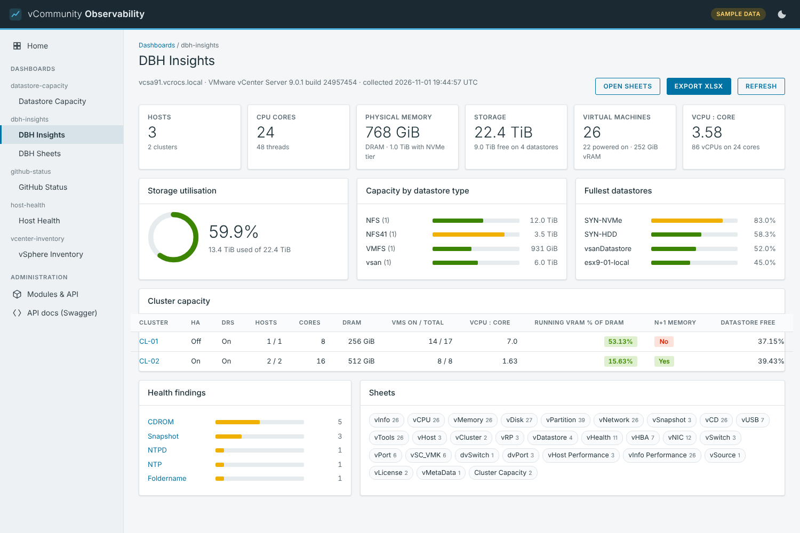

## Contents

- [Requirements and design goals](#requirements-and-design-goals)
- [How it fits together](#how-it-fits-together)
- [Data storage (SQLite)](#data-storage-sqlite)
- [Getting started](#getting-started)
- [Using the web UI](#using-the-web-ui)
- [Modules included](#modules-included)
- [Logs (syslog server)](#logs-syslog-server)
- [vCommunity Ask (local AI chat)](#vcommunity-ask-local-ai-chat)
- [Configuration reference](#configuration-reference)
- [Docker image and runtime](#docker-image-and-runtime)
- [Using it from MP Builder](#using-it-from-mp-builder)
- [Core API](#core-api)
- [Writing a module](#writing-a-module)
- [Security](#security)
- [Patching and updates](#patching-and-updates)
- [Dark sites](#dark-sites)
- [Troubleshooting](#troubleshooting)
- [Testing](#testing)
- [Repository layout](#repository-layout)
- [What's next](#whats-next)

## Requirements and design goals

| Goal | How it is met |
| --- | --- |
| Cross-platform | One container image (amd64 and arm64, including Apple Silicon), or run directly with Python 3.11+ on Windows, macOS or Linux |
| No Grafana | Dashboards are server-rendered HTML from the app itself |
| Works offline / at dark sites | No CDN links or runtime downloads; Swagger UI is vendored; images can be saved as tarballs |
| Open source | FastAPI, SQLite, APScheduler, pyVmomi, Jinja2, PowerShell 7 (PowerCLI is the one accepted non-open-source exception) |
| Easy to patch | Locked, hashed dependencies; layered Dockerfile; each module is a folder that can be replaced on its own |
| Language choice | Modules can be Python **or** PowerShell; the core never forces one |

## How it fits together

```
 vCenter / VCF Operations / any REST source
            │  (pyVmomi, PowerCLI, REST)
            ▼
 ┌──────────────────── vCommunity-Observability container ────────────────────┐
 │  Scheduler ──runs──▶ module collectors (.py or .ps1) ──JSON──▶ SQLite      │
 │      │                                                       (1 db/module) │
 │      └──runs──▶ scheduled exports (XLSX/CSV) ──▶ /app/exports              │
 │  FastAPI ──▶ /api/<module>/...      REST for MP Builder (token auth)       │
 │          ├─▶ /dash/<module>/...     dashboards (server-rendered HTML)      │
 │          ├─▶ /export/<module>/...   file downloads                         │
 │          └─▶ /settings, /modules, /docs                                    │
 └────────────────────────────────────────────────────────────────────────────┘
```

- **One container, one job.** Uvicorn (FastAPI) is the single main process. The scheduler runs inside it, and collectors and exports are short-lived child processes that start, write JSON and exit. SQLite is one file per module, so a single container avoids cross-container locking and keeps dark-site installs to one image. Split it only if you move to Postgres, need HA on Kubernetes, or want PowerCLI in its own image.
- **Collectors** are plain scripts. The core passes connection details in environment variables and reads one JSON object back. That is the whole contract, which is why a module can be Python or PowerShell.
- **Storage** is one SQLite file per module in `data/`, plus `data/_core.db` for core state (run history, module switches and order, settings saved in the UI, export schedules). See [Data storage (SQLite)](#data-storage-sqlite).

## Data storage (SQLite)

SQLite is the only data store. It runs inside the Python process, so there is no database server to install, patch or secure, which suits offline and dark-site installs. Everything lives in the `data/` folder (the `/app/data` volume in Docker).

**One database file per module.** Each module gets its own file, for example `data/vcenter-inventory.db` or `data/host-health.db`. Modules stay isolated, and deleting a module's file removes its data.

- Tables come from the `tables:` section of the module's `module.yaml`. The core creates them on start, and when a module update adds columns, the core adds them with `ALTER TABLE`. Columns are only ever added, never dropped, so there are no migration scripts to write.
- Collectors (Python or PowerShell) only print rows as JSON. The core writes them and stamps every row with `collected_at` (UTC).
- Each table has a `mode`:

| Mode | What a collector run does | Use it for |
| --- | --- | --- |
| `snapshot` | Deletes all rows, then inserts the new ones | Current state, such as inventory |
| `append` | Inserts the new rows and deletes rows older than `retention_days` (default 90) | History and trends |

- **Indexes (optional):** a table can list `indexes:` in `module.yaml`, one list of columns per index, for the columns its dashboards and API filter or sort on, for example `indexes: [[used_pct]]` or `[[vcenter, name, collected_at]]`. The core creates them on start (`ix_<table>_<columns>`). Snapshot rewrites keep them up to date. Only add them to tables that get big: a few thousand rows scan in well under a millisecond. Included today: `datastores.used_pct`, `datastore_history(vcenter, name, collected_at)`, `impact(kind, severity_rank)`, and DBH Insights `vinfo.powerstate`, `vdatastore.free_pct` and `vpartition.free_pct`.
- **WAL mode:** every module database and `_core.db` uses WAL with `synchronous=NORMAL`. A dashboard keeps reading the previous snapshot while a collector writes the next one, instead of waiting for it. Readers and writers wait up to 15 seconds for a lock before giving up. Each file gets `-wal` and `-shm` companions next to it, which is normal. The switch to WAL happens on the first start after the update and needs no action.

**`data/_core.db` holds the app's own state:**

| Table | Contents |
| --- | --- |
| `runs` | Collector run history (status, row count, error message), trimmed to the last 1000 runs |
| `module_state`, `module_order` | Module on/off switches and menu order set in the UI or API |
| `connection_settings`, `collector_settings` | Connections and collector intervals edited on the Settings page; they win over `config.yaml` and `.env` |
| `vcenter_instances` | The vCenter list managed on the Settings page (multi-vCenter). When it has any rows, it wins over `config.yaml` for vCenter |
| `export_schedules` | Scheduled export definitions and their last result |

Passwords saved on the Settings page are stored **unencrypted** in `_core.db`, so protect `data/` as you would `.env`.

**Reads are read-only.** Dashboards and the REST endpoints that MP Builder calls open module databases with a read-only connection (`mode=ro`), and manifest queries must be `SELECT`. Only collectors write.

**The Logs module has its own database**, `data/syslog.db`: the syslog messages (with an FTS5 full-text index), per-minute message counts, the Logs settings and the alert rules and fired alerts. Only the syslog listener writes messages; it trims the file by age and size (see [Logs (syslog server)](#logs-syslog-server)).

**vCommunity Ask has its own database**, `ask.db` in its own volume, completely separate from these files. See [The Ask database](#the-ask-database-askdb).

To back up or move everything, stop the container and copy `data/`. Any SQLite tool, such as DB Browser for SQLite, can open the files.

The databases are never committed to git: `.gitignore` excludes `data/` and `ask-data/`, plus any `*.db` file and SQLite's `*.db-wal` and `*.db-shm` side files wherever they are, as a safety net for a test run with a different data path. They hold unencrypted passwords, customer inventory and chat history, and they are rebuilt automatically.

## Getting started

These steps take a fresh clone to both containers running: the dashboards on port **8080** and vCommunity Ask on port **8081**. Each step has bash (macOS, Linux) and PowerShell (Windows) commands.

### Prerequisites

| What | macOS | Windows | Linux |
| --- | --- | --- | --- |
| Container engine | Rancher Desktop (Container Engine `dockerd (moby)`) or Docker Desktop | Docker Desktop (WSL 2 backend) or Rancher Desktop | Docker Engine with the Compose plugin |
| git | Xcode command line tools or Homebrew | Git for Windows | distro package |
| Ollama (only for Ask) | ollama.com app | ollama.com app | ollama.com install script |
| Models (only for Ask) | `nomic-embed-text` plus a chat model | same | same |
| Memory for the chat model | A 27B model needs roughly 20 GB free; 8B models run in roughly 6–8 GB | same | same |
| vCenter (optional) | Reachable from the container, with a read-only account | same | same |

No vCenter yet? Set `VCO_MOCK=1` in `.env` and every dashboard runs on built-in sample data. No Ollama? The dashboards work without it; only Ask needs it.

### 1. Get the code

```bash
git clone https://github.com/dalehassinger/vCommunity-Observability.git
cd vCommunity-Observability
```

### 2. Create your config and secrets

```bash
cp config/config.example.yaml config/config.yaml
cp .env.example .env
openssl rand -hex 32          # run twice: one token for VCO_API_TOKEN_MPBUILDER, one for ASK_API_TOKEN
```

```powershell
Copy-Item config/config.example.yaml config/config.yaml
Copy-Item .env.example .env
[Convert]::ToHexString([Security.Cryptography.RandomNumberGenerator]::GetBytes(32))   # run twice, one per token
```

Copy `config/config.yaml` **before** the first `docker compose up`. If it is missing, Docker creates a folder with that name and the `vco` container fails to start.

In `config/config.yaml`, change only what applies to you (the example uses the author's lab names):

| Key | Set it to |
| --- | --- |
| `connections.vcenter.host`, `user` | Your vCenter FQDN and a read-only account (or leave them and set the vCenter on the **Settings** page later) |
| `connections.vcenter.verify_ssl` | `true` if vCenter has a trusted certificate |
| `connections.vcfops.*` | Your VCF Operations, or leave it if you don't use it |
| `modules.dbh-*.settings.vcenter_name` | Your vCenter name (shown in the DBH sheets) |
| `modules.github-status.enabled` | `false` if the machine has no internet |

In `.env`, set:

| Variable | Value |
| --- | --- |
| `VCO_VCENTER_PASSWORD` | The vCenter password (`VCO_VCFOPS_PASSWORD` for VCF Operations) |
| `VCO_API_TOKEN_MPBUILDER` | The first token. Needed for saves on the Settings page and for the REST API |
| `ASK_API_TOKEN` | The second token. Needed to change Ask's Settings and Knowledge sources |
| `VCO_MOCK` | Uncomment `VCO_MOCK=1` for sample data instead of a live vCenter |
| `ASK_CHAT_MODEL` | Only if you won't use the default `qwen3.8:27b-mlx` (see step 4) |

Never commit `.env` or `config/config.yaml`; both are in `.gitignore`.

### 3. Create the data folders

The containers run as non-root users (`vco` uid 10001 and `ask` uid 10002), so they need folders they can write to.

```bash
mkdir -p data exports extra-modules ask-data ask-knowledge ask-sources control
chmod 777 control      # Apps on / off switches, written by both containers
# Linux only: give the folders to the container users
sudo chown -R 10001 data exports extra-modules
sudo chown -R 10002 ask-data
# macOS: Docker Desktop and Rancher Desktop map ownership for you; if a scheduled export can't write, run: chmod 777 exports
```

```powershell
New-Item -ItemType Directory -Force data, exports, extra-modules, ask-data, ask-knowledge, ask-sources, control | Out-Null
```

### 4. Set up Ollama (for Ask)

Ollama runs on the host, not in a container, so it can use the GPU. Two things are needed: Ollama must accept connections from containers, and the models must be pulled.

| OS | Let containers reach Ollama |
| --- | --- |
| macOS | `launchctl setenv OLLAMA_HOST 0.0.0.0`, then quit and reopen Ollama. Details and how to keep it after a reboot: [Start it on Rancher Desktop](#start-it-on-rancher-desktop) |
| Windows | `setx OLLAMA_HOST 0.0.0.0` in PowerShell, then quit Ollama from the tray and start it again |
| Linux | `sudo systemctl edit ollama`, add `[Service]` and `Environment="OLLAMA_HOST=0.0.0.0"`, then `sudo systemctl restart ollama`. Also uncomment the `extra_hosts` lines under `vco-ask` in `docker-compose.yml` |

Then pull the models:

```bash
ollama pull nomic-embed-text      # embeddings (search); required
ollama pull qwen3.8:27b-mlx       # default chat model on an Apple Silicon Mac with enough memory
```

The `-mlx` tags are built for Apple Silicon. On Windows, Linux or a smaller Mac, pull a chat model that fits your memory, for example `ollama pull qwen3:8b` or `ollama pull llama3.1:8b`, and set `ASK_CHAT_MODEL` to it in `.env` (or pick it on Ask's Settings page later). Check that a container can reach Ollama:

```bash
docker run --rm curlimages/curl -s http://host.docker.internal:11434/api/tags   # lists your models
```

With Rancher Desktop's `containerd` engine, set `ASK_OLLAMA_URL=http://host.lima.internal:11434` in `.env` instead.

**LM Studio instead of, or next to, Ollama.** Ask can also use the models of [LM Studio](#lm-studio). In LM Studio open the **Developer** tab, start the server and turn on **Serve on Local Network** (otherwise the container can't reach it), then on Ask's Settings page turn on **LM Studio** and keep its URL `http://127.0.0.1:1234`. Ollama can be turned off there too.

### 5. Build and start

```bash
docker context use rancher-desktop     # Rancher Desktop only
docker compose up -d --build           # builds and starts both containers (first build takes several minutes)
docker compose ps                      # both should show "healthy" after a minute
```

The commands are the same in PowerShell. With the `containerd` engine use `nerdctl compose up -d --build`. To start only one container, name it: `docker compose up -d --build vco` or `... vco-ask`. If PowerShell fails to build with `Illegal instruction`, see [Troubleshooting](#troubleshooting).

Quick health checks: http://localhost:8080/api/core/health and http://localhost:8081/api/health.

### 6. First steps

**Dashboards (http://localhost:8080)**

1. Open **Settings**. Under Connections, check the vCenter address and user, enter the password if it isn't in `.env`, and press **Save and test**. Paste `VCO_API_TOKEN_MPBUILDER` into the card's token field when asked.
2. Open **Modules & API** and press **Run collectors now** on a module, or wait for its first scheduled run.
3. Open a dashboard from the sidebar. If it shows "collector failed", the message says why; `docker compose logs -f vco` shows more.
4. Optional: turn off modules you don't need, and set collection intervals on **Settings**.

**vCommunity Ask (http://localhost:8081)**

1. Paste `ASK_API_TOKEN` into the token bar at the top (kept in that browser only).
2. Open **Settings** and press **Test connection**. It should show the Ollama version and fill the model lists. Pick your chat model if it isn't the default.
3. Open **Knowledge sources**. The example `isvara` source (a public GitHub repository of vSphere metric docs) starts syncing about 5 seconds after the first start, which needs internet. Indexing about 200 files takes a few minutes. Don't want it? Turn its switch off; deleting it isn't enough, because sources from `ask.yaml` are added back on the next start unless you use your own `ask.yaml` (see [Ask configuration](#ask-configuration)).
4. **Add source** for your own GitHub markdown repository, local folder (copied into `./ask-knowledge`) or blog.
5. Open **New chat** and ask one of the example questions.

### Try it with sample data without Docker

For a quick look on a laptop with Python 3.11+ and no container engine:

```bash
python3 -m venv .venv && source .venv/bin/activate
pip install -r requirements.txt
cp config/config.example.yaml config/config.yaml
VCO_MOCK=1 uvicorn core.app:create_app --factory --port 8080
```

```powershell
python -m venv .venv; .venv\Scripts\Activate.ps1
pip install -r requirements.txt
Copy-Item config/config.example.yaml config/config.yaml
$env:VCO_MOCK = '1'
uvicorn core.app:create_app --factory --port 8080
```

Open http://localhost:8080. A **Sample data** badge shows in the header while mock mode is on. The `host-health` module needs PowerShell 7 (`pwsh`) on the PATH; PowerCLI is only needed for live data. To run Ask without Docker, see [Start it on Rancher Desktop](#start-it-on-rancher-desktop).

## Using the web UI

The left sidebar has **Home** and **All dashboards**, then every enabled module's dashboards (in the order set on the Modules page), then **Modules & API**, **Settings** and **API docs (Swagger)**. The last button in the top-right toolbar switches light and dark theme: it shows a moon while the page is light and a sun while it is dark, and screen readers hear it as a **Dark theme** toggle that is pressed or not. The choice is remembered in the browser.

The header of both apps shows the app name and **– By: Dale Hassinger**. To change or remove the byline, edit the `brand-by` line in `core/templates/base.html` and `ask/app/templates/base.html`.

**Accessibility and browser behavior (both apps):**

- **Confirm and alert dialogs** (delete a chat, a report, a source or a schedule, remove a vCenter, change the embedding model, error messages) use one shared themed dialog, `core/static/dialogs.js`, instead of the browser's gray `confirm()` / `alert()` popups. It follows the light / dark theme, keeps focus inside the dialog, and **Esc**, **Cancel** or a click outside it cancel. Destructive actions show a red button and start with focus on **Cancel**. In scripts use `await vcoConfirm('Question?', { ok: 'Delete', danger: true })` and `await vcoAlert('Message')`; on a plain HTML form add `data-confirm="Question?"` (and optionally `data-confirm-ok="Remove"`).
- **Jump to top / bottom:** on a long page, round arrow buttons at the bottom right jump to the top (↑) or the bottom (↓). Each shows only when there is more than a screen-ful's worth (300 px) to go that way, so a short page shows none. The Ask chat doesn't have them: its own **Jump to latest** button on the question box does that job. One shared script, `core/static/pagejump.js`; it watches the page's content area (`main`) for size changes, not the whole page.
- **Contrast:** white text on blue (the selected sidebar row, primary buttons, the Ask question bubble, the highlighted row of the Logs menu) uses a darker blue, `#0064d1` (`--m-fill` and `--nav-active-fill` in `core/static/mac-ui.css`), which is 5.6 : 1 against white. The Mac system blue `#007aff` is only 4.0 : 1, under the 4.5 : 1 WCAG AA needs for small text. Links and icons keep the system blue.
- **Solid top bar where the page keeps scrolling:** the top bar is a blurred, see-through Mac toolbar, except on the Ask chat and the Logs page. There it is solid, because a blurred bar is drawn again on every scroll step and those two pages scroll all the time (a streaming answer, the live tail).
- **Pages update in place:** on the Ask Knowledge sources, Settings, Saved prompts, Scheduled prompts and Reports pages, an action (sync, switch, pin, delete, save, a sync or a scheduled run finishing) updates only the card or row it changed, without reloading the page, so the scroll position and the focused control stay. `AskAdmin.refresh(selectors)` in `ask/app/static/admin.js` fetches the page's HTML again and swaps just those parts; the page reloads only when its layout changes (the first item added, an app turned on or off, a different chat model or number of recent chats in the sidebar).
- **Reduced motion:** with the operating system's *Reduce motion* setting on, the sync spinner, the typing dots, the sidebar slide, switch and tree arrow animations, chart animations and smooth scrolling are turned off. Colour changes still happen.
- **Switches:** the on/off sliders on both Settings pages and the Ask Knowledge sources page are announced as switches (`role="switch"`), not checkboxes.
- **Folder picker** (Settings → Scheduled export → Browse…) closes on a click outside it (`closedby="any"`, with a small fallback for Safari). The Ask source editor dialog does not, so a stray click can't lose what you typed.

### Home

**Home** (and the logo) opens the **DBH Insights** dashboard (`/dash/dbh-insights/insights`): opening `/` redirects there. To open another dashboard instead, set `home:` in `config/config.yaml` (or `VCO_HOME` in `.env`) to its path, for example `home: /dash/vcenter-inventory/inventory`, and restart. If that dashboard's module is missing or switched off on the Modules page, `/` opens **All dashboards** instead.

### All dashboards

**All dashboards** (`/overview`) shows a tile for every dashboard of every enabled module, in menu order. The **Dashboards** link in each dashboard's breadcrumb goes here.

### Modules & API

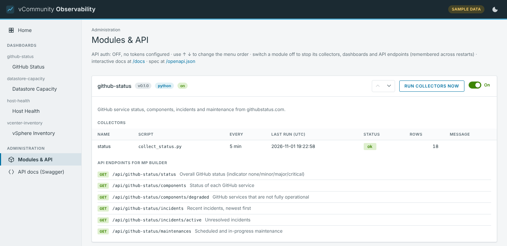

- Every module with its version, language, collectors, last run, row count and any error.
- **On/Off switch** per module. Off stops its collectors and hides its dashboards and API endpoints (they return 404). Saved in `data/_core.db`, so it survives restarts and upgrades.
- **↑ ↓** buttons set the menu order used by the sidebar, home page and this page. New modules appear at the bottom.
- **Run collectors now** starts a module's collectors in the background and the page comes back at once. The module shows **running…** and the page refreshes every few seconds until the run ends (dashboards have a **Refresh** button that does the same). Each collector runs once at a time: a manual run and the scheduled run of the same collector never overlap, and the second one is skipped.
- **API token.** When API tokens are configured, the page shows one **API token** field at the top. On/Off, ↑ ↓ and **Run collectors now** need it (it is kept for this browser tab only). Requests posted from another web site are refused.
- The full list of each module's REST endpoints and downloads.

### Settings

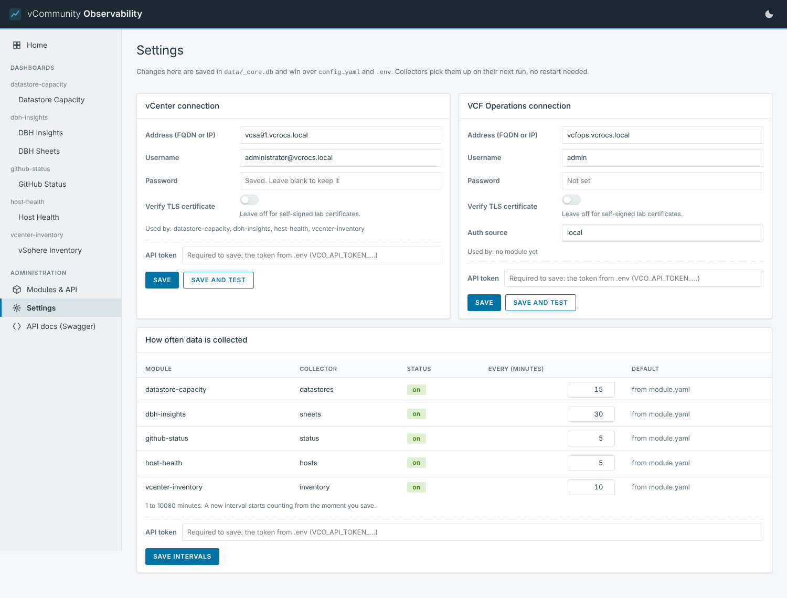

**Apps on / off.** The first card has two sliders, **vCommunity Observability** and **vCommunity Ask**, one for each container. Off *pauses* that part; its container keeps running, so it can always be switched back on:

| Switched off | What stops | What keeps working |
| --- | --- | --- |
| vCommunity Observability | Every collector run (scheduled, **Run now**, start-up) and scheduled exports. A yellow banner says it is paused | Dashboards, exports and the API, with the last collected data; Settings. Turning it on runs all collectors once |
| vCommunity Ask | Questions (chat page and `POST /api/ask` answer 503) and source syncs (scheduled, **Sync now**, uploads). The **Ask** button of the app switcher (top right) is hidden | Chats, sources, Settings and the rest of Ask's pages |

The same two sliders are on Ask's Settings page, and both pages save to one shared file, `./control/apps.json` (mounted at `/app/control` in both containers), so either page can switch either part. Saving here needs the API token when tokens are set; on Ask, the Ask API token. Scripts use `GET /api/core/apps` and `PUT /api/core/apps/{observability|ask}?on=false` (or `/api/apps` on Ask). A missing file means both are on.

**Connections.** Edit the vCenter and VCF Operations address, username, password and TLS check. **Save and test** saves and checks the login straight away. Values saved here are stored in `data/_core.db`, win over `config.yaml` and `.env`, and apply from the next collection without a restart. **Reset to config.yaml** drops them. Leaving the password blank keeps the current one.

**Collection intervals.** How often each collector runs, 1 to 10080 minutes. A new interval starts counting from the moment you save.

**Scheduled export.** One schedule that runs a module export (for example the DBH Insights XLSX, or one sheet as CSV) and writes it to a folder:

- **Daily, weekly or monthly** (day of week, or day of month 1 to 28 or the last day), at a time and time zone you pick. The default time zone comes from `TZ`.
- **Folder** under `/app/exports`, which Compose maps to `./exports` next to `docker-compose.yml`. **Browse…** opens a folder picker where you can open folders, go up a level and create a new folder. (A browser can't hand a web app a real path on your computer, and the container only sees the exports folder, so the picker browses that folder.)
- **Keep newest N** files; older ones made by this schedule are deleted. 0 keeps all.
- Once saved, the card shows a summary (schedule, export, folder, next run, last run) with **Edit**, **Run now**, **Pause** and **Remove**. **Edit** opens the form filled in with the current values; **Save changes** updates the same schedule.
- Every save is **verified**: the schedule is read back from the database and compared with what you entered, the folder is write-tested, and the scheduler is checked for the job. A green **Schedule saved and verified** box lists those checks and the next run. If anything fails, a red message in the card says what, and the form keeps what you typed.
- Files are written as `.part` and renamed when complete, so a half-written file never appears.

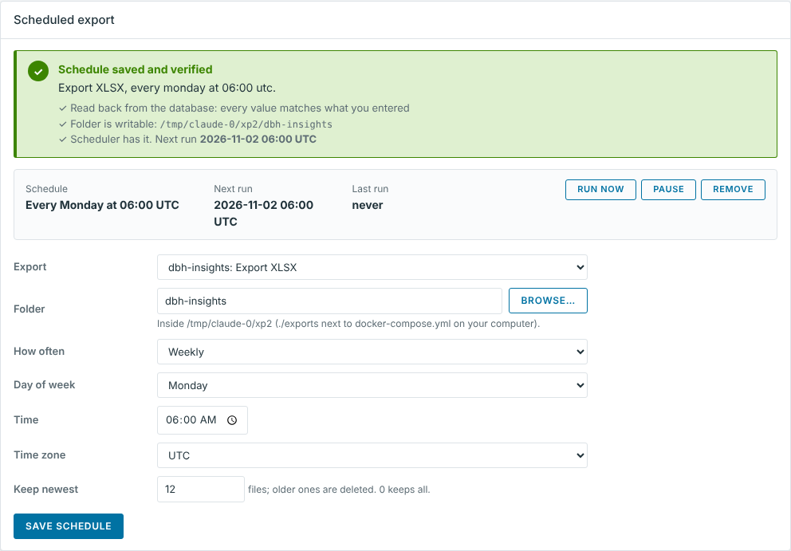

When API tokens are configured, every save on this page needs one of them (there is no UI login yet). The token field sits at the bottom of each card.

### Performance

There is **one Performance dashboard** for both containers, and it lives in vCommunity Ask (it also has the Mac's CPU, GPU and memory, Ollama and answer speed). **Performance** in the top-right toolbar (next to **Logs**) opens it at `VCO_ASK_URL/performance`, the same page as the **Performance** button in Ask's toolbar. It shows whenever `VCO_ASK_URL` is set, even while Ask is paused. `/performance` here redirects there too. The link is hidden when `VCO_ASK_URL` is empty.

The dashboard shows a KPI card and CPU and memory, network and disk charts for each container, vCommunity Observability (`vco`) and vCommunity Ask (`vco-ask`). This container gives Ask its numbers at the open `GET /perf/container` endpoint (raw cgroup counters, no secrets, no Docker socket). Ask reads it every 10 seconds at `ASK_VCO_INTERNAL_URL` (default `http://vco:8080`). If this container doesn't answer, its card turns red and says **Not running**. When the `logs` module is on, the dashboard also has a **Logs** panel: logs per second, per minute and per hour, log disk space used and disk space available (the numbers come in the same `/perf/container` answer, under `logs`). Because the dashboard is served by Ask, it needs the Ask container to be running. Pausing Ask with the Apps on / off slider keeps the dashboard working. See [Performance page and host agent](#performance-page-and-host-agent).

### API docs

`/docs` is Swagger UI (vendored, works offline) for every endpoint. `/openapi.json` is the machine-readable spec.

### About

**About** (last item in the sidebar, `/about`) shows what the project is, its version, how many modules are available, the number of dashboards, whether PowerShell is in the image, live or sample data, and the Python version, with links to GitHub, vcrocs.info and the API docs. Below that is this README, rendered in the app: an **On this page** list (h2 and h3 headings, the current section highlighted), a **Filter sections** box that hides sections that don't mention the text, working `#` links, screenshots served from the image (`/about/screenshots/<file>`) and links to repository files that open on GitHub. GitHub callouts such as the development warning show as alert boxes.

The README and `docs/screenshots/` are copied into both images at build time, so the page always matches the code you built, works offline, and needs no change when the README changes (rebuild to pick up a new README). Rendering is done in the browser by the vendored marked and DOMPurify (`core/static/vendor/`), with `core/static/about.js` and `about.css` shared by both containers. Ask has the same page, with its own version, models and index counts at the top.

## Modules included

| Module | Language | What it collects and shows | API endpoints (`/api/<module>...`) |
| --- | --- | --- | --- |
| `datastore-capacity` | Python (pyVmomi) | Capacity, free, provisioned and VM count per datastore, with 90 days of history for a runway estimate (appears after an hour of history). Widget dashboard | `/datastores`, `/datastores/critical`, `/runway` |
| `host-health` | PowerShell (PowerCLI) | Host status, alarms, maintenance mode, CPU and memory %, uptime, version. Widget dashboard with VCF Operations-style KPI cards | `/hosts`, `/hosts/unhealthy`, `/clusters` |
| `vcenter-inventory` | Python (pyVmomi) | Clusters, hosts and VMs (config, usage, disks, NICs, IPs, snapshots, notes) in a vCenter-style inventory browser with a tree, object pages and tabs | `/vms`, `/vms/powered-off`, `/vms/with-snapshots`, `/hosts`, `/clusters` |
| `github-status` | Python (requests) | GitHub service status from githubstatus.com (any Atlassian Statuspage site via the `url` setting): summary cards, one status card per service, open and recent incidents, maintenance. Needs internet or `HTTPS_PROXY` | `/status`, `/components`, `/components/degraded`, `/incidents`, `/incidents/active`, `/maintenances` |
| `dbh-insights` | Python (pyVmomi) | The [DBH Insights](https://github.com/DBH-Insights/DBH-Insights) inventory: 27 sheets plus Cluster Capacity. Insights and Sheets pages, **Export XLSX** and CSV per sheet | `/<sheet>` for every sheet (`/vinfo`, `/vhost`, `/cluster-capacity`...), `/sheets`, `/vhealth/by-type`, `/export/xlsx`, `/export/csv?sheet=vInfo` |
| `dbh-topology` | Python (pyVmomi) | DBH Insights **Topology**: hosts by cluster, datastores and every mount between them, with **Download HTML** | `/hosts`, `/datastores`, `/mounts`, `/single-host-datastores` |
| `dbh-impact` | Python (pyVmomi) | DBH Insights **Impact**: what stops if one host or datastore fails, and whether HA could restart it | `/hosts`, `/datastores`, `/critical`, `/single-points-of-failure` |
| `apple-homeview` | Python (web extension, no collector) | **Apple HomeView**: a full-screen 1088 × 1088 wall display (Dale's HomeView design) with live data from DBH Insights, Datastore Capacity and GitHub Status, auto-cycle. See [Apple HomeView](#apple-homeview) | none (`/homeview` page, `/ui/homeview/data` JSON) |
| `logs` | Python (service + web extension) | **Syslog server** on port 514 (UDP and TCP): full-text search, live tail, senders, alerts by email or webhook, retention by days and size. Three pages: Logs, Log alerts, Log settings. See [Logs (syslog server)](#logs-syslog-server) | `/logs/search`, `/logs/summary`, `/logs/hosts`, `/logs/alerts` |

All vCenter modules use the shared `vcenter` connection. Configure one or many vCenters in `config.yaml` (`connections.vcenter` flat form, or `instances:`) or on the Settings page. Collectors receive every enabled instance as `VCO_VCENTERS` (JSON) and stamp rows with a `vcenter` id so names and morefs do not collide. A module can limit itself with settings `vcenters: [id, ...]`.

### vSphere Inventory

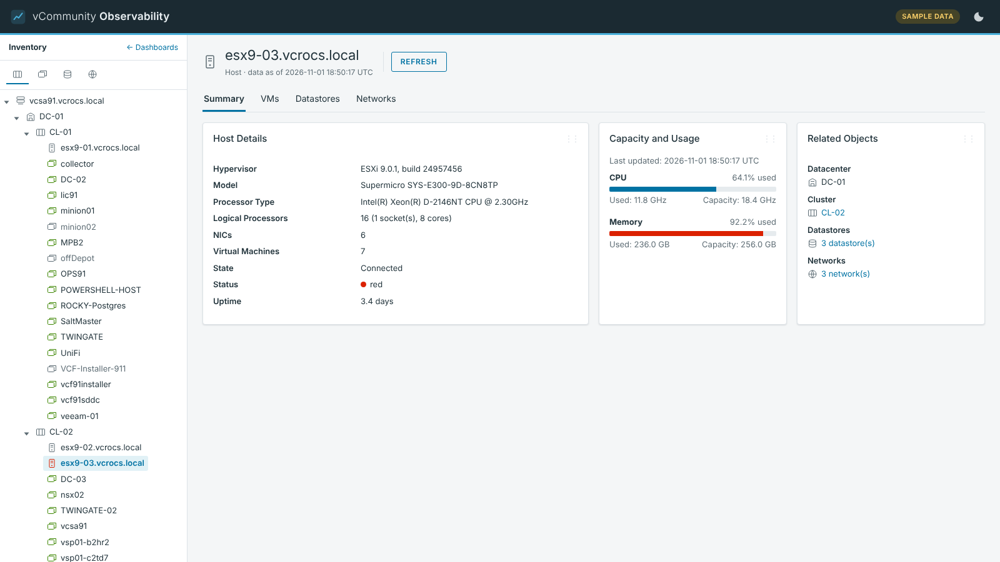

A tree of datacenter, clusters, hosts and VMs on the left; object pages with summary cards and tabs (Hosts, VMs, Datastores, Networks, Snapshots) on the right. Tags and storage policies are not collected yet (they need the vSphere REST API).

- Clicking an object in the tree, or a tab, swaps only the object pane: the tree keeps its scroll position and open folders. The address bar still changes (`?type=vm&name=...&tab=...`), so links, bookmarks, Back and Forward work as before. Without JavaScript every click is a normal page load.
- The tree replaces the app's sidebar on a wide screen; **← Dashboards** at the top of the tree goes back to All dashboards. On a phone (860 px wide or less) the menu button at the top left opens the usual sidebar with every dashboard, and the tree starts folded under its header (**Show tree** / **Hide tree**) so the selected object comes first.
- The dotted mark at the top right of each summary card copies the vSphere Client's card look. It is a design touch only: the cards don't move.

### Host Health

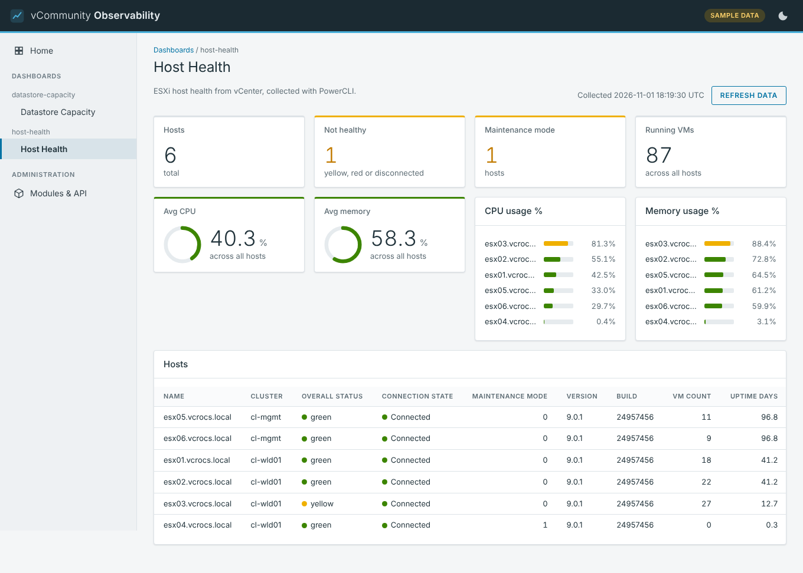

The reference PowerShell module: `Collect-HostHealth.ps1` uses PowerCLI and shows how a `.ps1` collector follows the same contract as a Python one.

### Apple HomeView

A full-screen wall display of the lab, built from the **HomeView** design (the `Apple HomeView/homeview-display` project): one 1088 × 1088 square canvas that scales evenly to fit any screen with no scrolling (other shapes get margins), the same VCF Operations-style dark palette and a 20-second **Auto-cycle**. There is no bottom bar: the **home icon** at the top left opens the dashboards menu (every page with its page count, the Auto-cycle switch and when the data was collected), so the pages use the whole height. Each page's title (for example *Hosts.*) sits in the top row beside **HomeView**, at the same size, instead of a big heading on the page. Its stylesheet is kept unchanged as `modules/apple-homeview/static/homeview-base.css`; the live pages add `homeview.css` on top. On a short, wide screen (below 520 px tall, such as the HomeView's Safari under its browser controls) it follows the original's compact rules: the canvas stops scaling, text drops to 8-13 px, secondary lines are hidden, cards share the height left, and the live pages show fewer rows per page (Hosts 7, Clusters 5, Findings 7, Datastores 7, VMs 7) so nothing scrolls.

Open **Apple HomeView** in the sidebar for a live preview and the **Open full screen** button, or browse straight to `/homeview` on the wall screen (`/homeview#hosts`, `#storage` ... open one page). It has no collector: every minute it reads what the other modules already collected, from `GET /ui/homeview/data`.

| Page | Data from | What it shows |
| --- | --- | --- |
| Home | dbh-insights | Live clock and greeting, a drawn stack of three MS-01 style mini PCs whose status lights follow the first three hosts (green online, amber maintenance, red not connected), vCenter name, version, hosts connected and VMs running, **Needs your attention** (hosts down or in maintenance, health findings, snapshots, Tools upgrades, datastores over 80 %, a GitHub incident), host CPU and memory in use |
| Lab | dbh-insights | Hosts, running VMs, datastores and health findings; compute (CPU and memory, weighted by cores and DRAM); storage ring; clusters with HA / DRS |
| Hosts | dbh-insights (vHost) | CPU and memory meters, VMs, version, state. 9 per page; sort **BY NAME** (cluster, then name), **BY CPU** or **BY MEMORY** |
| VMs | dbh-insights (vInfo) | Running, powered off, templates, snapshots, Tools to upgrade, and the busiest powered-on VMs, sorted **BY CPU** or **BY MEMORY** (the green menu in the list header, remembered on that screen) |
| Storage | datastore-capacity | Total, free, lowest free %, over 80 %; each datastore with used %, free and runway. 10 per page; sort **BY USED**, **BY RUNWAY** (shortest first), **BY SIZE** or **BY NAME** |
| Clusters | dbh-insights (Cluster Capacity) | Hosts available, VMs on, running vCPU : core, running vRAM % of DRAM, N+1, datastore free %. 7 per page |
| Health | dbh-insights (vHealth) | Findings by type and every finding, 12 per page |
| GitHub | github-status | Overall status, components, active incidents or coming maintenance (an example of a source outside the lab) |
| Ask | vCommunity Ask | The newest answer of each Ask [scheduled prompt](#scheduled-prompts) that has **Show the latest answer on the Apple HomeView** on (for example a daily weather or X posts digest), 2 per page, as plain text without citation marks |

**The Ask page** reads `GET /api/homeview` on Ask (inside the compose network at `VCO_ASK_INTERNAL_URL`, default `http://vco-ask:8081`, at most once a minute) with `ASK_API_TOKEN` from the shared `.env` (or `VCO_ASK_TOKEN`). It is left out while no scheduled prompt has the switch on, or Ask can't be reached.

**Offline dimming.** When the data can't load (vco stopped, network down), the top right shows **OFFLINE · RETRYING**. After 5 minutes without fresh data the pages are dimmed and grey, and it says **OFFLINE · DATA N MIN OLD**, so old numbers on the wall don't look current. Everything comes back at the next good load.

The pages show in the order above (default). The **Apple HomeView** card on the Settings page reorders them with up / down buttons and can hide a page (saved as `homeview.order` and `homeview.hidden` in `app_settings`; `/ui/homeview/data` returns them as `layout`). The sort menus (the green tag in a list header, on VMs, Hosts and Storage) are remembered per section on each screen (`localStorage` `homeview.sort`).

Lists longer than one screen become extra pages of the same section (Hosts 1, Hosts 2 ...; picking the section again in the menu shows its next page). On a list page whose list is longer than one screen (Clusters, Hosts, VMs, Health, Storage), a **Show** menu appears in that list's own header row (beside its title and tag, such as *Busiest right now ... BY CPU*): *Fit to screen* (the default, never scrolls) or 10, 25, 50 or 100 per page, which scroll inside the list with its column header kept in view. The choice is remembered per section on that screen (`localStorage` `homeview.show`); scrolling a list restarts the Auto-cycle timer. The data JSON carries up to 100 rows per list. Tap the home icon to open the menu; a pick, a tap outside it or Esc closes it, and the up / down arrow keys move through it. **Auto-cycle** shows every page for 20 seconds by default. Change the seconds (5 to 3600) in the **Apple HomeView** card on the Settings page (`POST /settings/homeview`, saved as `homeview.cycle_seconds` in the new `app_settings` table of `_core.db`); open screens pick it up within a minute, from `cycle_seconds` in `/ui/homeview/data`. Auto-cycle is on by default, and on / off is remembered on each screen. The arrow keys and a left / right swipe change page. A page is left out while its module is off or has not collected yet. Meters and numbers turn amber and red at the same levels as the dashboards (75 / 90 %; datastores 80 / 90 %). The owner name and time zone are set at the top of `static/homeview.js` (`OWNER`, `TIMEZONE`).

**Light on the screen's browser.** Only the page on screen is in the document; the others are kept as HTML and put in when they are shown. The minute refresh updates the page on screen in place: only the numbers, text and attributes that changed are written, so nothing flickers, a list keeps its scroll position and an open Show or Sort menu stays open. The clock's formatters are made once and the page is written once a minute (at the start of each minute), not every second.

### GitHub Status

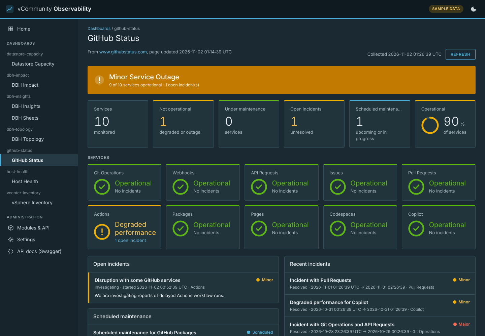

An overall status banner, a summary row (services, not operational, under maintenance, open incidents, maintenance windows, operational %), then a card per service with a coloured top edge and status ring. A service with an open incident links to it. Open and recent incidents are listed below.

### DBH Insights

`modules/dbh-insights` is a Python port of the DBH Insights website's query and export code (`collect/js/sheets.js`, `vim.js`, `xlsx.js`). The same columns, units, rounding and rules (vCLS VMs left out, "not reported" stays blank rather than 0) are used, but the data is collected on a schedule by the container with pyVmomi instead of from the browser through the desktop helper, so no helper app is needed and it works at dark sites.

- **Sheets:** vInfo, vCPU, vMemory, vDisk, vPartition, vNetwork, vSnapshot, vCD, vUSB, vTools, vHost, vCluster, vRP, vDatastore, vHealth, vHBA, vNIC, vSwitch, vPort, vSC_VMK, dvSwitch, dvPort, vHost Performance, vInfo Performance, vSource, vLicense, vMetaData, plus Cluster Capacity.
- **Insights** page: hosts, cores, DRAM, storage, VMs, vCPU:core ratio, storage utilisation, capacity by datastore type, fullest datastores, cluster capacity with the N+1 memory check, and vHealth findings.
- **Sheets** page: every sheet with sort, filter, paging, the **totals row** (sums, averages and ratios worked out the same way as the website) and **Group by**.

  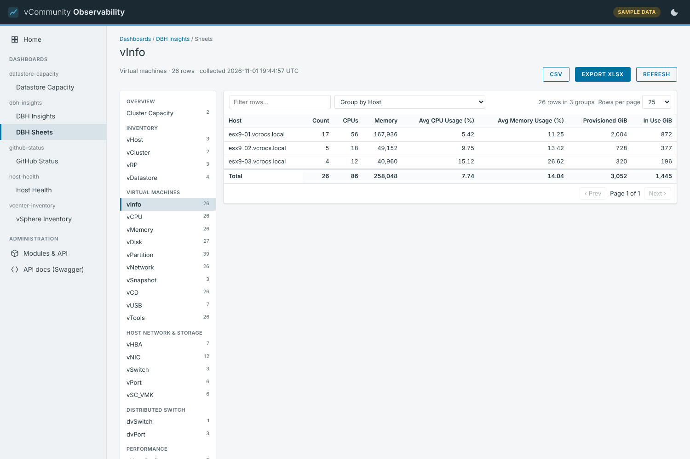

- **Export XLSX:** one workbook with every sheet, Verdana 9pt, black header row, frozen first row and column, AutoFilter, real Excel dates, in the inventory tool's sheet order. With several vCenters each worksheet holds the rows of all of them (one worksheet per sheet, never one per vCenter). Also at `/api/dbh-insights/export/xlsx` (token required) and as a scheduled export.
- Large inventories are read with the PropertyCollector and continuation tokens, so nothing is silently truncated. A property an older vCenter doesn't know is dropped and logged, and its column stays empty.
- The website's API Explorer is not ported. Multi-vCenter collection is supported here (Settings / `VCO_VCENTERS`); the website's combined multi-VC UI chrome is not replicated sheet-for-sheet.

To change a sheet, edit `sheets.py`, then run `python sheets.py --tables` in the module folder and paste the output over the `tables:` section of `module.yaml`. The smoke test fails if they don't match.

### DBH Topology

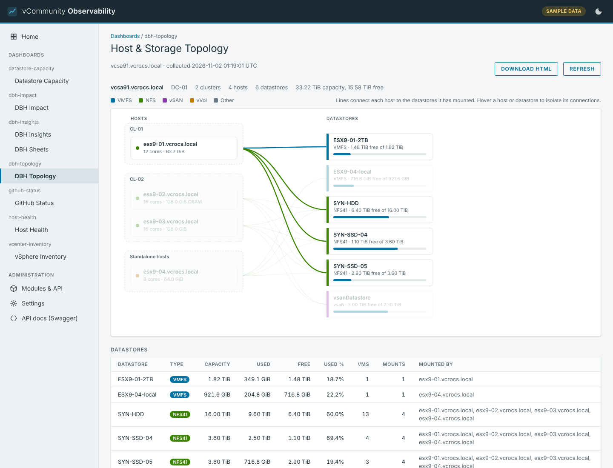

Port of the Topology view (`collect/js/insights.js` and `report.js`). Hosts are grouped by cluster (plus standalone hosts) on the left, datastores on the right with a capacity bar, and a line for each mount, coloured by datastore type (VMFS, NFS, vSAN, vVol, other). Hover a host or datastore to isolate its connections. Datastore and host tables sit below the map. **Download HTML** saves a standalone report, in the website's dark style, for emailing or archiving.

### DBH Impact

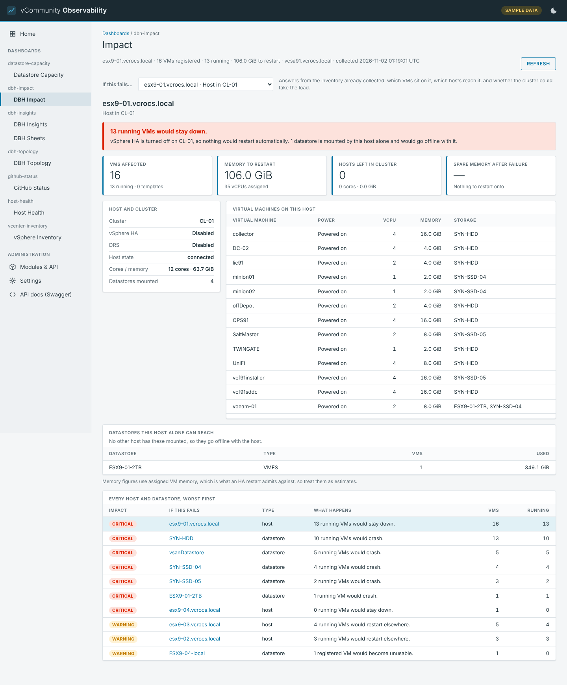

Port of the Impact view (`collect/js/impact.js`). Pick a host or datastore under **If this fails…**:

- **Host:** how many running VMs stop, whether vSphere HA would restart them (standalone host, HA off, no surviving hosts, or not enough uncommitted memory all mean they stay down), memory and vCPUs to restart, hosts left in the cluster, spare memory after the failure, datastores only that host can reach, and VMs on other hosts that use that storage.
- **Datastore:** how many running VMs crash, which have every file there versus split across datastores, which hosts mount it, and the capacity that goes offline.
- A table of **every host and datastore, worst first** (critical, warning, low).

Each collection answers the question for every host and datastore, so the answers are also REST endpoints for MP Builder (`/api/dbh-impact/hosts` gives severity, VMs running, memory to restart and headroom per host). Memory figures use assigned VM memory, which is what an HA restart admits against, so they are estimates.

`dbh-topology` and `dbh-impact` share one collector library, `fabric.py`. Each module keeps an identical copy so it stays self-contained; the smoke test fails if the copies drift. HA and DRS state come from the same vSphere session (`configuration.dasConfig.enabled`), so no extra credentials are needed.

## Logs (syslog server)

The `logs` module makes vCommunity Observability a syslog server. ESXi hosts, vCenter, NSX, switches, your own scripts and apps (vCommunity Ask sends its activity here, see [Ask activity log](#ask-activity-log)) or anything else that speaks syslog send to this computer on port **514**, and the **Logs** pages search what arrived. A **source** is whatever sent the message (the syslog HOSTNAME field: a host, an appliance, or an app's container), and the **app** is the program inside it (`vpxa`, `hostd`, `vcommunity-ask`, your script's name). It is open source, standard-library Python, needs no extra container or image, and works offline.

Open the three pages from the **Logs** menu in the top-right toolbar (left of the **Observability | Ask** switcher). They are not in the sidebar. The menu shows only while the Logs module is on. Ask's toolbar has the same **Logs** menu, which opens these pages on the dashboards (it uses Ask's **Observability URL**, so it is hidden when that is empty or Observability is off).

| Page | What it does |
| --- | --- |
| **Logs** (`/dash/logs/search`) | Status cards (messages and errors in the last hour, sources sending, unacknowledged alerts, storage used against the cap). A search box with time range (15 min to 7 days, or everything kept), severity, **source** and **app** pickers, and **Quick** searches (Errors, vCommunity Ask activity, Ask prompts, Ask thinking, Ask tool calls, Clear). A chart of messages over time, colored by severity (click a bar to zoom into that slice; **Reset zoom** goes back). The results newest first, the search words highlighted, the message ID under the app; a message longer than 500 characters (a prompt, the model's thinking) is cut in the list. Click a row for the whole message and every field (time in the message, sender IP, facility, process and message ID, RFC 5424 structured data) and **Only this source**, **Hide this source**, **Only this app**, **Messages around this one**. **Load older messages** pages back. **Live tail** adds new matching messages at the top every 2 seconds and keeps the newest 500 rows (older ones are a search away); it pauses while the browser tab is hidden and catches up when you come back. The chart library (ECharts, 1.1 MB, vendored) loads only when the chart comes into view, and the status cards stop refreshing in a hidden tab (the same on Log alerts and Log settings). **Export CSV** downloads the current search (up to 100,000 rows). The search is kept in the URL, so it can be bookmarked or shared |
| **Log alerts** (`/dash/logs/alerts`) | Alert rules you define in the page: a name, a search, a severity, "fire when N or more messages in M minutes", a wait before it can fire again, and whether to send email and/or a webhook. **Test against current logs** shows how many messages match now and whether it would fire. Fired alerts are listed with the count, the five newest matching messages, what was sent, and **Show messages** (opens Logs at that time window). Acknowledge or delete them one by one, selected, or all. **Notifications** holds the SMTP server (port, no TLS / STARTTLS / SSL, optional user and password, From, To) the default webhook URL and **Named webhooks** (Slack-style `text` JSON with `title` and `alert` for scripts; Discord webhook URLs get Discord embeds, red for alerts and failures). A saved URL is shown masked as its site only (`https://discord.com/…`), because it works like a password: leave the box blank to keep it, or tick **Clear**. **Add webhook** adds a named one (for example *daily*) with its own **Test** and **Remove**; each alert rule and each Ask scheduled prompt picks one (empty = the default). With **Send test email** and **Send test webhook**, and **Check alert rules**, the master switch for every rule (shown On or Off; saving it off asks first, and while it is off a yellow banner at the top of the page says so, with **Turn alert checking on**) |
| **Log settings** (`/dash/logs/settings`) | **Keep logs for** (days, default **5**) and **Size cap** (GB, default **5**), **Idle source after** (minutes, default 15; only a label, because apps such as Ask send only when used; make a log alert to be told a host stopped sending). Listener status (running, ports, messages received and dropped, rate, TCP connections, recent problems), disk use, every **source** (name, IP, its apps in the last 24 h, last message, messages and errors in 24 h, idle or sending), and copy-and-paste setup for ESXi, PowerCLI, vCenter, vCommunity Ask, and your own PowerShell or Python scripts, using the address you opened the page with |

**Point hosts and apps at it.** Use the address of the computer that runs the containers, port 514, or the port you set as `SYSLOG_PORT` in `.env` (containers in the same compose project use `vco:5514`). The Log settings page fills that port into every example; the examples below use 514:

```bash
# One ESXi host (SSH or ESXi Shell)
esxcli system syslog config set --loghost='udp://<this-computer-ip>:514'
esxcli network firewall ruleset set --ruleset-id=syslog --enabled=true
esxcli system syslog reload
```

```powershell
# Every host in vCenter (PowerCLI)
Get-VMHost | Get-AdvancedSetting -Name Syslog.global.logHost |
    Set-AdvancedSetting -Value 'udp://<this-computer-ip>:514' -Confirm:$false
Get-VMHost | Get-VMHostFirewallException -Name 'syslog' | Set-VMHostFirewallException -Enabled:$true
```

```powershell
# Your own PowerShell 7 script: TCP by default (fails loudly when nothing listens), -Protocol udp also works
function Send-Syslog {
    param([Parameter(Mandatory)][string]$Message, [string]$App = 'my-script', [int]$Severity = 6,
          [string]$Server = '<this-computer-ip>', [int]$Port = 514, [ValidateSet('tcp', 'udp')][string]$Protocol = 'tcp')
    $ts    = (Get-Date).ToUniversalTime().ToString('yyyy-MM-ddTHH:mm:ss.fffZ')
    $raw   = "<$(8 * 16 + $Severity)>1 $ts $([Environment]::MachineName) $App $PID - - $Message"
    $bytes = [Text.Encoding]::UTF8.GetBytes($raw)
    if ($Protocol -eq 'udp') {
        $udp = [System.Net.Sockets.UdpClient]::new(); [void]$udp.Send($bytes, $bytes.Length, $Server, $Port); $udp.Close(); return
    }
    $tcp = [System.Net.Sockets.TcpClient]::new($Server, $Port)
    $s   = $tcp.GetStream()
    $len = [Text.Encoding]::ASCII.GetBytes("$($bytes.Length) ")    # octet counting (RFC 6587), like ESXi
    $s.Write($len, 0, $len.Length); $s.Write($bytes, 0, $bytes.Length); $s.Flush(); $tcp.Close()
}
Send-Syslog 'Nightly report finished: 42 VMs checked'
Send-Syslog 'Datastore DS01 is 91% full' -Severity 4 -Server 127.0.0.1 -Port 1514   # same computer, SYSLOG_PORT=1514
```

```python
# Your own Python script: the standard library's SysLogHandler (UDP)
import logging, logging.handlers
log = logging.getLogger("my-script")
log.addHandler(logging.handlers.SysLogHandler(address=("<this-computer-ip>", 514)))
log.setLevel(logging.INFO)
log.warning("my-script: datastore DS01 is 91% full")
```

vCenter: VAMI (`https://<vcenter>:5480`) → **Syslog** → **Configure**. `tcp://...:514` works too; TCP does not drop messages when the network is busy. To try it without a lab, `python scripts/send_test_syslog.py --host <this-computer-ip>` sends 200 ESXi- and vCenter-like messages (`--count`, `--rate`, `--proto udp|tcp|both`).

**Search language** (the search box and alert rules):

| Type | Finds |
| --- | --- |
| `error disk` | both words, in the message, app or source name (full-text, any order) |
| `"lost access"` | the exact phrase |
| `vmk*` | words that start with `vmk` |
| `-debug` | leaves out messages with the word; works on fields too (`-host:esx9-04*`) |
| `host:esx9-0*`, `ip:192.168.1.*` | source name (the syslog HOSTNAME field) or sender IP; `*` matches any text; not case sensitive |
| `app:vpxa`, `procid:1234`, `msgid:...`, `facility:local4` | syslog fields (`app:vcommunity-ask msgid:prompt` = every Ask question) |
| `sev:err` | that severity or worse: `emerg`, `alert`, `crit`, `err`, `warning`, `notice`, `info`, `debug` |

**How it works.**

- The listener, `modules/logs/syslog_service.py`, is a core **service** (see [Writing a module](#writing-a-module)): the core starts it with the app, restarts it if it stops, and stops it when the module is switched off on the Modules page or vCommunity Observability is paused (Settings → Apps on / off). Its status and restarts are on the Modules page.
- It listens on **5514** UDP and TCP inside the container (no root needed); `docker-compose.yml` maps the host's port **514** to it (`SYSLOG_PORT` in `.env` changes the host port). TCP accepts newline-delimited and octet-counted framing (RFC 6587; ESXi uses octet counting). The UDP socket asks for an 8 MB receive buffer, so bursts are not lost.
- Messages are parsed as RFC 5424 (ESXi 7+, vCenter, vCommunity Ask), RFC 3164 (classic BSD syslog) or plain text. The source is the name in the message, or the sender's IP when there is none. A TCP message may span several lines (octet counting), which is how Ask sends a prompt or the model's thinking in one message. Every message is stored with the time the server **received** it (the time inside the message is kept too, but host clocks can be wrong).
- Rows are written in batches every second to **`data/syslog.db`**, a SQLite file of its own (WAL, FTS5 full-text index), so log traffic never slows the dashboards. In tests it took 5,000 messages per second over UDP and TCP with none dropped, using about 35 MB of memory. A message takes about 400 bytes with its index, so the default 5 GB holds roughly 12 million messages.
- **Checkpoints:** the housekeeping pass every 5 minutes runs a `PASSIVE` WAL checkpoint, which never waits for readers or blocks the writer. `TRUNCATE`, which also shrinks the `-wal` file, runs only on a size-cap pass. An `app` index (`logs_app_ts`, case-insensitive) serves the App picker and `app:` searches.
- **Retention:** every 5 minutes, messages older than **Keep logs for** are deleted, then, if the data is still above **Size cap**, the oldest 5% at a time until it fits. Freed space is given back to the disk (incremental vacuum). Changes on the Log settings page apply at the next cleanup.
- **Alerts** are checked every 30 seconds. A rule fires when its search finds at least its threshold of new messages in its window, then waits its cooldown before it can fire again. A message counts for a rule only once, so a cooldown of 0 is safe (every new match alerts right away, no repeats). For a rule with threshold 1, matches that arrive during the wait are sent together when it is over. Every fired alert is listed on Log alerts (and counted on the Logs page); email and webhook are optional per rule. The webhook (the rule's named webhook, or the default) is a JSON POST with a `text` field (Slack, Mattermost, Rocket.Chat style) plus the alert details (rule, count, window, search, newest messages); Discord gets a red embed. Both work at a dark site with a local mail relay or chat server.
- The **Performance** dashboard (on Ask) has a **Logs** panel: logs per second, per minute and per hour, log disk space used (against the cap) and disk space available, with charts. See [Performance](#performance).

**REST API** (token required, in Swagger under `logs`): `GET /api/logs/search?q=...&range=1h&sev=err&host=...&limit=200&before=<id>` (or `since`/`until` as epoch seconds), `app=` filters by app name too. `GET /api/logs/summary`, `GET /api/logs/hosts` (every source with its top apps; `quiet: true` = idle), `GET /api/logs/apps` (every app name: last seen, messages and errors in 24 h, how many sources), `GET /api/logs/alerts`. `POST /api/logs/notify/email` sends an email through the mail server set under **Notifications**, for other apps (Ask's [scheduled prompts](#scheduled-prompts)): `{"to": "a@x.com, b@x.com", "subject": "...", "text": "...", "html": "...", "attachments": [{"filename": "r.html", "content_type": "text/html", "data_base64": "..."}], "sender_name": "vCommunity Ask"}` (at most 20 addresses and 15 MB of attachments; 400 when no mail server is set or an address is wrong, 502 when the mail server refuses). `POST /api/logs/notify/webhook` posts `{"title": "...", "text": "Markdown"}` to the default webhook under **Notifications**, to a named one with `"webhook": "daily"`, or to `url` when given (`username` is the name Discord shows; `color` is `fail`, `warn`, `ok` or `info`; `link` makes the Discord title a link). Discord URLs get embeds (split into up to 5 of 4,000 characters, the title on the first, "Part 2 of 3" footers); others get `{"text", "title", "link"}`. `GET /api/logs/notify/webhooks` lists the webhook names (never the URLs). 400 when no URL is set or the service refuses, 502 when it can't be reached.

**Limits.** It is sized for a lab or a small site, not for a whole data center (use a dedicated log platform there). No TLS syslog (port 6514) yet. Syslog itself has no authentication: anyone who can reach port 514 can send messages, so keep it on the management network. The SMTP password is stored unencrypted in `data/syslog.db`, like the vCenter passwords in `_core.db`.

## vCommunity Ask (local AI chat)

A second container, `vco-ask`, gives you a chat prompt in the same VCF Operations look (same header, left sidebar and light/dark theme). You ask questions and it answers **only from knowledge sources you point it at**: the markdown files of a GitHub repository, the posts of a web site or blog (optionally only a date range), or spreadsheets such as RVTools or the dashboards' DBH Insights export. For spreadsheets it can also answer counting and totals questions ("how many VMs are powered on per cluster?") with a read-only SQL query that it shows you. Your local **Ollama** writes the answers, so nothing leaves your machine.

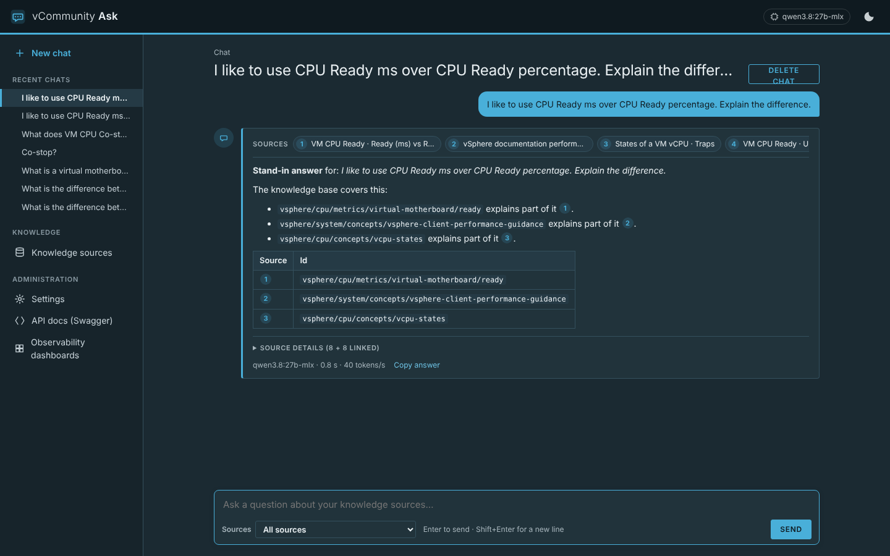

> Status: v0.1.0 (phase 1). Tested end to end against the [isvara-2](https://github.com/e1-rahabok/isvara-2) knowledge base (198 files, 1,095 chunks) with a stand-in for Ollama (`ask/scripts/fake_ollama.py`); the screenshots show that stand-in's answers. Answers from a real model on your Mac have not been tested here.

### How it works

The model is **not trained or fine-tuned**. It uses retrieval-augmented generation (RAG):

```
 GitHub repo / local folder ──▶ source plug-in (.py or .ps1) ──JSON documents──▶
 ┌──────────────────────────── vco-ask container ─────────────────────────────┐
 │ Indexer: split by "## " heading ─▶ Ollama /api/embed (nomic-embed-text)    │
 │          ─▶ data/ask.db: FTS5 keyword index + sqlite-vec vector index      │
 │ Chat:    question ─▶ hybrid search ─▶ follow links ─▶ numbered sources     │
 │          ─▶ Ollama /api/chat (streamed) ─▶ answer with [n] citations       │
 │ FastAPI: /chat  /sources  /settings  /doc  /api/*  /docs                   │
 └────────────────────────────────────────────────────────────────────────────┘
                     │ http://host.docker.internal:11434
              Ollama on the Mac (uses the GPU there)
```

1. **Sync.** A source plug-in clones or pulls the repository and prints its markdown files as JSON. Only files whose content changed since the last sync are re-embedded.
2. **Index.** Each file is split at `## ` headings; sections over 3,500 characters are split again (blank lines, line breaks, sentences, then a hard cut with overlap), so no chunk is larger than that. Each chunk is embedded together with the file title and id, so a chunk makes sense on its own. Everything lives in one SQLite file, `data/ask.db`: documents, chunks, the FTS5 keyword index, the sqlite-vec vector index, chats and settings.
3. **Retrieve.** A question is embedded and searched two ways, by meaning (sqlite-vec, cosine) and by keyword (FTS5, BM25). The two rankings are merged with reciprocal rank fusion, with at most two chunks per file.
4. **Follow links.** Files that the matches link to in their metadata are added: `same_name` first (it stops the model mixing the VM and ESXi meaning of the same metric label), then `internal_derive`, `same_meaning` and `related`. They show as **Linked files** under the answer.
5. **Answer.** The numbered sources, the last few turns of the chat and the question go to the Ollama chat model with the system prompt (answer only from the sources, cite them as `[n]`, say when the sources don't cover it, flag `status: draft` content, follow diagnosis steps in order). The answer streams back word by word.

The sections [The Ask database](#the-ask-database-askdb), [From prompt to answer](#from-prompt-to-answer), [How Ollama and the chat model are used](#how-ollama-and-the-chat-model-are-used) and [Tuning the answers](#tuning-the-answers) below go into each step in detail.

### Start it on Rancher Desktop

Ollama stays on the Mac, not in a container: Docker on macOS has no GPU passthrough, so Ollama inside a container would run on CPU only.

1. **Let containers reach Ollama** (once). Rancher Desktop runs containers in a VM, so Ollama must listen on all addresses, not only `127.0.0.1`:
   ```bash
   launchctl setenv OLLAMA_HOST 0.0.0.0     # then quit and reopen Ollama
   lsof -nP -iTCP:11434 -sTCP:LISTEN        # should show *:11434
   ```
   `launchctl setenv` is lost at reboot. To keep it, add a LaunchAgent (`~/Library/LaunchAgents/setenv.OLLAMA_HOST.plist` running `launchctl setenv OLLAMA_HOST 0.0.0.0` at load) or run the command again after a restart. Ollama now accepts connections from your network without a password, so keep the macOS firewall on when you are away from home.
2. **Pull the models** (once): `ollama pull nomic-embed-text` for search; the default chat model is `qwen3.8:27b-mlx` (any installed chat model can be picked on the Settings page). The `-mlx` tags are for Apple Silicon; on another machine pull a model that fits its memory, such as `qwen3:8b`, and set `ASK_CHAT_MODEL`.
3. **Check that a container can reach Ollama:**
   ```bash
   docker run --rm curlimages/curl -s http://host.docker.internal:11434/api/tags   # lists your models
   ```
4. **Set a token and start it:**
   ```bash
   # in .env (see .env.example):  ASK_API_TOKEN=<long random string>
   docker context use rancher-desktop            # container engine: dockerd (moby)
   docker compose up -d --build vco-ask          # or "docker compose up -d --build" for both containers
   ```
5. Open http://localhost:8081. On first start the `isvara` source (from `ask.example.yaml`) syncs by itself after about 5 seconds: watch it on **Knowledge sources**. Indexing ~200 files with `nomic-embed-text` takes a few minutes. This first sync clones from GitHub, so it needs internet. To skip it, turn the source's switch off (deleting it is not enough: sources from `ask.yaml` are added back on the next start unless you mount your own `ask.yaml` without them).

On **Windows or Linux**, the Ollama steps differ: see [Getting started, step 4](#4-set-up-ollama-for-ask).

With the `containerd` engine use `nerdctl compose up -d --build vco-ask` and set `ASK_OLLAMA_URL=http://host.lima.internal:11434` in `.env`.

Run it without Docker (from the `ask/` folder, Python 3.11+, git on the PATH):

```bash
cd ask && python3 -m venv .venv && source .venv/bin/activate
pip install -r requirements.txt
ASK_OLLAMA_URL=http://127.0.0.1:11434 uvicorn app.main:create_app --factory --port 8081
```

### Using the chat UI

- **No sources (just the model)** is a button at the top of the Sources list. Use it to work with text you paste: rephrase, fix grammar and spelling, shorten, change the tone, summarize or translate. Nothing is searched (no sources, no citations); the model gets your message, the recent turns of the chat and the **System prompt without sources** from the Settings page, which tells it to keep your meaning and voice and to give the edited text first, then a short list of changes. It still runs on your local Ollama, so the text stays on your machine. Ticking a source unticks it (and the other way round); web search and MCP tools can be ticked with it. The REST API takes `"sources": ["none"]`.
- **A picked source that is gone.** When every source a chat or scheduled prompt picked by name no longer exists (deleted or renamed), the question is answered as **No sources (just the model)**, not with **All sources**. If some of the picked sources still exist, only those are searched.
- **Switch the chat model under the prompt.** The model button at the left under the question box (for example `qwen3.8:27b-mlx`) is a menu: click it to list the chat models installed in Ollama, with their size and a **no tools** tag for models that can't call tools (web search and MCP tools need them). Picking one saves the **Chat model** setting, the same one as on the Settings page, and it is used from the next question. When `ASK_API_TOKEN` is set, enter the token once on the Settings page first; the menu uses it from this browser.
- **New chat** shows example questions (set per source) and how much is indexed. Type a question; **Enter** sends, **Shift+Enter** adds a line. In a chat, **Up arrow** in the empty box puts your last question back in it to change and send again; press it again for earlier questions and **Down arrow** to come forward (past the newest gives back what you had typed). Once you type in it, the arrows move the cursor as usual. The **Sources** list under the question box shows every source as a button, one row per type (blogs and web sites, markdown repositories, PDF documents, API specs, spreadsheets, web, MCP tools). Click buttons to pick one or more (a picked one turns blue with a check mark), or use **only these** on a row (for example only the blog sites). **All sources** clears the picks, which searches every enabled source except spreadsheets (a source switched off on Knowledge sources is left out until you pick it by name); the line at the top says what is picked. **Hide list** folds the rows to that one line (remembered in this browser; folded by default on a phone). A mouse click or tap in the question box also folds the list, so it gets out of the way while you type; **Show list** opens it again. A chat keeps the sources it started with, and a new chat starts with your last selection (remembered in this browser). **Stop** ends an answer early (what was written so far is kept).
- Each answer starts with a compact **Sources** strip: one numbered pill per matching section (title · heading), plus a **+N linked** pill for files added by link expansion. It stays small while the answer streams, so the answer is what you read.
- Numbered **citation chips** `[n]` in the answer, and the pills in the strip, open **Source details** and jump to the matching card. **Source details** (folded by default) holds the full cards: title, section, file id, `draft`/`reviewed` badge, a snippet, linked diagrams, **Open** (the full file in the app, with its images and metadata) and **View on GitHub**, then a **Linked files** group showing what link expansion added and why.
- While an answer streams the page follows it to the bottom. Scroll up to read something and it stops following, and a **Jump to latest** button appears above the question box; click it, or scroll back to the bottom, and it follows again. The answer is redrawn at most 10 times a second while it streams. Only its last, still growing block (paragraph, list, table or code block) is parsed again on each redraw; finished blocks are parsed once and kept, and the whole answer is parsed one more time when it is done. A list with blank lines between its items can show in two parts while it streams and joins up at the end.
- **Screen readers** hear the answer once, when it is finished: the answer being written is the live region (marked busy while it streams), not the whole chat.
- **Opening a long saved chat** is quick: the server sends every question and answer as plain text, so the chat shows at once, before any script runs. The newest three questions and answers are then drawn with markdown, source cards and stats right away, and older ones only when you scroll near them.
- **Save prompt** (with a bookmark mark) is always shown under each of your questions; it used to appear only when the mouse was over the question.
- **Sources list folded on short screens:** on a phone or a screen less than 820 px tall (most laptops), the Sources list under the question box starts folded to its one-line summary, so the answer has room. **Show list** opens it; your own Hide / Show choice is remembered and wins.
- Every code block in an answer has a **Copy** button at its top right (it also works on a plain `http://` address, where the browser's clipboard API is not allowed).
- The footer shows the model, the time and tokens per second, and **Copy answer**. With **Show model thinking** on (Settings), thinking models show their reasoning above the answer.
- Chats are saved: **Recent chats** in the sidebar reopens them, **Delete chat** removes the open one. To remove several, press **Select** next to **Recent chats**: each chat gets a check box (click a chat to tick it, Shift+click ticks a range, **All** ticks every listed chat), then **Delete (n)** removes them after one confirmation. **Cancel** or **Esc** leaves select mode. Follow-up questions see the last turns (Settings → Chat history).
- **More room:** the menu button at the top left hides the whole sidebar so chats, reports and dashboards use the full width; click it again to bring the sidebar back. Click a sidebar heading (**Recent chats**, **Knowledge**, **Administration**) to fold just that section. Both choices are remembered in the browser.
- **Web search (Ollama)** and **Web search (Brave)** in the Sources list (group **Web**) let the model search the web when the knowledge sources don't answer. **Web fetch (Ollama)** lets it read only the pages the question names (no searching). See [Web search (Ollama)](#web-search-ollama) and [Web search (Brave)](#web-search-brave).
- **Tools: &lt;server&gt;** in the Sources list (group **Tools (MCP)**) lets the model call the tools of your MCP servers; tool calls show in a **Tool calls** box, and tools that change things ask **Run** or **Cancel** first. See [MCP tools](#mcp-tools-your-own-mcp-servers).
- **Reports** in the sidebar lists the HTML reports and dashboards Ask has made (see [HTML reports and dashboards](#html-reports-and-dashboards)).
- **About** in the sidebar shows Ask's version, chat and embedding models, sources, documents, chunks and chats, then the full project README (the same page as the dashboards' [About](#about)).

### Knowledge sources page

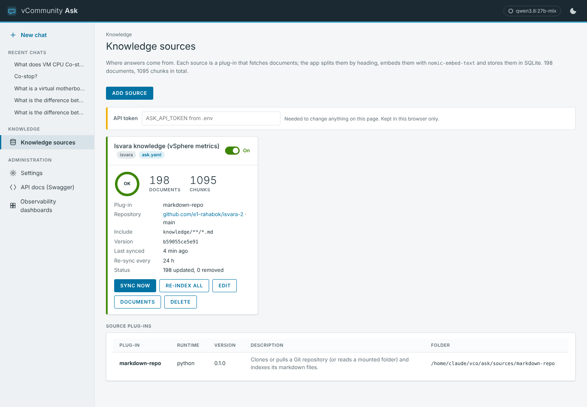

One card per source with a status ring (green OK, blue syncing, red error, amber new), document and chunk counts, repository and branch (or site and date range), the commit it indexed (or page count and newest post), last sync, re-sync interval and progress while it runs.

- **Sync now** pulls and re-embeds what changed. **Re-index all** re-embeds every file. **Documents** lists every indexed file (with a filter), and each opens in the document view. **Edit** changes options. **Delete** removes the source and its index (not the repository itself). A source that a [scheduled prompt](#scheduled-prompts) picks by name can't be deleted: the card names those prompts with a link to each, **Delete** says so, and `POST /ui/sources/{name}/delete` answers 409. Change the prompts to another source first (prompts on **All sources** don't count). The switch turns a source off without deleting it.
- **Add source** opens a form built from the chosen plug-in's options. For **Markdown repository**: repository URL and branch (or a local folder), include and exclude globs, metadata format, link base and a token env var for private repositories. For **Web site (blog crawler)**: site URL, where to find pages, URL include/exclude globs, **Published from / Published to** dates or **last N days**, what to do with undated pages, max pages and delay. Every source also has a name, title, re-sync interval (****Re-sync**, see below) and up to six example questions.
- Sources are re-synced automatically when their interval has passed (checked every 10 minutes); the plug-in reports "no changes" cheaply when the commit hasn't moved. Set **Re-sync every (hours)** to `0` to never re-sync on a schedule: the card shows "never (Sync now only)", the source keeps its index, and it changes only when you press **Sync now** or **Re-index all**. A new source still gets its first sync. The smallest other value is 0.25 (15 minutes).
- **Re-sync at a set day and time.** Instead of **Every N hours**, **Re-sync** can be **Daily**, **Weekdays (Mon–Fri)**, **Weekly** (pick the day) or **Monthly** (day 1–28 or **last**), at a time in a time zone, the same choices as [scheduled prompts](#scheduled-prompts). The card shows it with the next run, for example *Every Sunday at 05:30 America/New_York · next 2026-11-15 05:30 EST*. A sync that is already running is not started twice, a run missed while the container was down is made up within an hour, and nothing runs while Ask is paused or the source is off. A new source still gets its first sync right away. Saved in `ask.db` (`sources.sync_schedule`); `GET /api/sources` returns `sync_schedule` and a `resync` text, and `POST /ui/sources/save` takes `"sync_schedule": {"frequency": "weekly", "weekday": "sun", "at_time": "05:30", "timezone": "America/New_York"}` (`"interval"` = every `interval_hours`).
- Sources from `ask.yaml` are seeded into the database on first start (badge **ask.yaml**); after that the page owns them.

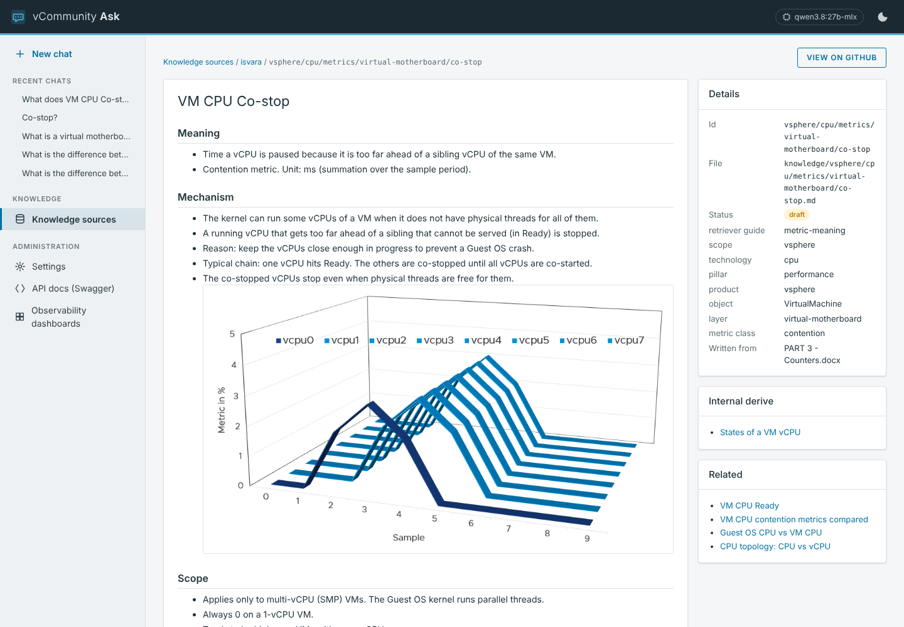

### Settings page

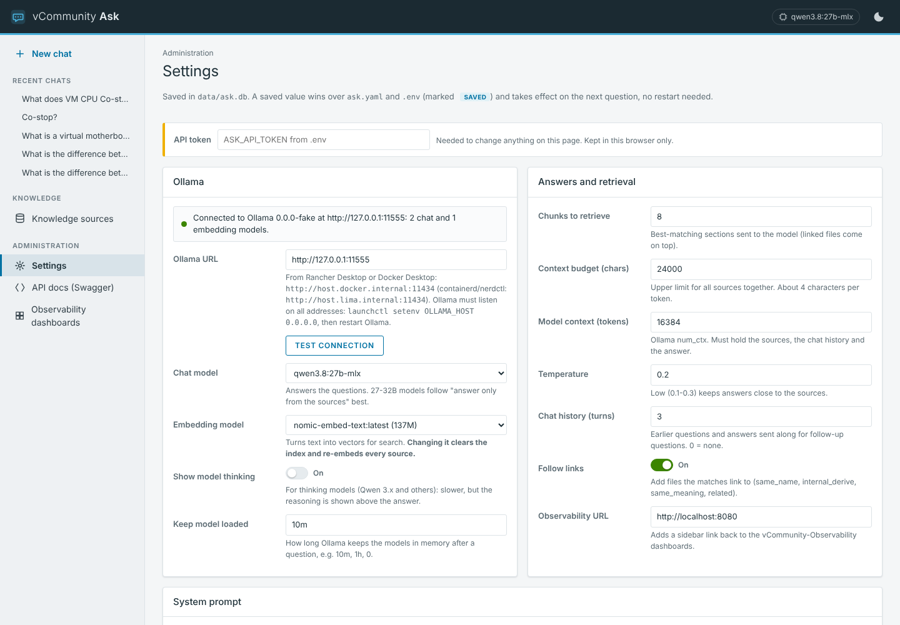

**Apps on / off** (top card): the same two sliders as on the dashboards' Settings page (see [Settings](#settings)), saved as soon as you flip one (needs the Ask API token when `ASK_API_TOKEN` is set). With **vCommunity Ask** off, the chat answers "vCommunity Ask is paused" and sources don't sync; with **vCommunity Observability** off, the **Observability** button of the app switcher (top right) is hidden.

| Setting | Default | Notes |
| --- | --- | --- |
| Ollama | on | **Use Ollama models.** Off: Ollama is not asked for anything, its models are not listed, and a saved or scheduled prompt that names an Ollama model fails with *Ollama is turned off in Settings*. See [LM Studio](#lm-studio) |
| Ollama URL | `http://host.docker.internal:11434` | Shown while Ollama is on. **Test connection** shows the Ollama version and fills the model lists |
| LM Studio | off | **Use LM Studio models.** See [LM Studio](#lm-studio). Ollama and LM Studio can't both be off, and the chat and embedding models must belong to a provider that is on (the save says which one to change) |
| LM Studio URL | `http://127.0.0.1:1234` | Shown while LM Studio is on. The address LM Studio's Developer tab shows; inside the container `127.0.0.1` / `localhost` are sent to `host.docker.internal`. **Test connection** checks it and adds its models to the lists |
| Chat model | `qwen3.8:27b-mlx` | Chat models of the providers that are on, in an **Ollama** and an **LM Studio** group. LM Studio models are saved as `lmstudio:<model id>` |
| Embedding model | `nomic-embed-text` | Embedding models of the providers that are on. **Changing it clears the index and re-embeds every source** (vectors from two models can't be compared), also when you move from Ollama's to LM Studio's copy of the same model |
| Show model thinking | off | Sends `think: true` to Ollama. LM Studio has no such switch: its reasoning (the `reasoning_content` field or a `<think>` block) is shown when this is on and dropped when it is off |
| Keep model loaded | `10m` | Ollama `keep_alive`; LM Studio gets it as the request's idle `ttl` in seconds (`0` leaves LM Studio's own setting) |
| Chunks to retrieve | 8 | How many matching sections are picked; linked files are added on top. See [Chunks, context budget and model context](#chunks-context-budget-and-model-context) |
| Sections per source | 2 | With several sources picked, each source that matches the question gets at least this many of the chunks, so one big source can't take them all. 0 = off. See [Several sources picked](#several-sources-picked-balanced-retrieval) |
| Context budget (chars) | 24000 | How much source text (in characters) is sent with a question, for all sources together |
| Model context (tokens) | 16384 | Ollama `num_ctx`: the model's working memory for one answer; must hold the sources, system prompt, history, thinking and answer. Not used for LM Studio models: set **Context Length** in LM Studio when the model loads |
| Temperature | 0.2 | Low keeps answers close to the sources |
| Chat history (turns) | 3 | 0 = every question stands alone |
| Example questions on New chat | 6, from the sources | The question boxes on an empty **New chat**: **How many show** (0 to 24; 0 hides them, `ASK_CHAT_EXAMPLES`) and **Questions**, your own list, one per line, in that order (at most 50). Empty uses the example questions of the enabled knowledge sources; **Start from the sources' questions** copies those into the box to edit. Clicking a box asks it with the sources picked under the chat box |
| Recent chats shown | 10 | How many chats the sidebar lists under **Recent chats**, newest first (1 to 200, `ASK_RECENT_CHATS`). Older chats are kept, just not listed |
| Follow links | on | Link expansion (step 4 above) |
| Data questions | on | Counting and totals questions about spreadsheet sources are answered with a read-only SQL query (see [Spreadsheets and data questions](#spreadsheets-and-data-questions)) |
| Whole-source questions | on | "How many posts…", "summarize this blog", "what does it write about most" are answered from a catalog of every post in the selected sources (see [Whole-source questions](#whole-source-questions)) |
| Host agent URL | `http://host.docker.internal:9101` | The Ask host agent for the [Performance page](#performance-page-and-host-agent); empty turns it off (`ASK_AGENT_URL`) |
| Ask address | `http://localhost:8081` | The address used for links in [scheduled prompt](#scheduled-prompts) emails (`ASK_PUBLIC_URL`). `localhost` is replaced by the Mac's current IP from the host agent; a name you set is used as it is |
| Observability URL | `http://localhost:8080` | Sidebar link back to the dashboards. A `localhost` address follows the host you opened Ask with, so it works from another computer too |
| Send activity to the log server | on | Prompts, thinking, tool calls and answers go to the Logs module as syslog (`ASK_ACTIVITY_LOG`). See [Ask activity log](#ask-activity-log) |
| Log server | `tcp://vco:5514` | Where the activity goes: `tcp://` or `udp://` host and port (`ASK_ACTIVITY_LOG_URL`). **Send a test message** tries the address in the box |
| Include the model's thinking | on | The thinking, sent when the answer ends, in parts of about 6,000 characters |
| Include the answer text | on | Off sends only the answer's length, time and token counts |
| System prompt | built in | Editable; **Reset to the default** restores it |

Saved values live in `data/ask.db` and win over `ask.yaml` and environment variables; they apply on the next question. Saving needs the API token when `ASK_API_TOKEN` is set (enter it in the bar at the top; it is kept in that browser only). Both apps have an **app switcher** at the top right, next to the light/dark button: **Observability | Ask**, with the app you are in highlighted and the other one a link (only icons on a phone). The dashboards' Ask button uses `VCO_ASK_URL` (default `http://localhost:8081`, empty hides the switcher); Ask's Observability button uses **Observability URL**.

### Answer quality test

Use it to check whether a change (new code, another chat model, different **Chunks to retrieve**, **Sections per source**, context budget and so on) gives better or faster answers. The **Answer quality test** card on the Settings page replays your most recent saved questions with the current code and settings, and compares the new answers with the saved ones.

1. On **Settings**, set **Questions** (1 to 50, default 10), pick a model in **Answer with** (default: your Chat model), leave **Judge with** on and pick the judging model (default: the answering model), then press **Run test**. The test page opens and fills in as each question finishes. **Stop** ends it early and keeps what was measured.
2. **What is replayed.** The newest distinct questions from your chats that were answered from knowledge sources. Data/spreadsheet answers, whole-source overviews, MCP and web tool answers, **No sources** answers, and answers that failed are skipped. Each question is asked again with the same Sources pick and the same earlier turns of its chat. One question runs at a time, using Ollama like a normal answer. **Nothing is added to your chats or to the activity log.**
3. **What is compared** for each question, saved answer → now:
   - **Speed:** seconds per answer, time to the first words, tokens per second, prompt tokens, and retrieval ms. Answers saved before 2026-11-13 have no retrieval ms.
   - **Sources:** documents in common (overlap), documents newly used or no longer used, and sections reserved by balanced retrieval.
   - **"Not found" answers:** answers that say the sources don't cover the question. "Now found" and "now not found" tags mark the changes.
   - **Judge (optional):** the chat model reads the question, the replay's source sections and both answers, then says which is better, with a 1–5 score for each and one sentence why. The two answers are shown in random order, so a habit of preferring the first one can't decide. It doubles the run time. The judge is the same local model, so treat its verdicts as a hint and read the answers, which are side by side under each question.
4. **Before and after.** The page also compares the run with another test run: the previous one by default, or any run picked under **Compare with**. The settings that changed are highlighted, and each question that is in both runs shows the other run's time, judge score and answer. That is the fairest comparison, because saved answers may come from older settings or another model. A good routine is to run the test, make one change, and run it again.
5. **Comparing chat models.** Pick each model in **Answer with** in turn (your saved Chat model is not changed) and keep **Judge with** on the same model for every run, ideally your strongest one, so the judge scores are on the same scale. A model judging its own answers tends to be generous, and two different judges score differently. The page warns when the two compared runs had different judges. Then open the newest run and pick the other model's run under **Compare with**. Seconds, tokens/s, prompt tokens and "not found" counts are fair to compare whatever the judge. The runs table on the Settings card lists each run's model, judge, median seconds, tokens/s and judge score. Embedding models can't be compared this way: changing one clears the index and re-embeds every source.

Runs are kept in `ask.db` (tables `eval_runs`, `eval_items`). The card lists the last five, and **Delete run** removes one. Starting a run needs the API token when `ASK_API_TOKEN` is set. The same works from the API: `POST /api/eval/runs` with `{"count": 10, "judge": true, "model": "gemma3:27b", "judge_model": "qwen3.8:27b-mlx"}` (model and judge_model are optional), then `GET /api/eval/runs/{id}?vs={other id}`.

Code: `ask/app/evalrun.py`, `ask/app/templates/eval.html`. Tests: `ask/tests/test_eval.py`.

### Scheduled prompts

A prompt Ask answers on a schedule and emails to you, posts to your chat webhook (Discord, Slack ...), or both, for example "Summarize the posts published in the last 7 days, with each post's date and full URL" every Monday at 07:00. Open **Scheduled prompts** in the sidebar (under Knowledge) and press **New scheduled prompt**:

| Field | What it does |
| --- | --- |
| Name | Shown in the list and used as the email subject: `[Ask] Weekly blog: 2026-11-16` |
| Sources | The same grouped buttons as the chat: **All sources** (every source except spreadsheets), **No sources (just the model)**, or any mix of sources, MCP tools and web search |
| Prompt | Written exactly as you would type it in the chat. Words like *report* or *dashboard* make an HTML report when a spreadsheet source is picked |
| Model | Empty uses the **Chat model** from Settings. Another model can be picked for this prompt only (web search and MCP tools need one that can call tools) |
| Schedule | **Every day**, **Weekdays (Mon–Fri)**, **Every week** (day), **Every month** (day 1–28 or **last**) or **Every N hours**, at a time, in a time zone (default `America/New_York`, or `ASK_SCHEDULE_TZ`) |
| Send to | **Email** (on by default), **Webhook** (off by default), or both. Webhook posts the answer to a webhook set on **Log alerts → Notifications** in vCommunity Observability: pick **Default** or one of the **Named webhooks** (for example *daily*); **Send a test to the webhook** checks it right away. The list shows Send to as icons (envelope, webhook) |
| Email to | Shown with Email on. One or more addresses, separated by commas (at most 20). **Send a test email** checks the mail path right away |
| Sync the picked sources first | Starts a sync of each picked source and waits for it (up to 30 minutes) before asking |
| Attach the HTML report | When the answer made a report or dashboard, the `.html` file is attached (up to 12 MB) |
| Show the prompt in the message | On by default. Off leaves the prompt out of the email's header and the webhook message (a failure still shows it) |
| List the sources in the message | On by default. Off leaves out the Sources list and the `[1]` citation marks in the answer, for example for an X posts digest where the answer already has the links |
| Send only when the answer changed | Skips the email and webhook when the answer is the same as the last run's (ignoring citation numbers, case and spacing). The run shows **no change** |
| Show the latest answer on the Apple HomeView | Off by default. On adds this prompt's newest answer to the **Ask** page of the [Apple HomeView](#apple-homeview) wall display |
| On | Off keeps the prompt but stops its schedule; **Run now** still works |

**Schedule this.** Each saved prompt has a **Schedule** link (Saved prompts page) that opens a new scheduled prompt filled with its name, prompt (with its pages), sources and model (`/schedules?saved=<id>`). A `{variable}` uses its default; one without a default stays as written, so give it a default first.

**What a run does.** It asks the question exactly like the chat (same retrieval, tools and system prompt) and saves it as a new chat called *Scheduled: name · date*, so the answer is in **Recent chats** and you can ask follow-up questions there. Then it emails:

- the answer, turned from Markdown into HTML (tables, lists and links; raw HTML from the model is shown as text, never run), plus a plain-text copy for mail apps that don't show HTML,
- the sources, each with its web URL, or a link to the document in Ask,
- an **Open in Ask** button for the chat and a link to change or stop the schedule,
- the report as an attachment when there is one.

**The webhook message** is Markdown: the name, time, model and seconds in bold, the prompt as a quote, the answer, up to 10 sources with their URLs and **Open in Ask**. Discord webhook URLs get Discord embeds (blue, red when the run failed, the title links to the chat in Ask): a long answer is split at paragraph breaks into up to 5 embeds of 4,000 characters, and anything beyond that is cut (the full answer is in Ask). Other URLs (Slack, Mattermost, Rocket.Chat, your own script) get one JSON `{"text": ..., "title": ...}`. The HTML report is not attached to the webhook. Ask never stores the webhook URL: it posts through the Logs module's `POST /api/logs/notify/webhook` on vco, with the same token as email.

When the answer fails (for example Ollama can't be reached), an email saying so is sent instead (subject ends in *failed*). With MCP tools or web search picked, the email holds only the model's final answer, written after its tool calls, not the "Let me check ..." lines in between (those stay in the saved chat). The sources list names each tool call and says which ones failed. If a model never writes an answer, the email shows what it said and a note to raise **Tool turns per answer** or make the prompt more specific.

**Don't repeat recent answers** (off by default) is for prompts that should give something new each time, such as a daily inspirational quote from a web search. Each run adds the answers of that schedule's last 30 runs under the prompt (newest first, each cut to 600 characters) and tells the model not to repeat any of them. The model never sees earlier runs otherwise, because each run is a fresh chat. The added text is saved in the run's chat, so you can see what was sent. Runs whose chat you deleted are left out. Leave it off for reports and status checks, where the same answer is fine.

**The list** shows each prompt's schedule and next run, the last run (**sent**, **no change**, **failed** or **not sent** when the email or webhook failed, with the reason), **Run now**, the on/off switch, **Edit**, **History** (the newest 25 runs; 100 are kept with time, how it started, result, seconds, who got the email and a link to the answer) and **Delete** (the chats it made are kept). A run that is already going is not started twice. While Ask is paused (Apps on / off), scheduled runs are skipped. A run missed because the container was down is made up when it starts again within an hour; older ones are skipped.

**How email is sent.** Ask has no mail settings of its own. It uses the mail server set up in vCommunity Observability under **Log alerts → Notifications** (host, port, security, user, password, from). Ask posts the message to the Logs module's `POST /api/logs/notify/email` on `vco` (inside the compose network, `ASK_VCO_INTERNAL_URL`, default `http://vco:8080`), with the dashboards API token: `ASK_VCO_TOKEN` if set, else `VCO_API_TOKEN_MPBUILDER`. Both containers read the same `.env`, so normally nothing needs setting. The SMTP password never leaves the vco container. Messages say what to fix when something is missing: no token, Logs module off, no mail server, or vco not reachable.

**Links in the email** use **Ask address** on the Settings page (default `http://localhost:8081`, `ASK_PUBLIC_URL`). While it says `localhost` (or `127.0.0.1`, `host.docker.internal`), each run asks the [host agent](#performance-page-and-host-agent) for the Mac's current IP address and uses that instead, keeping the port, for example `http://192.168.1.50:8081`. The address is read at every run, so the links follow a laptop to a new network. This needs host agent 0.2.1 or later (run the installer again to update it); without the agent the links say `localhost`. Set a name such as `http://dales-mac.local:8081` to always use that name.

Schedules are kept in `ask.db` (tables `schedules`, `schedule_runs`). They work from the API too, with the same fields as the form (`scope` is a source name, a comma-separated list, `all` or `none`):

```powershell
$h = @{ 'X-API-Key' = $env:ASK_API_TOKEN }
$body = @{ name = 'Weekly blog'; prompt = 'Summarize the posts published in the last 7 days with each full URL'
           scope = 'vcrocs'; frequency = 'weekly'; weekday = 'mon'; at_time = '07:00'
           timezone = 'America/New_York'; recipients = 'you@example.com' } | ConvertTo-Json
$s = Invoke-RestMethod -Method Post -Uri http://localhost:8081/api/schedules -Headers $h -ContentType 'application/json' -Body $body
Invoke-RestMethod -Method Post -Uri "http://localhost:8081/api/schedules/$($s.id)/run" -Headers $h
```

Code: `ask/app/schedules.py` (scheduling and sending, class `Notifier`), `ask/app/routes_schedules.py` (the web routes), `ask/app/templates/schedules.html`, `ask/app/static/schedules.js`; the email endpoint is in `modules/logs/web.py` and `modules/logs/notify.py`. Tests: `ask/tests/test_schedules.py` (no Ollama, no mail server) and the email part of `scripts/smoke_test.py`, which uses `scripts/fake_smtp.py` (a stand-in mail server that saves each message as a `.eml` file: `python scripts/fake_smtp.py 2525 ./fake-mail`).

### Saved prompts

A prompt that works, kept with its sources so you can ask it again with one click. For example, "List the newest fixes in these release notes" with **Web fetch (Ollama)** and the release notes URL: one cheap web fetch, no searching. Open **Saved prompts** in the sidebar (under Knowledge) and press **New saved prompt**, or press **Save prompt** under any question in a chat to start one from it with the sources picked now.

| Field | What it does |
| --- | --- |
| Name | Shown in the **Saved** menu and as the new chat's title. Empty uses the start of the prompt |
| Sources | The same grouped buttons as the chat: knowledge sources, **Web fetch (Ollama)**, **Web fetch (local)**, **Web search (Ollama)**, **Web search (Brave)**, MCP tools, **No sources** or **All sources**. Each saved prompt keeps its own pick |
| Pages to fetch | Optional, one full URL per line (at most 10). They are added under the prompt as *Read these pages with web_fetch: - url*. Needs **Web fetch (Ollama)**, **Web fetch (local)** or **Web search (Ollama)** picked. Each page is one Ollama web fetch call (free with Web fetch (local)) |
| Prompt | Written exactly as you would type it in the chat. A value that changes can be a variable: `{city}`, or `{city=Dillsburg}` with a default (letters, digits and `_`, at most 8 per prompt). Variables work in the pages too, for example `https://example.com/weather/{city}` (the value is URL-encoded there) |
| Model | Empty uses the chat model in use. Another model is used for that chat only; the **Chat model** setting is not changed |
| Tags | Optional words such as *sports, weather, news* (commas between, at most 10; stored in lower case). Used to filter the list and the Saved menu |

**Finding one.** **Saved prompts** is the first link in the sidebar, above **New chat**. The page and the **Saved** menu both have a search box (it matches the name, prompt, pages, tags and sources; every word must match) and a row of tag buttons (**All**, then each tag in use). The picked tag is remembered in this browser and shared by the page and the menu. **Enter** in the search box runs the first match (in the menu, **Shift+Enter** opens it with **Edit first**).

**Running one.** The **Saved** button beside the model button under the chat box lists every saved prompt with its sources and tags. Click one to ask it in a new chat (an empty new chat runs it in place), with its sources ticked and its model used. **Edit first** puts the prompt in the box with its sources ticked so you can change it before sending. The Saved prompts page has the same as **Run** and **Edit before sending**, plus **Edit**, **Delete** and **Delete selected** (tick boxes, Shift-click for a range). The list shows how many times each was run and when last. The links `/chat?saved=<id>` and `/chat?saved=<id>&edit=1` do the same, so a saved prompt can be bookmarked.

**Pinned and most used first.** The ☆ star beside a saved prompt (on the page and in the **Saved** menu) pins it to the top; ★ unpins. The rest are listed most used first, then by name.

**Variables.** Running a prompt with `{variables}` first opens a small form with one box per variable, filled with the last values used for that prompt in this browser, else the defaults. A variable without a default must be filled. The list shows *Asks for: city*.

**Unavailable sources** are flagged before you run: the list and the Saved menu say *Not available now: Web search (Brave)* and whether Run leaves it out or answers with No sources.

**Export and import.** **Export** downloads every saved prompt as `saved-prompts-<date>.json` (name, prompt, pages, sources, model, tags, pinned). **Import** adds the prompts from such a file, here or in another Ask; a prompt with the same name is replaced, and the page says how many were added, replaced or skipped (with the reason). REST API: `GET /api/saved/export`, `POST /api/saved/import` (the same JSON, or `{"items": [...]}`).

Saved prompts are kept in `ask.db` (table `saved_prompts`). Saving and deleting need the API token when `ASK_API_TOKEN` is set; running does not. REST API: `GET/POST /api/saved`, `GET/PUT/DELETE /api/saved/{id}`, `PUT /api/saved/{id}/pin` (`{"on": true}`) and `POST /api/saved/{id}/run` (asks it in a new chat and returns the whole answer, like `POST /api/ask`; `{"values": {"city": "York"}}` fills its variables).

When a saved prompt's sources can't be used now (a source deleted or turned off, a web search without its key, the MCP server down), they are left out. When none is left, the prompt runs with **No sources (just the model)**, never All sources. The chat shows a *Not available now* note under Sources, and `POST /api/saved/{id}/run` adds `scope_used` and `unavailable` to its answer.

### Ask activity log

Ask tells the [Logs module](#logs-syslog-server) what it is being used for. Every question becomes a few syslog messages from source `vco-ask`, app **`vcommunity-ask`**, facility `local5`. The message ID says what each one is:

| Message ID | Severity | What is sent |
| --- | --- | --- |
| `prompt` | notice | The question as typed, with the chat ID, model, sources picked (or "no sources"), MCP tools and web search picked, whether it came from the chat page or the REST API, and whether thinking is on |
| `data` | info | For a data question or dashboard: the SQL the model wrote and how many rows it returned |
| `tool` | info (warning when refused or failed) | Each MCP or web search tool call: tool, server, arguments, status, time and result size |
| `thinking` | info | The model's thinking, when **Show model thinking** is on and the model supports it. Long thinking is cut into parts (`part="2/5"`) |
| `answer` | info | The answer text (or only its size when **Include the answer text** is off), with seconds, tokens and tokens per second |
| `error` | err | Why the answer failed |
| `stopped` | warning | The reader closed the page or pressed Stop before the answer finished; what was written so far |
| `test` | notice | **Send a test message** on the Settings page |

Details are in RFC 5424 structured data (`[ask@32473 chat="..." model="..." sources="..." part="1/3" seconds="..." tokens="..."]`), shown in a row's details on the Logs page. The chat ID is in the text too, so searching it finds every message of one chat. Useful searches: the **Ask prompts**, **Ask thinking** and **Ask tool calls** quick buttons, `app:vcommunity-ask sev:warning` (refused tools, failures and stops), or an alert rule on `app:vcommunity-ask msgid:error`.

How it is sent: TCP to `vco:5514` (the vco container on the compose network) with octet counting, so a message can hold many lines. A background thread sends the messages, so the activity log never slows or breaks an answer. When the log server can't be reached (for example vCommunity Observability is paused or the Logs module is off), messages are dropped for 10 seconds at a time and the Settings page shows how many were sent and dropped and the last problem. Any other syslog server works too (`udp://...` or `tcp://...`). Turn it off on the Settings page or with `ASK_ACTIVITY_LOG=0`.

Privacy: prompts, answers and thinking can contain whatever users paste into the chat. They are kept in `data/syslog.db` for the Logs retention (5 days by default) and are visible to anyone who can open the Logs page. Turn off **Include the model's thinking** or **Include the answer text** if that is too much.

### The Ask database (`ask.db`)

Ask keeps everything in one SQLite file, `data/ask.db` (the `./ask-data` volume). It is both the document store and the search engine, so no separate vector database is needed and nothing has to be downloaded at run time.

| Table | Contents |
| --- | --- |
| `settings` | Values saved on the Settings page (Ollama URL, models, top_k and the rest). They win over `ask.yaml` and environment variables |
| `sources` | Each knowledge source: plug-in, title, options, re-sync interval, example questions, on/off switch, and whether it came from `ask.yaml` or the UI |
| `source_state` | Per source: status, progress, last start/end/success, last error and the version indexed (commit or page count) |
| `documents` | One row per markdown file or web page: title, path, URL, `status` (draft/reviewed), metadata, links to other documents, images, full text and a content hash |
| `chunks` | Each document split into sections. These are what get searched |
| `chunks_fts` | SQLite FTS5 full-text index over the chunks (`porter unicode61` tokenizer, so "datastores" also matches "datastore"); ranked with BM25 |
| `chunks_vec` | sqlite-vec `vec0` table with one embedding per chunk, compared by cosine distance. Its size is set by the embedding model |
| `chats`, `messages` | Chat history. An answer is saved with its source cards, the model used, timing stats and (with thinking on) the model's reasoning |
| `eval_runs`, `eval_items` | [Answer quality test](#answer-quality-test) runs: the settings used, a summary, and per question the saved and replayed answers, their stats, documents used and the judge's verdict |

**Indexing.** The source plug-in clones the repository or crawls the site and returns documents as JSON. Each document's content hash is compared with the stored one, so unchanged files are skipped. A changed file is split at `## ` headings (long sections are split again on blank lines), each chunk is embedded through Ollama `/api/embed` with the file title and id in front of it, and both indexes are updated. Deleting a source removes its documents, chunks and index entries.

- The database runs in WAL mode, so a sync can write while you keep chatting. It uses `synchronous=NORMAL` (no fsync on every commit), which is durable enough for an index that can be rebuilt.
- **One connection per thread.** Each thread keeps its own connection, with sqlite-vec loaded once and a 64 MB page cache (`ASK_SQLITE_CACHE_MB`). So the global search, the per-source searches, the keyword checks and the chunk load of one question all run on one warm connection. The vector size is remembered, so a search doesn't read the schema first. `ASK_SQLITE_MMAP_MB` turns on memory-mapped reads (off by default). Try it on a Linux volume, but measure it on Docker Desktop for Mac, where the data volume is often a slower file share.
- **Source partition key.** `chunks_vec` stores each chunk's source as a sqlite-vec partition key (`vec0(source text partition key, embedding float[N] ...)`). A search of one source scans only that source's vectors, with the same exact KNN. Several sources are searched one by one and merged, because `source IN (...)` returns the sources one after another rather than as one ranking. On an index shaped like a real one (28,299 chunks, 768 dimensions, 14 sources), retrieval for one source dropped from about 250 ms to 4 ms, and **All sources** with balancing dropped from about 2.1 s to 0.22 s, with identical results. An older index is migrated once on the first start after the update: its vectors are copied into the new table (about 2 seconds for 28,000 vectors, logged as `vector index: added the source partition key`), with no re-embedding.
- **Indexing in batches.** A sync saves embedded documents 25 at a time in one transaction, with `executemany` for the chunks. No transaction stays open while Ollama embeds, so chat writes never wait on a sync, and a failed sync still saves what it had embedded. The spreadsheet plug-in builds its `tables.db.part` with `synchronous=OFF`, because the file only replaces the live one after its commit.
- To back up Ask, copy `ask.db`. To start over, stop the container and delete it; the sources in `ask.yaml` are seeded again and re-indexed on the next start (chat history, saved settings and sources added in the UI are lost).
- Vectors from two embedding models can't be compared. Changing the embedding model on the Settings page clears the index and re-embeds every source.

### From prompt to answer

What happens between pressing **Send** and the finished answer:

```
 YOU (browser, ask.js)
   │  type a question, press Send
   ▼
 [1] POST /ui/chat  { question, chat_id, scope }        (REST clients: POST /api/ask)
   ▼
 [2] FastAPI (main.py) creates the chat if it is new, loads its history,
   │  and saves your question in ask.db (messages)
   ▼
 [3] EMBED THE QUESTION ──────────────▶ Ollama /api/embed (nomic-embed-text)
   │                    ◀──────────────  one vector
   ▼
 [4] SEARCH ask.db (two searches)
   │   a) sqlite-vec: chunks closest in MEANING to the vector
   │   b) FTS5/BM25:  chunks containing the KEYWORDS (stop words removed)
   ▼
 [5] MERGE with reciprocal rank fusion
   │   at most 2 chunks per document, keep the best top_k (default 8)
   ▼
 [6] FOLLOW LINKS (expand_links)
   │   add the first section of linked documents:
   │   same_name, internal_derive, same_meaning, related
   ▼
 [7] FIT TO context_chars (24000), number the sources [1] [2] ...
   │   browser gets a "meta" event: the source cards appear
   ▼
 [8] BUILD THE MESSAGES
   │   system prompt + last history_turns Q&A pairs + (numbered sources + question)
   ▼
 [9] GENERATE ────────────────────────▶ Ollama /api/chat (chat model, stream: true)
   │              ◀─────────────────────  "thinking" and "token" events
   ▼
 [10] Browser renders the markdown live (marked + DOMPurify, vendored);
   │   [n] citations open the matching source card
   ▼
 [11] Answer + source cards + model + stats saved to ask.db
      (also when you press Stop half way)
```

1. **Send.** The browser posts the question, the current chat id and the source scope (all sources or one) as a server-sent event (SSE) stream request.
2. **Save.** A new chat is created if needed. The earlier messages are loaded for history, then your question is stored.
3. **Embed.** The question goes to the Ollama embedding model (with the `search_query: ` prefix that nomic-embed-text expects) and comes back as a vector, a list of numbers that represents its meaning.
4. **Search.** The vector search finds sections that mean the same thing even in other words. The keyword search finds exact terms such as metric names or error codes. Each search returns up to `max(30, top_k × 4)` candidates.
5. **Merge.** Reciprocal rank fusion combines the two rankings. A chunk found by both searches rises to the top. At most two chunks come from one file, and the best `top_k` are kept.
6. **Follow links.** Documents the hits link to in their metadata are added, `same_name` first. This is what keeps, for example, the VM and ESXi meanings of the same metric label apart. These show as **Linked files**.
7. **Fit and number.** Direct hits go first, then linked files, until `context_chars` is used up. The sources are numbered and sent to the browser, which shows the **Sources** strip.
8. **Build the messages.** See the next section for exactly what the model receives.
9. **Generate.** Ollama streams the answer back in small pieces, and Ask passes each one to the browser as it arrives.
10. **Display.** The answer appears as formatted markdown with numbered citation chips.
11. **Save.** The answer, its sources, the model and the stats (tokens, tokens per second, seconds) are stored, so the chat is there when you come back.

Nothing leaves your network. The only calls out of the container go to your own Ollama: one embedding and one chat request per question.

### How Ollama and the chat model are used

Ollama runs two models with separate jobs:

| Model (default) | Job | When it runs |
| --- | --- | --- |
| `nomic-embed-text` (embedding model) | Turns text into vectors so search works by meaning | For every chunk during indexing, and once per question |
| `qwen3.8:27b-mlx` (chat model) | Reads the numbered sources and writes the answer | Once per question |

The chat model does not search and never sees the whole knowledge base or the internet, only the handful of sources picked for that question. That is why answers carry citations, and why "the sources don't cover this" is a valid answer.

Ask calls Ollama's native REST API with `requests` (no SDK), by default at `http://host.docker.internal:11434`, which is the Ollama on your Mac reached from inside Docker. The chat call is `POST /api/chat` with `stream: true`, and the messages are, in order:

1. The **system prompt**: answer only from the numbered sources, cite every fact as `[n]`, say so plainly when the sources don't cover the question, keep VM, host and cluster metrics apart, quote thresholds only when a source states them, flag `status: draft` sources, and follow diagnosis steps in order. It can be edited on the Settings page.
2. Up to `history_turns` earlier questions and answers from this chat, as plain text (their old sources are not resent).
3. One user message with the numbered sources, then the question. Each source header shows its number, document id, title and section, and the page's full `url` when the source has one (web-site pages always do). When any source has a url, a short note tells the model to copy links exactly as shown and never make one up, so "include the URL" prompts get the full address.

Ollama options sent with every question: `temperature`, `num_ctx`, `think` and `keep_alive`. `keep_alive` (default `10m`) keeps the model loaded after a question so follow-ups don't wait for a 27B model to load again.

**Swapping models.** The Settings page lists the models installed in Ollama (and in LM Studio when it is on), split into chat and embedding models. Any chat model (Llama, Gemma, a smaller Qwen) can be picked with no code change, or set `ASK_CHAT_MODEL` in `.env`. A new chat model applies on the next question. Only a new embedding model needs a re-index.

### Tuning the answers

#### Chunks, context budget and model context

These three settings decide how much of your knowledge base the model reads for each answer. They work as a chain, and each one caps the next.

**Chunks to retrieve (`top_k`).** When a source is indexed, every document is split into **chunks**: one per `## ` section, and a section longer than 3,500 characters is split into several chunks of at most 3,500 characters (at blank lines first, then line breaks, then sentence ends, and only as a last resort mid-text with a 200-character overlap). No text is dropped: every piece is indexed and keeps the post's title and section heading. A chunk is the unit that is searched and handed to the model. For each question Ask finds the best matching chunks (by meaning and by keyword, at most 2 from the same document) and keeps the best `top_k`. Files those chunks link to (**Follow links**) are added on top. More chunks means more material and more different posts, but also weaker matches further down the list. As a guide, a blog chunk is about 1,000 to 2,000 characters and an Isvara chunk about 450.

**Context budget (`context_chars`).** The most source text, in characters, sent with one question, for all chunks together (each chunk also carries a short header with its title, id and date). Chunks are added best first; one that would go over the budget is skipped and a smaller one may still fit. If the budget is full, raising **Chunks to retrieve** changes nothing, so raise both together. At the default of 24,000 characters, about 12 to 15 blog chunks fit.

**Model context (`num_ctx`, tokens).** The model's working memory for one answer, sent to Ollama as `num_ctx`. It has to hold everything at once: the system prompt, the chat history, the sources, the question, the model's thinking (when on) and the answer it writes. A token is about 3 to 4 characters of English, fewer for code, numbers and product names. If the total is larger, Ollama silently shortens the prompt, which can drop sources or the instructions, and answers get worse or stop early. A bigger context uses more memory on the Ollama machine and makes the first word appear later, since the model reads the whole prompt first.

Rule of thumb: **Model context (tokens) ≥ Context budget (characters) ÷ 3 + 8,000.** The 8,000 leaves room for the system prompt, a few turns of history and the answer; add more with **Show model thinking** on.

| Setting | Default | More data (recommended) | Most data |
| --- | --- | --- | --- |
| Chunks to retrieve | 8 | 16 | 24 |
| Context budget (chars) | 24000 | 48000 | 80000 |
| Model context (tokens) | 16384 | 32768 | 65536 |

- **Default** suits short look-up questions ("What is CPU Ready?") and smaller models.
- **More data** gives each answer about twice the material: better summaries and comparisons across several posts, and room for [whole-source questions](#whole-source-questions) to list about 900 post titles (all of a typical set of blogs). A good everyday setting for a 27B or larger model.
- **Most data** is for questions across many sources at once. Check that the chat model supports that context (Qwen 3.x does; Ollama shows a model's maximum with `ollama show <model>`), and expect slower answers and more memory use.
- More chunks don't help when the right post isn't found at all. Then rephrase with the words the post uses, pick the source in the **Sources** menu, or check the source's document count and **Date from** on Knowledge sources.
- **Whole-source questions** size their catalog from **Model context** (about 2.5 characters per token, never less than **Context budget**), so a larger model context lets more post titles and headings through.
- If answers become slow or are cut off, step back one column.

#### Several sources picked (balanced retrieval)

Without balancing, all picked sources share one ranked list, so a big source (a blog with hundreds of posts) can win every slot and a small one (a PDF, an API spec, a markdown repo) gets none even when it holds the answer. With **Sections per source** above 0 (default **2**) and two or more sources picked (or **All sources**):

1. **The shared search runs first, as before.** Only a source that the shared top **Chunks to retrieve** left with fewer than **Sections per source** sections is searched again on its own (vector and keyword). Sources that already have their share are not scanned again, so most questions add little work.
2. **A real match is required before a slot is reserved.** A section qualifies in one of two ways:
   - **By meaning:** its vector distance is within **0.10** of the best distance over all picked sources (`BALANCE_MARGIN` in `ask/app/rag.py`). Sections found only by keyword are checked this way too.
   - **By keywords, strictly:** it holds at least **half** of the question's search words, and never fewer than 2 (`BALANCE_TERM_SHARE`), *and* its BM25 score is at least **half** as strong as the best keyword hit overall that also passes the word rule (`BALANCE_BM25_RATIO`).

   A plain keyword OR hit is not relevance. One or two shared words, even rare ones (a party-planning page that says "host" and "value" for a CPU ready question), earn no slot. A source with nothing on the question (a cooking blog for a CPU question) gets no slot either. Those sections can still appear through the normal shared ranking, just without a reserved slot.
3. **Each source's pick follows the two-sections-per-document rule.** If a source's best sections all come from one document, its third reserved section comes from that source's next document, not from another source. If a reserved section is too big for the **Context budget**, the source's next matching section that fits takes its place, so the slot stays with that source.
4. **Sources are ranked by their own match quality** when there are more short sources than slots: a source with nothing in the shared top first, then the closest best section (vector distance), then the source's own search score. Each then gets up to **Sections per source** slots (fewer when there are many, at least 1, never more than **Chunks to retrieve** in all). The other slots go to the best sections overall.
5. Reserved sections are fitted into the **Context budget** first, and the model still gets the sections best first.

**Retrieval note.** When a slot was reserved, the line under the answer says so, for example `1 section reserved (smallpdf 1)`, and those source cards carry a **reserved** tag. The same note is saved with the message (`stats.retrieval`: `reserved`, `sources`, `searched`) and returned by `GET /api/search` as `retrieval`.

**All sources skips disabled sources.** A source switched off on the Knowledge sources page is left out of **All sources** (and so out of balancing). It can still be used by picking it by name.

**Tests.** `ask/tests/test_balanced.py` covers a dominant source, a keyword-only false hit, more sources than **Chunks to retrieve**, the per-document cap and refill, the budget refill, and a single source (no balancing). They need no Ollama. Run them (and `ask/tests/test_eval.py`) with `python -m unittest discover -s tests -v` from the `ask/` folder, or `docker compose exec vco-ask python -m unittest discover -s tests -v`.

Tips: picking only the sources that fit the question still helps most; check the source cards under an answer to see which sources were used; set it to **0** to go back to one shared ranking.

#### Temperature

Temperature controls how adventurous the model is when it picks each next word. These ranges are general guidance for LLMs, not measured on this app:

| Temperature | Effect |
| --- | --- |
| 0.0–0.2 (default 0.2) | Picks the most likely words. The same question gives nearly the same answer, close to the wording of the sources. Best for metric definitions, thresholds and procedures |
| 0.5–0.7 | More natural, varied wording and more examples. Mostly still grounded, but paraphrases more loosely and repeat questions give different answers |
| 0.8 and above | Much more creative, and riskier: it may blend in general training knowledge, mix up similar terms (such as the VM and ESXi versions of a metric), change exact names or numbers, or cite a source for a claim the source doesn't make |

Temperature has no effect on which sources are found, because retrieval happens before the model runs. It can't fix a "not found" answer. If answers miss information, raise `top_k` or `context_chars` instead. Keep 0.1–0.3 for technical questions; try 0.5–0.6 if answers feel stiff, for example for a blog-style summary.

#### Chat history (`history_turns`)

One turn is one question plus its answer. The default of 3 sends your last 3 questions and the last 3 answers (6 messages) with the new question.

- History is what makes follow-ups like "explain that more simply" or "give me a PowerShell example of that" work.
- **0** makes every question stand alone: the most predictable, and the least use of `num_ctx`.
- **Higher values** help long conversations, but old answers take room in `num_ctx` (16384 tokens) away from the sources, make each answer slower, and can let earlier topics bleed into new answers.
- **History goes only to the model, not to the search.** Retrieval uses only the new question. After "What is CPU Ready?", the follow-up "what about on ESXi?" searches only for those words and may find weak sources. Make follow-ups self-contained ("What is CPU Ready on ESXi?") for the best results.
- **New chat** starts with no history. Each chat keeps its own.

#### Thinking (`think`)

Qwen 3.x and some other models can reason step by step before they answer. The **Show model thinking** setting sends `think` to Ollama.

- **Off (default).** The model goes straight to the answer: the first words appear much sooner and the whole answer takes less time. That is enough for most look-it-up questions, since the sources already hold the answer.
- **On.** The model reasons first, then answers. Ask streams the reasoning separately (the `thinking` event), shows it above the answer and saves it with the message. It helps multi-step questions such as comparing two metrics or a troubleshooting walk-through. It costs a slower start and many more tokens, and the reasoning uses up `num_ctx`, which can crowd out sources or cut the answer short. Consider raising `num_ctx` if you use it often.
- Thinking does not find new sources. It reasons over the same retrieved sources.
- Ask always sends the flag, even when it is off, because Ollama lets thinking models think by default when `think` is missing. Models without thinking ignore it.

### Whole-source questions

A normal answer only sees the best few matching chunks (**Chunks to retrieve**, 8 by default), so it can't count the posts of a blog or summarize a whole site: for "How many blogs are in the source?" the model would see about 7 posts out of 200. Questions about a whole source therefore get a different context: a **catalog of every post**.

- **Which questions.** *How many posts / blogs / articles*, *list all posts*, *summary of this site / blog*, *most common topics*, *what does he write about the most*, *latest / first post*, *posts per year or month*, *how often does she post*. Spreadsheet sources are left out (they have [data questions](#spreadsheets-and-data-questions)); when a spreadsheet is selected too, a question about hosts, VMs or sheets still goes to the spreadsheet.
- **What the model gets.** For each selected source, as one numbered source:
  - numbers Ask counted over every indexed document, so they are exact: posts (category, tag and listing pages are counted apart), first and latest date, posts per year and per month, and the most frequent words and word pairs in the titles (with how many titles contain them);
  - the source's **Date from / Date to** setting, so the model can say that older posts are not indexed;
  - every post, newest first: date, title and its section headings.
- **Size.** The catalog may use most of the context window (about `Model context (tokens)` x 2.5 characters, never less than **Context budget**). If the headings don't fit, only dates and titles are sent; if even those don't fit (several large blogs at once), the newest posts are kept and the rest are named as left out. 200 posts with headings fit in the default 16384-token context; raise **Model context (tokens)** to 32768 for several blogs at once.
- **Links.** Each catalog line is `date | title | url` (plus headings when they fit), so the model can list posts with their full links.
- **Excerpts.** When room is left, up to 6 of the best matching chunks follow the catalog, so the model can also quote post text.
- **In the chat.** The sources show an **All posts** card per source: posts, first and latest date, a bar per year, the frequent title words, and the full list of posts (**All 203 posts**, each opening the indexed post, with a link to the original). The answer's stats show `overview`.
- Turn **Whole-source questions** off on the Settings page to send these questions through the normal search.

### Spreadsheets and data questions

The `spreadsheet` source plug-in reads `.xlsx` and `.csv` files, for example an RVTools export or the dashboards' **DBH Insights** XLSX export. It can read them in two ways (the **Files from** option):

- **folder (default).** A folder inside the container. Compose mounts the dashboards' `./exports` folder read-only at `/exports`, so a scheduled DBH Insights export is picked up automatically: Ask re-checks the folder on the source's **Re-sync every** interval (as low as 0.25 h, 15 minutes) and re-indexes only when a matching file is new or changed (name, size and modified time). With `0` (never) a new export is not picked up until you press **Sync now**.
- **upload.** Drag a file onto the source's card on the **Knowledge sources** page (or click **choose a file**). Ask saves it under `data/uploads/<source>/` and re-indexes. By default a new upload replaces the earlier files (**When a file is uploaded again** = `replace`); `keep` keeps them all. **Remove** deletes an uploaded file. Uploading needs the API token when `ASK_API_TOKEN` is set. Only `.xlsx` and `.csv` are accepted, up to `ASK_UPLOAD_MAX_MB` (default 50).

**Add a spreadsheet source.** On **Knowledge sources** press **Add source**, pick **Spreadsheet (xlsx / csv)**, keep the defaults to read the newest `dbh-insights-*.xlsx` from `/exports` (or set **Files from** to `upload`), and save. Spreadsheet sources are not created automatically. **Spreadsheet sources are used only when you pick them.** **All sources** in the chat's Sources list (and `"sources": "all"` in the API) searches every source except spreadsheets, so RVTools rows never crowd out documentation answers. To ask about a spreadsheet, tick it in the Sources list (or pass its name in the API); you can tick it together with other sources.

Each sheet is used in two ways:

1. **Search (normal answers).** Rows of the main sheets become documents (one per row, such as one per VM in `vInfo`), plus a summary per cluster (or per host) and an overview of each sheet with its columns and row count. They are chunked, embedded and searched like any other source, which suits "tell me about vm-web-01" or "what is on host esx03?".
2. **Data questions (counts, totals, top N).** Every sheet is also loaded into a small SQLite database, one table per sheet, at `data/sources/<source>/tables.db`. The plug-in writes it to a temporary file and swaps it in, so a question never sees a half-written table. A column becomes a number column when all of its values are numbers, otherwise text. A `source_file` column records which file each row came from.

How a data question is answered:

1. **Is it a data question?** Counting and totals words (*how many*, *total*, *average*, *top 10*, *per cluster*, *more than*), listing phrases (*show all hosts*, *list the VMs*, *which datastores*, *every snapshot*), the words *sheet*, *table* or *column*, or the name of one of the source's sheets (one typo allowed, so *vHosst* finds `vHost`) send the question down this path (when **Data questions** is on and a spreadsheet source is selected in the Sources list; **All sources** never includes spreadsheets).
2. **Pick the tables.** Ask matches the question against table and column names (with RVTools synonyms, so "VM" finds `vinfo`) and describes up to 5 tables to the model (a sheet named in the question always comes first): column names and types, what common RVTools columns mean, and 3 sample rows.
3. **The model writes one SQL query.** A separate, short call to the chat model with temperature 0 and thinking off. If the query fails, the error goes back to the model once for a corrected query.
4. **Checks before it runs.** Only a single `SELECT` (or `WITH ... SELECT`); no `ATTACH`, `PRAGMA`, `INSERT`, `UPDATE`, `DELETE`, `DROP`, `load_extension` and similar; the database is opened read-only; SQLite's internal tables are blocked; a query is stopped after 5 seconds; at most 500 rows come back.
5. **The answer.** The query and its result (up to 60 rows) go to the model as source [1], and the model writes the answer from it. The chat shows a **Query and result** card with the SQL (**Copy SQL**) and the complete result table (up to 500 rows, scrollable, **Download CSV**), so you can check the numbers. For a long list the model summarizes it instead of copying it, because the full table is right there.
6. **Fallback.** If the model can't write a valid query, or the checks refuse it, Ask answers with the normal search instead; the answer's stats show `data_error`.

**Charts.** Ask for a chart and the result is also drawn with [Apache ECharts](https://echarts.apache.org/) (Apache-2.0, vendored, works offline) at the top of the **Query and result** card:

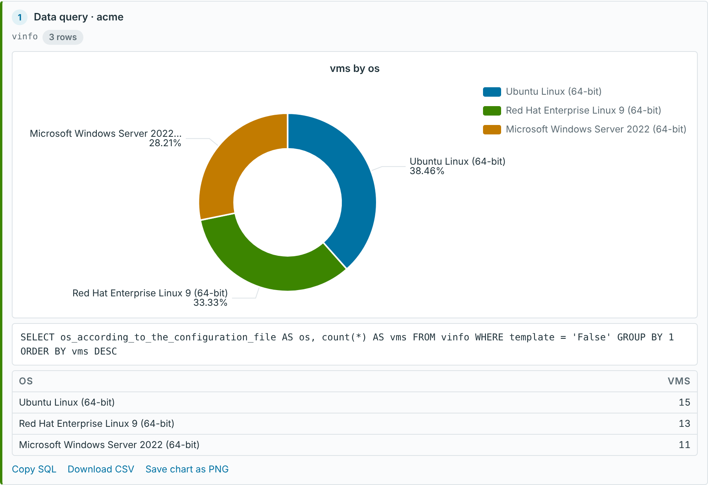

- **Which chart.** *pie* gives a pie chart, *donut* or *doughnut* a donut, *line*, *trend* or *over time* a line chart, and any other *chart*, *graph* or *plot* a bar chart. A chart word also makes the question a data question. Examples: "Pie chart of VMs per cluster", "Donut chart of VMs by OS", "Bar chart of vCPUs and memory per host".
- **How it is built.** The SQL prompt tells the model to return one label column and the value column(s), one row per category. Ask then builds the chart from the result itself: the first text column gives the labels, the numeric columns the values (pie and donut use one value column, bar and line up to four). The model never writes chart code, and nothing it returns is run in the browser.
- **Limits.** Pie and donut show the 11 largest slices plus an **Other (n)** slice; bar and line draw the first 50 categories. A note under the chart says when something was grouped or cut.
- **In the card.** The chart follows the light/dark theme and the window width, has tooltips and a legend (along the bottom, scrollable), and **Save chart as PNG** downloads it (2x resolution). Pie and donut slices under 3% get no label (the legend and tooltip still name them), long names are shortened with "..." and labels that would still collide are hidden, so text never overlaps.
- **Enlarge.** The button at the top right of the chart (or **Enlarge chart** under the card) opens it in a panel that fills the window: the whole legend, full-length labels lined up at the edges, labels down to 1% slices, and its own **Save as PNG**. **Esc**, the close button or a click outside closes it.
- **Saved.** The chart is saved with the chat and redrawn when you reopen it. The library (about 1 MB) is loaded only when the first chart is drawn.
- If the result has no number column (for example a list of names), no chart is drawn and you still get the table.

| Option | Default | Meaning |
| --- | --- | --- |
| `location` (Files from) | `folder` | `folder` or `upload` |
| `path` (Folder) | `/exports` | Folder inside the container (folder mode only) |
| `pattern` (File names) | `dbh-insights-*.xlsx` | Globs, one per line, e.g. `*.xlsx` or `RVTools*.xlsx` (folder mode only) |
| `pick` (Which files) | `newest` | `newest` = only the newest file of each name (a trailing timestamp is ignored, so "Keep newest N" exports aren't counted twice); `all` = every matching file |
| `sheets` | (all) | Sheets to include, one per line |
| `embed_sheets` (Searchable sheets) | automatic | Sheets that get one document per row. Automatic = the main RVTools / DBH Insights sheets (`vInfo`, `vHost`, `vDatastore`, `vCluster`, `vSnapshot`, `vRP`, `vSource`, `vLicense`, `vHealth`, `dvSwitch`, cluster capacity), or every sheet for other workbooks. Every sheet is always loaded for data questions |
| `max_embed_rows` | `5000` | Larger sheets are used for data questions only (embedding every row takes time) |
| `uploads` | `replace` | `replace` or `keep` earlier uploads (upload mode only) |

The header row is the first row with at least two filled cells. Column names are made SQL-friendly (`# CPUs` becomes `num_cpus`, `Provisioned MiB` becomes `provisioned_mib`); the model sees the original header next to each name. [openpyxl](https://openpyxl.readthedocs.io/) (MIT) reads the `.xlsx` files (values only, formulas and macros are never run).

Tips for good data answers:

- Ask for lists the same way: "Show all hosts from the vHost sheet" returns every host row in the card. Search alone can't list a whole sheet, because it only retrieves the best few matches (**Chunks to retrieve**).
- Ask about columns that exist: "How many VMs are powered on per cluster?", "Top 10 VMs by provisioned MiB", "Which datastores have less than 20% free?". The **Data tables** row on the source card lists each table and its row count.
- Use a chat model that is good at SQL; Qwen 3.x models are. Smaller models write wrong queries more often, and you see it in the query card.
- Turn **Data questions** off on the Settings page to send every question through the normal search.

### X posts (accounts)

The `x-posts` source indexes the recent posts of a list of X (Twitter) accounts, one document per post: the account, date and time, full text (long posts included), likes, reposts, replies, quotes and views, and the link `https://x.com/<account>/status/<id>`. With **Email only when the answer changed** on a [scheduled prompt](#scheduled-prompts), you get an email when the accounts post something new.

1. **Token, once.** Create an app in the X developer portal and copy its **Bearer token**. Put it in `.env` as `X_BEARER_TOKEN=<token>` and run `docker compose up -d vco-ask`. The token is never stored in Ask's database or in the source's options; the source only names the variable (**Token env var**, default `X_BEARER_TOKEN`).
2. **Source.** On **Knowledge sources**, **Add source**, plug-in **X posts (accounts)**. Under **Accounts** put one account per line (`bpatvmware`, `@vcrocs` or `https://x.com/lamw` all work). Options: **Reposts** and **Replies** (skip by default), **Keep posts for (days)** (default 30), **Max posts read per sync** (default 100). Set **Re-sync** to how often to check, for example every 2 hours, or daily at a set time.
3. **Email.** On **Scheduled prompts**, pick the X source, a prompt such as *List the latest posts with their account, date, text and link*, a schedule (for example every 2 hours), and turn on **Sync the picked sources first** and **Email only when the answer changed**.

How it reads X: the X API v2 recent search (`GET /2/tweets/search/recent`), which covers the last 7 days. All accounts go into as few queries as fit (`(from:a OR from:b) -is:retweet -is:reply`, 512 characters each, about 25 accounts), and later syncs ask only for posts newer than the newest one kept (`since_id`), so a sync is usually one request. Posts older than **Keep posts for** and posts of accounts taken off the list are dropped. **Cost:** X charges or caps the posts an app reads per month by plan, so keep **Max posts read per sync** low and don't sync more often than you need. A rate limit (429) keeps the posts already indexed and says when to try again; a refused token (401) or a plan without recent search (403) fails the sync with that reason. The chat's Sources list has an **X posts** group, and "latest posts" or "how many tweets" questions get the [whole-source catalog](#whole-source-questions). For X posts that catalog lists every post with its date and time (UTC), account, **complete text** and link, plus the current time, and the model is told to copy post text word for word, so "posts from the last 24 hours" can be answered and emailed in full.

Code: `ask/sources/x-posts/` (`fetch_x.py`, `source.yaml`). Tests: `ask/tests/test_x_posts.py` against `ask/scripts/fake_x.py`, a stand-in for the X API (`python ask/scripts/fake_x.py 11557`, token `good-token`, then set the source's **API address** to `http://127.0.0.1:11557`).

### API specs (OpenAPI)

An **API specs (OpenAPI)** source (plug-in `openapi`) indexes REST API specifications in OpenAPI 3 or Swagger 2 format, JSON or YAML: the VCF Operations API, vCenter, SDDC Manager, NSX or any other product that publishes one. Ask can then answer "which call do I use to ...", "what fields does that body take" and "show me that in PowerShell", with citations to the exact endpoint.

**Why not just drop the JSON in a folder?** A spec is one large file (the VCF Operations 9.1.1 spec is 2.3 MB with 535 calls and 640 schemas), and each call's fields live in schemas elsewhere in the file. Searched as plain text, the model would see fragments of JSON with no context. The plug-in turns it into one short markdown document per API call instead.

**Add one:** **Knowledge sources** → **Add source** → **API specs (OpenAPI)**. Then drag the spec onto the source's card (or **choose files**, several at once). Uploads must parse as JSON or YAML and contain `openapi` or `swagger` plus `paths`. To read a folder instead, set **Files from** = `folder` and copy the specs into `./ask-knowledge` (mounted read-only at `/knowledge`).

**What each API call's document holds:**

1. `# METHOD /path - summary`, then the API name and version, the area (tag), the operationId and the description as plain text.
2. `## Request`: the full path with the server base path (for VCF Operations `/suite-api`), the authentication scheme and every parameter (where it goes, type, required, default).
3. `## Request body`: the body fields with types, enum values and descriptions. `$ref` schemas are expanded up to 3 levels deep (60 lines at most), with a guard against schemas that refer to themselves. The spec's JSON example is added when it has one (cut at 1,500 characters).
4. `## Response` and `## Response fields`: every status code and the fields of the success response.
5. `## PowerShell`: an `Invoke-RestMethod` call. When the spec has `/api/auth/token/acquire` (VCF Operations), the example first gets a token and sends it as `OpsToken`.

Each `##` section becomes its own chunk, headed with the call's title, so a long field list never loses its endpoint. One more document per spec, **API overview**, lists every area with its description and calls, for "what can this API do with alerts?" questions.

| Option | Default | Meaning |
| --- | --- | --- |
| `location` (Files from) | `upload` | `upload` = specs uploaded on the Knowledge sources page; `folder` = a folder in the container |
| `path` (Folder) | `/knowledge` | Only for `folder` |
| `pattern` (File names) | `**/*openapi*.json`, `**/*swagger*.json`, `**/*openapi*.yaml`, `**/*openapi*.yml` | Only for `folder`. Globs relative to the folder, one per line |
| `tags` (Only these areas) | empty | One API tag per line (for example `Alerts`, `Resources`). Empty = every area |
| `deprecated` | `skip` | `skip` leaves out calls marked deprecated; `include` keeps them (marked **deprecated**) |
| `base_url` (Server for examples) | empty | Used only in the PowerShell examples, for example `https://ops.lab.local`. Empty = `$server` |
| `uploads` | `keep` | `keep` = every uploaded spec is indexed (same file name overwrites); `replace` = a new upload removes the earlier files |

**Size and speed.** The VCF Operations 9.1.1 spec gives 522 calls (13 deprecated skipped) plus the overview: 523 documents and about 2,860 chunks. Reading the spec takes under a second; embedding the chunks is the slow part and depends on the embedding model (a few minutes on Apple Silicon with `nomic-embed-text`). Re-syncs with no file change answer "no changes" at once.

**Not included:** XML examples and media types other than JSON, `$ref` links to other files (only references inside the same spec are followed), and the spec's response examples (the response fields are listed instead).

### PDF documents (with OCR)

A **PDF documents** source (plug-in `pdf`) indexes PDF files such as product guides, design documents, runbooks and white papers. Scanned PDFs work too: pages with no text layer are read with OCR.

**Add one:** **Knowledge sources** → **Add source** → **PDF documents**. Then drag PDFs onto the source's card (or **choose files**, several at once). Each upload is saved under `data/uploads/<source>/` and the source re-indexes. **Remove** deletes an uploaded file. To read a folder instead, set **Files from** = `folder` and copy the PDFs into `./ask-knowledge` (mounted read-only at `/knowledge`).

**How the text is read:**

1. [pypdf](https://github.com/py-pdf/pypdf) (BSD-3-Clause, pure Python) reads each page's text layer.
2. A page with almost no text (under 25 characters: a scanned or photographed page) is rendered to a grayscale image with `pdftoppm` (poppler-utils) and read with [Tesseract OCR](https://github.com/tesseract-ocr/tesseract) (Apache-2.0). Both are installed in the Ask image and run offline.
3. Each PDF becomes one document, titled from the PDF's Title property (or the file name), with one `## Page N` section per page (`## Page N (OCR)` for OCR pages). The page sections become the chunks, so answers name the page.
4. The source card under an answer has **Open PDF, page N**, which opens the file in the browser at that page (`/files/<source>/<file>.pdf#page=N`). Ask serves only the PDFs of `pdf` sources.

| Option | Default | Meaning |
| --- | --- | --- |
| `location` (Files from) | `upload` | `upload` = PDFs uploaded on the Knowledge sources page; `folder` = a folder in the container |
| `path` (Folder) | `/knowledge` | Only for `folder` |
| `pattern` (File names) | `**/*.pdf` | Only for `folder`. Globs relative to the folder, one per line |
| `ocr` | `auto` | `auto` = OCR only pages with no text layer; `always` = OCR every page (for PDFs whose text layer is garbled; slow); `off` = never |
| `ocr_languages` | `eng` | Tesseract languages joined with `+`, for example `eng+deu`. The image has English; for others build with `--build-arg OCR_LANGS="tesseract-ocr-deu"` (see below) |
| `ocr_dpi` | `200` | Render resolution for OCR. 300 reads small print better but is slower |
| `max_pages_per_file` | `2000` | Pages after this are ignored |
| `uploads` | `keep` | `keep` = every uploaded PDF is indexed (same file name overwrites); `replace` = a new upload removes the earlier files |

**Speed.** Text pages take milliseconds. OCR takes a few seconds per page on Apple Silicon, so a 300-page scanned manual can take 15 to 30 minutes the first time. Results are cached per file (by content hash) in `data/sources/<source>/cache/`, so re-syncs only read new or changed PDFs, and a sync with no file changes answers "no changes" at once. A sync may run 60 minutes: the plug-in stops a few minutes before that, indexes what it has (the version shows "N to finish next sync") and continues where it stopped on the next sync (press **Sync now** to continue right away).

**More OCR languages.** Debian packages `tesseract-ocr-<lang>` add languages (`deu`, `fra`, `spa`, `nld`, `jpn` ...):

```bash
docker compose build --build-arg OCR_LANGS="tesseract-ocr-deu tesseract-ocr-fra" vco-ask && docker compose up -d vco-ask
```

Then set **OCR languages** to `eng+deu+fra`. For a dark site, build the image online with the languages you need, then save it with `New-OfflineBundle.ps1`.

**Not supported:** password-protected PDFs (skipped, with a line in the log), handwriting (Tesseract reads printed text), tables as tables (their cells come out as text lines), and images or diagrams inside PDFs (only their text is read).

### HTML reports and dashboards

Ask a data question with the word *report* or *dashboard* and, besides the normal answer, Ask writes a modern, self-contained HTML page you can open, print, download and email.

| You ask | You get |
| --- | --- |
| "HTML report of VMs by OS using the vInfo sheet" | **Report.** One query. KPI cards (rows, number of categories, total, largest share), the chart (a donut for 8 or fewer categories, otherwise a bar chart, or the chart type you name), a ranked bar version of a pie or donut, and the full result as a sortable table |
| "Dashboard of the vInfo sheet", "Create a dashboard of VM capacity per cluster" | **Dashboard.** The model plans up to 8 panels (KPI tiles, donut, pie, bar and line charts, top-N tables), each with its own query, and Ask lays them out like a VCF Operations dashboard |

How it works:

1. **Detect.** *report*, *reports*, *html page* or *web report* makes it a report; *dashboard* makes it a dashboard. Both are data questions, so they need a spreadsheet source picked in the Sources list.
2. **Report: one query.** Same path as any data question (model-written SQL, the same checks, read-only run). When you didn't name a chart type Ask picks one from the result.
3. **Dashboard: a plan.** A separate call with temperature 0 asks the model for a JSON list of panels, each `{title, chart, sql}`, where `chart` is `kpi`, `donut`, `pie`, `bar`, `line` or `table`. Every panel's SQL goes through the same checks and read-only connection as a single data question. A panel whose query fails or is refused is left out and named under the dashboard (**Left out**), the others still show. A KPI must return one number, otherwise it is shown as a table. Each panel keeps at most 200 rows.
4. **Summary.** The model writes the answer in the chat as usual; for a dashboard it is asked for a short executive summary (3 to 6 bullets). That text becomes the report's **Summary** card.
5. **Build.** Ask fills the fixed template `ask/app/templates/report.html` with the results. The model only wrote the SQL and the summary; the charts are built from the results (as in the chat) and the summary is markdown that DOMPurify cleans when the page opens.

What is in the page:

- Header with the title (taken from your question: "HTML report of VMs by OS using the vInfo sheet" becomes **VMs by OS using the vInfo sheet**), source, files and sheets used, the time it was made and the model.
- KPI cards with colored edges, the summary, then the panels in a responsive grid; tables are full width, sortable (click a column header) and have a **Filter rows** box when they have more than 8 rows.
- **Queries** (folded) lists every SQL query, so the numbers can be checked; a footer says the numbers are a snapshot of the spreadsheet at the time it was indexed.
- Light/dark switch (the charts redraw) and a **Print** button. The print layout drops the buttons and keeps panels whole on a page, so **Print → Save as PDF** gives a clean PDF.

**One file, works offline.** Everything is inlined: the stylesheet, Apache ECharts, marked, DOMPurify, the chart and report scripts, and the data as JSON. A report is about 1.2 MB, needs no network and nothing from Ask, so it opens from a file share, an email attachment or a dark site laptop. When Ask shows it, it is sent with a strict Content-Security-Policy (no network requests at all, no forms, inline scripts only) and `X-Content-Type-Options: nosniff`.

**Where to find them.**

- Under the answer: **Open HTML report** (or **Open dashboard**), **Download .html** and **All reports**. A dashboard also shows a small version in the chat (KPI tiles, the charts with **Enlarge**, top 10 rows of each table).
- **Web pages the model writes.** Any question can ask for its answer "as a modern HTML web page" (for example web search results, race results, a summary of blog posts). When the answer contains a whole web page (an ```` ```html ```` block with `<html>`, `<!doctype html>` or `<body>`), Ask saves it as a report of kind **Page** and shows it under the answer like the reports above (**Open web page**, **Download .html**, preview with **Expand** and **Hide preview**); the code itself is replaced in the answer by a one-line note. While the answer streams you still see the code; it turns into the page when the answer is done. Because the page is written by the model, it is served sandboxed even when opened in its own tab (CSP `sandbox allow-scripts`): it can't read Ask's storage or token or call Ask, can't load scripts, styles or fonts from the internet, and may show pictures from `https` sites. Pages are listed on the **Reports** page too.
- **The report is also shown inside the answer**, right under those buttons, as a scrollable preview of the full page (520 px high). **Expand** makes it 85% of the window, **Hide preview** folds it away. The preview runs in a sandboxed frame: its charts and tables work, but it cannot reach Ask, your token or the chat page. It follows the chat's light or dark theme.
- **Reports** in the sidebar: every report with its type, source, age and size, plus **Open**, **Download**, **Chat** (back to the chat that made it) and **Delete** (needs the API token when `ASK_API_TOKEN` is set). To delete several at once, tick their checkboxes (Shift-click ticks a range, the header box ticks all) and press **Delete selected (n)**; **Delete all** removes every report. Both ask first and can't be undone (`POST /ui/reports/delete` with `{"ids": [...]}` or `{"all": true}`).
- On disk: `data/reports/<id>.html` with a `<id>.json` file holding the title, type, source, question and chat (the `./ask-data` volume). Delete files there to clean up; the page lists whatever is in the folder.
- API: `GET /api/reports` lists them; `GET /reports/<id>.html` opens one and `?download=1` downloads it as `ask-report-<title>.html`.

Tips: name the sheet ("using the vInfo sheet") and what to group by ("by OS", "per cluster"). For dashboards a model that is good at SQL and JSON matters even more, since it writes up to 8 queries; Qwen 3.x models are. Open **Queries** to check anything that looks wrong.

### LM Studio

Ask can use [LM Studio](https://lmstudio.ai)'s models next to Ollama's, or instead of them. Both are turned on or off on the Settings page (**Ollama**, **LM Studio**); at least one must stay on.

**Set up LM Studio** (once): open the **Developer** tab, turn on **Serve on Local Network** and start the server (default port 1234). The container reaches your Mac through the Rancher / Docker VM, which LM Studio refuses while it listens on `127.0.0.1` only, the same as Ollama without `OLLAMA_HOST=0.0.0.0`. Then on Ask's Settings page turn on **LM Studio**, keep or enter the URL (`http://127.0.0.1:1234` as LM Studio shows it is fine: inside the container `127.0.0.1` and `localhost` are sent to `host.docker.internal`; set `ASK_HOST_ALIAS=host.lima.internal` with containerd, or `off` to keep URLs as typed), press **Test connection**, pick a chat model and **Save**.

**How it works** (`ask/app/llm.py`):

- LM Studio's models are listed from its `GET /api/v0/models` (type `llm`, `vlm` or `embeddings`, loaded or not; older builds: `GET /v1/models`, with *embed* in the name meaning an embedding model) and named `lmstudio:<model id>`, for example `lmstudio:google/gemma-4-31b`. The prefix is how a saved setting, saved prompt or scheduled prompt knows which provider to ask; every other name is an Ollama model, so existing settings keep working. Menus show the name without the prefix, in an **LM Studio** group.
- Answers use LM Studio's OpenAI-compatible `POST /v1/chat/completions` with `stream: true`. Ask turns its stream into the same pieces Ollama sends, so citations, tool calls (MCP tools and web search, with ids matched to each tool result), the thinking panel and the stats line work the same. Tokens and prompt tokens come from the stream's `usage`; tokens per second are timed from the first word.
- Embeddings use `POST /v1/embeddings`. The `search_query:` / `search_document:` prefixes are added for LM Studio's nomic model too.
- **Model context** is not sent: LM Studio sets the context length when it loads a model (LM Studio's model settings, **Context Length**). **Temperature** is sent; **Keep model loaded** becomes LM Studio's `ttl`. Just-in-time loading in LM Studio loads a model on its first question.
- `ASK_LMSTUDIO_API_KEY` in `.env` is sent as a Bearer token, for an LM Studio server that requires one.
- **Errors** are plain: *Cannot reach LM Studio at http://host.docker.internal:1234 ... (LM Studio must accept connections from the network: Developer tab, Settings, turn on 'Serve on Local Network' ...)*, or *LM Studio /v1/chat/completions returned 404: Model ... not found*. A model of a provider that is off: *Ollama is turned off in Settings, so the model ... can't be used*.
- **Performance monitoring** works like Ollama's (see [Performance page and host agent](#performance-page-and-host-agent)): an **LM Studio** KPI card (models loaded, memory, share of the host CPU), an **LM Studio CPU** line on the host CPU chart and an **LM Studio** line on the host memory chart, the models it has loaded (type, quantization, context and maximum context) in the **Models** card, and **LM Studio processes** in the host table. LM Studio's API has no memory or GPU figures, so memory and CPU come from the host agent (v0.3.0 or later), which adds up LM Studio's own processes: the app and its helpers (`/Applications/LM Studio.app/...`), the model engines it starts from `~/.lmstudio/` (llama.cpp and MLX) and its `llmster` / `lms` daemon. The memory is those processes' RSS, so on a Mac it can read lower than what the GPU holds for the model. Without the agent the card shows the loaded models only. The Ollama KPI card is hidden while Ollama is off.
- **Update the host agent once** to get these numbers: run `ask/agent/Install-AskAgent.ps1` (or `install.sh`) again; it copies the new `ask-host-agent.py` and restarts it, keeping the token. The host table says *Agent v0.3.0 or later needed* until then.
- `GET /ui/models` (pages) and `GET /api/models` (token) return the models of every provider that is on, with each provider's status.

Tested with a stand-in LM Studio server (`ask/scripts/fake_lmstudio.py`, `ask/tests/test_llm.py`), not with LM Studio itself.

### Performance page and host agent

**Performance** (top-right toolbar, always shown) shows how both containers (Ask and vCommunity Observability), Ollama and the machine that runs Ollama are doing. It is the one Performance dashboard: the **Performance** button in the Observability toolbar opens this same page (see [Performance](#performance)). Ask takes a sample every 10 seconds and keeps 24 hours of them in `ask.db` (table `perf_samples`, about 5 MB); the page refreshes every 10 seconds and offers 1 h, 6 h and 24 h.

| Part | What it shows | Where it comes from |
| --- | --- | --- |
| KPI cards | Host CPU, host GPU, host memory (and memory pressure), Ollama (models loaded, memory, share on the GPU), LM Studio when it is on (models loaded, memory and share of the host CPU of its processes), answer speed (tokens per second and seconds per answer over the last 20 answers), the Ask container. The colored edge is green, amber (70%+) or red (90%+); Ollama turns amber when a model is not fully on the GPU | The three sources below |
| Host CPU, GPU, Ollama and LM Studio | CPU %, GPU % and the CPU used by Ollama's own processes and by LM Studio's (once it has been sampled), each as a share of the whole host (all cores = 100%), over time | Host agent |
| Host memory | Memory used, memory held by Ollama's loaded models, LM Studio's memory (its processes, or the model sizes LM Studio reports) when it is on, and memory pressure | Host agent, Ollama and LM Studio |
| Answer speed | Tokens per second (bars) and answer time per answer, last 24 hours; the tooltip names the chat and model | The stats saved with every answer |
| Prompt size per answer | Prompt tokens of each answer against a dashed **Model context** line. Bars near the line mean sources or history are being cut: see [Chunks, context budget and model context](#chunks-context-budget-and-model-context) | The stats saved with every answer |
| Ask container | CPU % (of the CPUs the container may use), memory (like `docker stats`, without page cache), network and disk throughput | The container's own cgroup files (`/sys/fs/cgroup`, v2 or v1). No Docker socket is mounted |
| Observability container | The same numbers for vCommunity Observability (`vco`): a KPI card plus CPU and memory, network and disk charts. **Not running** (red) when it doesn't answer | Its `GET /perf/container` endpoint at `ASK_VCO_INTERNAL_URL` (default `http://vco:8080`) |
| Logs | Logs per second (last 10 s), per minute (last 60 s) and per hour, log disk space used against the size cap, and disk space available on the data volume, with a rate chart and a disk chart. Shown only while the Observability `logs` module is on | The `logs` part of the Observability container's `GET /perf/container` |
| Host power and temperature | Total power (W) and GPU temperature, shown only when available | Host agent with [macmon](https://github.com/vladkens/macmon) installed |
| Ollama table | Version, each loaded model with size, memory, share on the GPU, context length and when it unloads | Ollama `/api/ps` |
| Host table | Chip, OS, cores (performance and efficiency), load, memory (app, wired, compressed), pressure, swap, GPU memory, Ollama processes, LM Studio processes, disk, network | Host agent |

**Web search usage and cost this month.** ollama.com and Brave have no API for the usage and cost numbers on their account pages, so Ask counts its own web calls (`app/webusage.py`, table `web_usage` in `ask.db`, kept 400 days) and the Performance page shows, for the current calendar month (UTC):

| Part | What it shows |
| --- | --- |
| KPI cards | Ollama requests and estimated cost, Brave requests and estimated cost, the total estimated cost, and **Brave quota left** (with the monthly limit and reset date, as Brave reported them in the `X-RateLimit-*` headers of the last search) |
| Chart | One stacked bar per day of the month: Ollama web search, Ollama web fetch, Brave search and failed calls; the tooltip shows the day's estimated cost |
| Table | Each tool's requests, failures (and how many were rate limits), price per call and estimated cost |

Estimated cost = successful calls × the **Price per web call** on the Settings page (defaults: Ollama search $0.01, Ollama fetch $0.001, Brave search $0.005 = $5 per 1,000; set 0 for calls a free plan covers). Calls that never reached the provider (no key) are not counted; failed calls are counted but not priced. Searches by other apps that use the same keys are not included, so the providers' own pages can show more. `GET /api/perf` returns the same numbers under `web`.

A GPU share under 100% means part of the model runs on the CPU, which is many times slower: pick a smaller model or a smaller **Model context**. A container can't see the Mac's hardware, so everything about the host comes from the agent.

**The Ask host agent** (`ask/agent/ask-host-agent.py`) is one Python file that runs on the Mac itself, outside Docker. It uses only the Python standard library (3.9 or newer, as installed with the Xcode Command Line Tools), so there is nothing to download and it works on dark sites. Every 5 seconds it reads, without sudo:

- CPU from `top`, memory from `vm_stat` and `sysctl` (used = app + wired + compressed, as in Activity Monitor; pressure from `kern.memorystatus_level`; swap from `vm.swapusage`);
- GPU utilization and GPU memory in use from `ioreg` (IOAccelerator performance statistics);
- network (Wi-Fi and Ethernet, `en*`) from `netstat`, disk space of the data volume, and the CPU and memory of every `ollama` process from `ps`;
- power and temperature from `macmon pipe` when [macmon](https://github.com/vladkens/macmon) (MIT, `brew install macmon`) is installed; macOS only gives these to root otherwise.

On Linux it reports CPU, memory, network, disk and Ollama from `/proc` (no GPU).

It answers on port 9101: `GET /metrics` (JSON, needs the token as `Authorization: Bearer <token>` or `X-API-Key`) and `GET /health`. Since 0.2.1 `/metrics` also has `lan_ip`, the Mac's current network address (the one its default route uses), which [scheduled prompt](#scheduled-prompts) emails use for their links. It listens on all addresses because the Docker VM reaches the Mac through its own network; the token keeps everyone else out, and it only ever returns numbers.

**Install it** on the Mac, from the repository folder:

```powershell
pwsh ./ask/agent/Install-AskAgent.ps1          # or: ./ask/agent/install.sh
```

The installer copies the agent to `~/Library/Application Support/ask-host-agent/`, creates a random token in `~/.config/ask-host-agent/token` (readable only by you), and registers the LaunchAgent `com.vcommunity.ask-host-agent`, which starts at login and is restarted if it stops (log: `~/Library/Logs/ask-host-agent.log`). It prints a line to add to `.env`:

```
ASK_AGENT_TOKEN=<the printed token>
```

Then `docker compose up -d vco-ask`. The page finds the agent at `http://host.docker.internal:9101` (the **Host agent URL** setting, or `ASK_AGENT_URL`; leave it empty to turn the host part off). Remove the agent with `pwsh ./ask/agent/Install-AskAgent.ps1 -Uninstall` (or `install.sh --uninstall`). Try it by hand with `python3 ask/agent/ask-host-agent.py --once`, which prints one sample.

The same numbers are at `GET /api/perf?hours=1` (with the API token), for your own monitoring.

### MCP tools (your own MCP servers)

Ask can call the tools of your own **MCP servers**, for example a PowerShell MCP server whose tools are PowerShell functions (PowerCLI, RVTools, VCF Operations, switches). Pick **Tools: &lt;server&gt;** in the chat's **Sources** menu and the model decides which tools to call, with which arguments, and answers from what they return. Each result is one more numbered source, so `[n]` citations point at it.

**Where the server runs.** On the Mac, not in a container: an MCP server's tools usually need what only the Mac has (pwsh, PowerCLI, ImportExcel, Posh-SSH, the lab config file, SSH keys and `known_hosts`). The [Ask host agent](#performance-page-and-host-agent) starts the server, keeps it running and passes Ask's tool calls to it over HTTP, protected by the same token as the Performance page. The server itself is not changed and stays where it is, so you keep editing it in place: add a function, add its name to `$FunctionsToExpose`, and the next question (or **Reload tools**) restarts the server and shows the new tool. The agent restarts a server by itself when its script, or a `.ps1` next to it, changes.

```
Ask (container) --HTTP + token--> Ask host agent (Mac) --stdio JSON-RPC--> pwsh MCP-Server-vCommunity-Ask.ps1
```

**Set it up** (once):

1. Install or update the host agent with your MCP config. `-McpConfig` takes an `.mcp.json` file (the format Claude Code and other MCP clients use) and copies it to `~/.config/ask-host-agent/mcp.json`:

   ```powershell
   pwsh ./ask/agent/Install-AskAgent.ps1 -McpConfig ~/Documents/GitHub/PS-TAM-Lab/MCP/.mcp.json
   # or: ./ask/agent/install.sh --mcp-config ~/Documents/GitHub/PS-TAM-Lab/MCP/.mcp.json
   ```

   The installer prints the servers and their tools. Only `stdio` servers (a `command`, its `args` and `env`) are used. Example:

   ```json
   { "mcpServers": { "powershell-mcp": { "type": "stdio", "command": "pwsh",
       "args": ["-NoLogo", "-NoProfile", "-NonInteractive", "-File", "/Users/you/.../MCP/MCP-Server-vCommunity-Ask.ps1"], "env": {} } } }
   ```

2. `ASK_AGENT_TOKEN` in `.env` (as for the Performance page), then `docker compose up -d --build vco-ask`.
3. Open **MCP tools** (sidebar, under Knowledge): the server should say **running** and list its tools.

**Change the server's path, or add servers.** Ask uses `~/.config/ask-host-agent/mcp.json` on the Mac, a copy of the `.mcp.json` you gave the installer. To point at a moved or renamed script, edit the last entry of `args` there (for example `code ~/.config/ask-host-agent/mcp.json`) and save; add more servers under `mcpServers` the same way. The agent reads the file again when it changes and starts the server from the new path on the next question or **Refresh** on the MCP tools page, with no restart. Because it is a copy, editing the original `.mcp.json` changes nothing until you run the installer again with `-McpConfig` (or `--mcp-config`). To use another file altogether, start the agent with `--mcp-config <file>` (or set `ASK_AGENT_MCP_CONFIG`). The MCP tools page shows the command in use but can't edit it.

**The MCP tools page** shows each server (running or not, its command, errors and its stderr), **Reload tools**, and every tool with what it does, whether it is **read-only** or **changes things** (from the server's `readOnlyHint`), and a policy:

| Policy | What happens in a chat |
| --- | --- |
| **Allowed** | The model calls it whenever it decides to. The default for read-only tools |
| **Ask first** | The chat shows the tool and its arguments with **Run** and **Cancel**; nothing runs until you press Run (it waits up to 15 minutes). The default for tools that change things (`Send-Email`, `Create-DNS-ARecord`, `Save-HTML-Report`, and `Get-ESX-Switch-Port-Map`, which writes an HTML file) |
| **Off** | The model never sees the tool |

Below that: **Tool turns per answer** (default 6: how many times the model may call tools before it must answer; on the last turn Ask tells the model it can't call more tools and must answer from the results it has, and any tool call it still makes is ignored. Between turns, what the model says ("I'll check the hosts ...") is kept as its own paragraph) and **Result size the model reads** (default 16,000 characters of one tool result; keep it well under the Model context). Changing them needs the API token, like Settings.

**In the chat:** the Sources strip gets one pill per tool call, and a folded **Tool calls** box under the answer holds a card per call: tool, server, status (done, failed, needs your OK, cancelled), time, the arguments, and the **Result** (formatted JSON; PowerShell results are shown without their `{"data": ...}` wrapper). Tools can be combined with knowledge sources: tick a blog and the tools, and the answer can use both. "Nothing ticked" never includes tools.

**Notes.** The chat model must support tools (Ollama marks it with the `tools` capability; `qwen3.8:27b-mlx` does, `gemma3:27b` does not). Tool results go to the model as text, so a tool that returns thousands of rows uses up the context: give such tools filter parameters. The REST API can use tools too (`"sources": ["mcp:powershell-mcp"]` on `POST /api/ask`), but there a tool set to **Ask first** is refused, because nobody can press Run. Tool calls are not saved in the chat history the model sees on follow-ups, only the answers are.

#### The tools in Dale's PowerShell MCP server

`powershell-mcp` runs `MCP-Server-vCommunity-Ask.ps1` from the `PS-TAM-Lab/MCP` folder on the Mac. It exposes the 39 PowerShell functions named in `$FunctionsToExpose`. Their code is in `MCP-Server-vCommunity-Ask.ps1`, `MCP-vCommunity-Tools.ps1`, `MCP-Salt-Tools.ps1` and `MCP-Salt-Guest-Tools.ps1`. Each tool's description is the function's `.SYNOPSIS`, and each argument's description is its `.PARAMETER` help, so the model reads exactly what the comment-based help says. Connection details (vCenter, VCF Operations, the switch, the Salt master, the mail account and the DNS server) come from `Home-Lab-Config.yaml` beside the folder and never pass through Ask.

This list is the server as of 2026-11-17. The **MCP tools** page always shows the live list, with each tool's arguments and policy. In the tables, **bold** arguments are required, `= x` is the default, and every other argument is optional. All tools return JSON.

**vCenter (PowerCLI)**

| Tool | What it returns | Arguments |
| --- | --- | --- |
| `Get-All-vCenter-VMs` | Every VM and its main properties | none |
| `Get-vCenter-VM-Properties` | Full VM details: guest OS and version, VMware Tools, IPs, hardware, host and cluster, storage, reservations, limits, shares, uptime, notes, tags and custom attributes. Filters by OS, power state or cluster | `Name = *`, `VMId`, `GuestOS`, `PowerState` (PoweredOn, PoweredOff, Suspended), `Cluster`, `IncludeTags = $true`, `MaxVMs = 25` |
| `Get-vCenter-VM-Stats` | Latest performance stats for one VM: CPU, memory, disk, network, uptime | **`VMName`** |
| `Get-vCenter-Snapshot-Audit` | Old or large snapshots and VMs that need consolidation (nothing is removed) | `Name = *`, `VMId`, `MinAgeDays = 7`, `MaxVMs = 25`, `MaxResults = 100` |
| `Get-vCenter-Change-Events` | vCenter event timeline for one VM or all of vCenter, with users and messages (up to 7 days) | `VMName`, `VMId`, `Hours = 24`, `StartTimeUtc`, `EndTimeUtc`, `MaxEvents = 100` |
| `Get-vCenter-Datastore-Runway` | Each datastore's free space, growth (GB/day), days until full and thin-provisioning overcommit | `Name` (name or pattern), `Days = 30` |
| `Get-VM-Diagnostics` | Evidence for one VM's problem: configuration, snapshots, events, Operations alerts, and performance compared with a baseline, plus its host and datastores (evidence, not a proven root cause) | `VMName`, `VMId`, `Hours = 4`, `MaxEvents = 50`, `BaselineHours = 24`, `IncludeInfrastructure = $true` |

**VCF Operations**

| Tool | What it returns | Arguments |
| --- | --- | --- |
| `Get-Operations-Alert-Details` | Active alerts for VMs, hosts, clusters or datastores, with their recommendations | `ResourceName = *`, `ResourceId`, `ResourceKind`, `Criticality = Information` (Information, Warning, Immediate, Critical), `MaxResources = 5`, `MaxAlerts = 25` |
| `Get-Operations-Metric-History` | Lists the metrics a resource has (`ListMetrics`), or their history with units and interval statistics (up to 30 days) | `ResourceName`, `ResourceId`, `ResourceKind`, `ListMetrics`, `MetricPattern = *`, `Hours = 24`, `StartTimeUtc`, `EndTimeUtc`, `MaxSamples = 96`, `MaxMetrics = 100` |
| `Get-Operations-VM-Rightsizing` | Operations sizing recommendations next to each VM's current vCenter CPU and memory (no VM is changed) | `Name = *`, `VMId`, `MaxVMs = 10` |
| `Get-Operations-Cluster-Capacity` | Cluster capacity, headroom and time remaining | `ResourceName = *`, `ResourceId`, `MaxClusters = 5` |
| `Get-vCenter-Host-Health` | The latest Operations health badge for each ESXi host | none |
| `Get-vCenter-Host-Alerts` | Active Operations alerts for each ESXi host | `HostName` (name or pattern), `Criticality` (Info, Warning, Immediate, Critical) |

**Lab network and the Mac**

| Tool | What it returns | Arguments |
| --- | --- | --- |
| `Get-Network-Switch-Stats` | CPU and memory use and fan status of the TRENDnet TEG-7124WS switch (over SSH) | none |
| `Get-ESX-Switch-Port-Map` | Which switch port each ESXi host NIC (vmnic) is cabled to, plus an HTML diagram of it. **Writes a file**, so it is set to Ask first | `OutputPath` (default `ESX-Switch-Port-Map.html` beside the script) |
| `Get-HostUptime` | Uptime and boot time of the Mac that runs the MCP server | none |

**Salt (the Salt master and its minions)**. A minion target is a minion ID, a glob such as `web*`, or a comma-separated list, and it defaults to all minions. Every Salt tool is read-only: `Get-Salt-Config-Drift` runs the states as a dry run (`test=True`), and no updates are downloaded or installed.

| Tool | What it returns | Arguments |
| --- | --- | --- |
| `Get-Salt-Minion-Status` | Minions that are up, and minions that are down (key accepted but not answering) | `Target = *`, `TimeoutSeconds = 5` |
| `Get-Salt-Minion-Grains` | Grains (OS, hardware, BIOS, CPU, memory, network, storage, Salt, security) by name or named set, or the list of grains each minion has | `Target = *`, `GrainSet` (OS, Hardware, Network, Storage, Salt, Security, All), `ListGrains`, `MaxMinions = 100` |
| `Get-Salt-VM-Correlation` | Matches minions to vCenter VMs (BIOS UUID, then name, hostname or IP) and compares their OS, CPU and memory. Also lists VMs without a minion and minions without a VM | `VMName = *`, `Target = *`, `MaxItems = 200` |
| `Get-Salt-Job-History` | Recent jobs in the job cache: function, target, user and start time (no arguments or results) | `Function`, `Target`, `MaxJobs = 50`, `IncludeMonitoringQueries = $false` |
| `Get-Salt-Running-Jobs` | Jobs running now and the minions still working on them | `MaxJobs = 50` |
| `Get-Salt-Job-Result` | One job's outcome: which minions returned, success and return codes, and a state summary. Output is optional, with secrets redacted | **`Jid`**, `IncludeOutput = $false`, `MaxOutputChars = 1000` |
| `Get-Salt-Config-Drift` | Which assigned states would change or fail (a dry run) | `Target = *`, `MaxStatesPerMinion = 50`, `TimeoutSeconds = 100`, `MaxMinions = 100` |
| `Get-Salt-Guest-Health` | Guest uptime and boot time, load or CPU, memory and swap (Linux and Windows) | `Target = *`, `MaxMinions = 100` |
| `Get-Salt-Guest-Disk-Usage` | File systems and drives, flagging those above the threshold | `Target = *`, `ThresholdPct = 85`, `IncludePseudoFilesystems = $false`, `MaxMinions = 100` |
| `Get-Salt-Guest-Network` | Interfaces with MAC and IP addresses, DNS servers, search domains and gateways | `Target = *`, `MaxMinions = 100` |
| `Get-Salt-Installed-Software` | Installed packages and versions, with a version summary across VMs | `Target = *`, `Name = *` (for example `openssl*`), `MaxPackagesPerMinion = 200`, `MaxMinions = 100` |
| `Get-Salt-Pending-Updates` | Pending updates: Linux packages (kernel too), and Windows Update with severity and reboot status | `Target = *`, `Refresh = $false`, `MaxUpdatesPerMinion = 100`, `TimeoutSeconds = 90`, `MaxMinions = 100` |
| `Get-Salt-Service-Status` | Running and auto-start services, a named service across VMs, or auto-start services that are not running | `Target = *`, `Name`, `MaxServicesPerMinion = 300`, `MaxMinions = 100` |
| `Get-Salt-VMware-Tools-Guest` | VMware Tools / open-vm-tools version and service state inside each VM, compared with what vCenter reports | `Target = *`, `IncludeVCenter = $true`, `MaxMinions = 100` |
| `Get-Salt-Linux-Storage` | Linux block devices, mounted file systems and LVM (volume groups, logical and physical volumes, free space) | `Target = *`, `MaxMinions = 100` |
| `Get-Salt-Linux-Security` | Linux SELinux mode, firewalld zones, login-capable accounts, extra UID 0 accounts and admin group members | `Target = *`, `MaxMinions = 100` |
| `Get-Salt-Linux-Time` | Linux time zone, UTC offset, clock skew against the Mac, and whether chronyd or ntpd runs | `Target = *`, `MaxSkewSeconds = 5`, `MaxMinions = 100` |
| `Get-Salt-Windows-System` | Windows OS name, version and build, install and boot dates, domain or workgroup, and activation status | `Target = *`, `MaxMinions = 100` |
| `Get-Salt-Windows-Updates` | Missing Windows updates with KB, severity and category, and whether a reboot is pending | `Target = *`, `SecurityOnly = $false`, `IncludeDrivers = $false`, `MaxUpdatesPerMinion = 100`, `TimeoutSeconds = 100`, `MaxMinions = 100` |
| `Get-Salt-Windows-Roles` | Installed Windows Server roles and features, Windows Firewall profiles, and hardening checks (RDP, NLA, UAC, SMB1, TLS 1.0, Windows Update policy) | `Target = *`, `MaxFeaturesPerMinion = 200`, `MaxMinions = 100` |

**Tools that change things** (set to **Ask first**, so the chat shows **Run** / **Cancel** before they run)

| Tool | What it does | Arguments |
| --- | --- | --- |
| `Send-Email` | Sends an HTML email through the mail account in the lab config | **`ToEmail`** (comma or semicolon separated), **`Subject`**, `Body` (HTML) |
| `Create-DNS-ARecord` | Creates or updates an IPv4 A record in the lab DNS zone (over SSH with a key) | **`RecordName`** (one label, no zone), **`IPv4Address`**, `TTL` (default `01:00:00`) |
| `Save-HTML-Report` | Saves an HTML page to the `Reports` folder beside the script, or another folder | **`Report`** (the HTML), **`WebPageName`** (no `.html`), `Path` |
| `Get-ESX-Switch-Port-Map` | Read-only toward vCenter and the switch, but writes its diagram file (see above) | `OutputPath` |

**Ideas for questions:** "Which VMs have snapshots older than 14 days?", "Why was app01 slow in the last 2 hours?" (`Get-VM-Diagnostics`), "Which Linux VMs have pending kernel updates?", "Compare VMware Tools versions inside the VMs with vCenter", "How many days until NFS-01 is full?". To add a tool, write the function with `.SYNOPSIS` and `.PARAMETER` help, add its name to `$FunctionsToExpose`, and press **Reload tools**. If it changes things, also add it to the write list in `MCP-StdioRuntime.ps1` (the `$writes` line), so it is marked as changing things and defaults to Ask first.

### Web search (Ollama)

Ask can let the chat model search the web with **Ollama's web search** ([docs](https://docs.ollama.com/capabilities/web-search)), for questions the knowledge sources don't cover, such as current versions, release notes or news. It works like the [MCP tools](#mcp-tools-your-own-mcp-servers): the model gets two read-only tools and decides when to call them.

| Tool | What it does |
| --- | --- |
| `web_search` | `POST https://ollama.com/api/web_search` with a query; returns titles, URLs and page text (5 results by default, up to 10) |
| `web_fetch` | `POST https://ollama.com/api/web_fetch` with one URL; returns the page's text and links |

**Set it up** (once):

1. Create an API key on ollama.com (**Settings → Keys**, a free account works within Ollama's limits) and put it in `.env`. It is read from the environment only, never saved in `ask.db` or shown in the UI:

   ```
   OLLAMA_API_KEY=<your key>
   ASK_WEB_SEARCH=1
   ```

2. `docker compose up -d vco-ask` (the container reads `.env` when it starts).
3. Settings → **Web search (Ollama)** shows whether the key is set. The switch there turns web search on or off without a restart (`ASK_WEB_SEARCH=1` only sets the default).

**Web fetch (Ollama)** (scope `web:fetch`, shown next to it when Ollama web search is available) gives the model only the `web_fetch` tool: it reads the pages whose full URLs are in the question, one paid Ollama call per page, and cannot search. When the question names pages (for example a saved prompt's **Pages to fetch**), only those pages are fetched: a call for any other page, such as `?page=2` of the same forecast, is answered "not fetched" without calling Ollama (shown as **not run** in Tool calls). In every answer, a page asked for a second time reuses the first result instead of a second paid call (Ollama web search too). It is the cheap choice when you already know the page, for example in a [saved prompt](#saved-prompts) with **Pages to fetch**. With both Ollama entries ticked, Web search (Ollama) already includes web_fetch.

**In the chat:** tick **Web search (Ollama)** (group **Web**) in the Sources list, alone or with knowledge sources. The model searches only when the sources don't answer, cites each web result by its number, and the **Tool calls** box shows every search with its query, the pages found as links, and the text the model read. The REST API takes it as `"sources": ["web:ollama"]` (or together with source names) on `POST /api/ask`. Nothing ticked never includes web search.

**Which is used first: knowledge sources or the web?** The knowledge sources always come first. With blogs (or any other sources) and **Web search** ticked together:

1. Ask searches the ticked sources as usual and gives the model the best matches as numbered sources `[1]`, `[2]`, … before it starts answering.
2. Web search is a tool the model *may* call after reading them. Its instructions say to prefer the knowledge sources and to search the web only when they do not answer the question or it needs current information (versions, releases, news).
3. Web results get the next numbers (for example `[9]`, `[10]`), so one answer can cite both a blog post and a web page.

So "What did Brock write about vSAN?" is usually answered from the blogs alone, while "What is the latest PowerCLI version?" usually shows a `web_search` card under **Tool calls**. To force a search, say so in the question ("search the web for …"); to keep the answer to your sources, untick **Web search**.

### Web search (Brave)

A second web search provider, **Brave Search** ([API](https://api-dashboard.search.brave.com)), works the same way and can be used instead of Ollama's or together with it. It gives the model one read-only tool:

| Tool | What it does |
| --- | --- |
| `brave_search` | `GET https://api.search.brave.com/res/v1/web/search` with a query; returns titles, URLs, the age of the page, Brave's summary and up to 5 extra snippets of each page (5 results by default, up to 10). There is no page fetch: the snippets are what the model reads |

**Set it up** (once): create a key in the Brave Search API dashboard (the free plan works within its monthly limit) and put it in `.env`, then `docker compose up -d vco-ask`:

```
BRAVE_API_KEY=<your key>
ASK_BRAVE_SEARCH=1
```

Settings → **Web search (Brave)** shows whether the key is set and turns it on or off without a restart; **Brave Search API URL** defaults to `https://api.search.brave.com`. **Web results per search** is shared with Ollama.

**In the chat:** the Sources list's **Web** group lists **Web search (Ollama)** and **Web search (Brave)**; tick either or both. Knowledge sources still come first, exactly as described above.

**Which web search goes first when both are ticked?** Settings → **Web search order** decides:

| Web search order | What happens |
| --- | --- |
| **Ollama first, Brave as fallback** (default) | Every answer searches Ollama first. If Ollama fails (bad key, limit reached, no internet) or finds nothing, Brave is searched automatically with the same query, in the same tool card (**web_search → brave_search**, with a note saying why). If Ollama's results don't answer the question, the model may then search Brave itself |
| **Brave first, Ollama as fallback** | The same, the other way round |
| **No fixed order (the model picks)** | The model gets all three tools and chooses; it usually tries the first listed (Ollama) |

The order is enforced by Ask, not only asked of the model: if the model tries the second provider before the first one has searched, Ask runs the first one instead (the card notes "Fixed order"). Ollama's `web_fetch` (read one page in full) can be used at any time. Tool cards say **Ollama web search** or **Brave web search**. `ASK_WEB_ORDER` (`ollama_first`, `brave_first` or `model`) sets the default; the Settings page wins. The REST API takes `"sources": ["web:brave"]` (or `["web:brave", "web:ollama", …]`). The question's search queries are sent to Brave, so leave it off for private data and on dark sites. `ask/scripts/fake_websearch.py` also stands in for Brave (`GET /res/v1/web/search`).

### Web fetch (local)

A free page reader for dark sites and internal pages. With **Web fetch (local)** (scope `web:local`) ticked, the model gets one read-only tool, `local_fetch`, that reads the pages whose full URLs are in the question. Ask downloads each page itself from the `vco-ask` container with Python `requests` (no cloud service, no key, no cost) and keeps the main text with trafilatura, the same extractor the web-site source uses, plus the page's title and up to 40 links. It cannot search.

- Turn it on under Settings → **Web fetch (local)** (`ASK_LOCAL_FETCH=1` sets the default). It is off by default.
- **Allowed hosts** (`ASK_LOCAL_FETCH_HOSTS`): comma-separated host names, `*` patterns allowed, for example `wiki.corp.local, *.vcrocs.local`. Empty = any host the container can reach. A redirect to another host is refused too. Set it on a shared Ask, because the container can reach internal addresses.
- **Accept self-signed certificates** (`ASK_LOCAL_FETCH_INSECURE=1`) for internal sites with their own CA. Off by default.
- Pages: HTML, plain text, Markdown, JSON or XML only, at most 3 MB, 20 second timeout. The container's `HTTP(S)_PROXY` is used when set.
- The same rules as Web fetch (Ollama) apply: only the pages the question names are fetched, and a page asked twice is reused. It is never counted against the [monthly web budget](#monthly-web-budget).

It works in the chat, saved prompts (**Pages to fetch**) and scheduled prompts. The answer stats line shows *1 local fetch · $0.00*.

### Monthly web budget

Settings → **Monthly web budget (US$)** (`ASK_WEB_BUDGET`, default 0 = no budget) caps what Ollama and Brave web calls may cost in a calendar month (UTC), counted with the **Price per web call** settings, the same numbers as the Performance page. At 80 % each answer that uses the web shows a yellow *Monthly web budget 84 % used* note; at 100 % Ask stops making web calls until next month (the tool card says **not run**, and the model is told to answer without the web). The Performance page has a **Monthly web budget** card. `GET /api/perf` returns it under `web.budget`.

**Answer stats.** Every answer that used the web shows its calls and their estimated cost in the stats line under it, for example *2 web searches, 1 web fetch · $0.021*. Pages reused or refused cost nothing and aren't counted.

**Notes on both.** Web search needs internet access from the container and a chat model with the `tools` capability (`qwen3.8:27b-mlx` has it). The question and the model's search queries are sent to ollama.com, so leave it off for private data and on dark sites (it is off unless `ASK_WEB_SEARCH=1` or the Settings switch is on, and the menu entry only appears when a key is set). **Web results per search** (default 5) and **Web search API URL** (default `https://ollama.com`) are on the Settings page; the result size the model reads is the MCP tools page's **Result size the model reads**. For tests without internet, `ask/scripts/fake_websearch.py` is a stand-in API on port 11556.

### Ask configuration

`ask/config/ask.example.yaml` is built into the image as `/app/config/ask.yaml`. To use your own, copy it to `ask/config/ask.yaml` and uncomment the volume line in `docker-compose.yml`.

| Key | Meaning |
| --- | --- |
| `data_dir` | Where `ask.db` and cloned repositories live (`/app/data`, the `./ask-data` volume) |
| `sources_dirs` | Folders scanned for source plug-ins; later wins, so a plug-in in `/sources` (`./ask-sources`) overrides the built-in one |
| `settings.*` | Defaults for every Settings page value (table above) |
| `api.tokens` | `token_env` names the variable holding the token (`ASK_API_TOKEN`) |
| `sources` | Sources seeded on first start: `name`, `plugin`, `title`, `interval_hours` (default 24, `0` = never re-sync), `options`, `examples` |

| Environment variable | Meaning |
| --- | --- |
| `ASK_API_TOKEN` | Token for changing Settings and Sources and for `/api/*` (header `X-API-Key` or `Authorization: Bearer`) |
| `ASK_OLLAMA_URL`, `ASK_CHAT_MODEL`, `ASK_EMBED_MODEL` | Override the yaml defaults (the Settings page still wins) |
| `ASK_OLLAMA_ENABLED`, `ASK_LMSTUDIO_ENABLED`, `ASK_LMSTUDIO_URL` | Ollama on (default 1), [LM Studio](#lm-studio) on (default 0) and its URL (default `http://127.0.0.1:1234`); the Settings page wins |
| `ASK_LMSTUDIO_API_KEY` | Bearer token for an LM Studio server that requires one |
| `ASK_HOST_ALIAS` | Inside the container, Ollama and LM Studio URLs naming `127.0.0.1` / `localhost` go to this host instead (default `host.docker.internal`; `host.lima.internal` with containerd; `off` keeps them as typed) |
| `ASK_OBSERVABILITY_URL` | Sidebar link to the dashboards |
| `ASK_CONFIG`, `ASK_DATA_DIR`, `ASK_SHARED_DIR` | Config file, data folder, folder holding the shared `app.css` (set in the image) |
| `ASK_GITHUB_TOKEN` (any name) | Read-only token for a private repository; put the variable's **name** in the source's "Token env var" |
| `ASK_UPLOAD_MAX_MB` | Largest upload (spreadsheet, PDF or API spec) in MB (default 50). Raise it for large scanned PDFs |
| `ASK_CHAT_EXAMPLES` | How many example question boxes an empty New chat shows (default 6, 0 hides them; the Settings page wins) |
| `ASK_RECENT_CHATS` | How many chats the sidebar lists under Recent chats (default 10, 1 to 200; the Settings page wins) |
| `ASK_SQLITE_CACHE_MB` | SQLite page cache per connection, in MB (default 64). Each worker thread keeps one connection, so the cache stays warm across a question's searches. Lower it on a small machine |
| `ASK_SQLITE_MMAP_MB` | Memory-mapped I/O for `ask.db`, in MB (default 0 = off). Measure before keeping it, especially on Docker Desktop for Mac |
| `ASK_AGENT_TOKEN` | Token of the Ask host agent (printed by `Install-AskAgent.ps1`), for the Performance page |
| `ASK_AGENT_URL` | Where Ask reaches the host agent (default `http://host.docker.internal:9101`) |
| `OLLAMA_API_KEY` | ollama.com API key for [Web search (Ollama)](#web-search-ollama). Secret: keep it in `.env` only |
| `X_BEARER_TOKEN` | X API Bearer token for the [X posts](#x-posts-accounts) source. Secret: keep it in `.env` only |
| `BRAVE_API_KEY` | Brave Search API key for [Web search (Brave)](#web-search-brave). Secret: keep it in `.env` only |
| `ASK_WEB_ORDER` | Which web search goes first when both are ticked: `ollama_first` (default), `brave_first` or `model` (the Settings page wins) |
| `ASK_BRAVE_SEARCH`, `ASK_BRAVE_SEARCH_URL` | `1` turns Brave web search on by default (the Settings switch wins); API URL (default `https://api.search.brave.com`) |
| `ASK_WEB_SEARCH`, `ASK_WEB_SEARCH_URL` | `1` turns web search on by default (the Settings switch wins); API URL (default `https://ollama.com`) |
| `ASK_LOCAL_FETCH`, `ASK_LOCAL_FETCH_HOSTS`, `ASK_LOCAL_FETCH_INSECURE` | [Web fetch (local)](#web-fetch-local) on by default, its allowed hosts, and accepting self-signed certificates (the Settings page wins) |
| `ASK_WEB_BUDGET` | [Monthly web budget](#monthly-web-budget) in US$ (default 0 = none; the Settings page wins) |
| `VCO_ASK_INTERNAL_URL`, `VCO_ASK_TOKEN` | First container: where the Apple HomeView's Ask page reads answers (default `http://vco-ask:8081`) and with which token (default `ASK_API_TOKEN` from the shared `.env`) |
| `VCO_ASK_URL` | First container: sidebar link to Ask (and the Performance link). A `localhost` / `127.0.0.1` address follows the host you opened the page with, so the link also works from another computer |
| `ASK_VCO_INTERNAL_URL` | Where Ask reads the Observability container's numbers for its Performance page (default `http://vco:8080`) |

### Source plug-ins

A source plug-in is a folder with `source.yaml` and a script in **Python or PowerShell**, the same idea as collector modules. The core runs the script with:

| Variable | Content |
| --- | --- |
| `ASK_SOURCE_OPTIONS` | The source's options as JSON (fields declared under `options:` in `source.yaml`, which also build the Add source form) |
| `ASK_SOURCE_WORKDIR` | A private folder under `data/sources/<name>` (for clones or caches) |
| `ASK_SOURCE_STATE` | JSON the script returned last time (for example the commit), `{}` on a full re-index |
| `ASK_SOURCE_FULL` | `1` on **Re-index all** |
| `ASK_SOURCE_TIME_LIMIT` | Seconds the script may run (`timeout_seconds` in `source.yaml`). A script still running at the limit is stopped and the sync fails with nothing changed, so a slow plug-in should stop early and print what it has (`web-site` does) |
| `ASK_SOURCE_UPLOAD_DIR` | The folder the Knowledge sources page saves this source's uploads into (`data/uploads/<name>`); used by `spreadsheet` |

The script prints **one JSON object** to stdout (logs go to stderr; a non-zero exit marks the sync failed):

```json
{"version": "b59055ce…", "root": "/app/data/sources/isvara/repo", "unchanged": false,
 "state": {"version": "b59055ce…"},
 "documents": [{"id": "vsphere/cpu/metrics/virtual-motherboard/co-stop", "title": "VM CPU Co-stop",
                "path": "knowledge/vsphere/cpu/metrics/virtual-motherboard/co-stop.md", "url": "https://github.com/…",
                "text": "# VM CPU Co-stop\n## Meaning\n…", "status": "draft", "meta": {"object": ["VirtualMachine"]},
                "links": {"related": ["vsphere/cpu/metrics/virtual-motherboard/ready"]},
                "images": [{"path": "knowledge/vsphere/cpu/images/….png", "alt": "…"}], "hash": "86194afe…"}]}
```

`unchanged: true` with no documents means "nothing changed". `root` is the folder images are served from (`/files/<source>/<path>`, images only, never outside that folder). The core does all chunking, embedding and storage, so a plug-in never touches vectors.

**Built-in plug-ins:**

**`markdown-repo`.** Clones (`git clone --depth 1`) or pulls a repository, or reads a folder mounted at `/knowledge` (`./ask-knowledge`). Options: `repo_url`, `branch`, `path`, `include`/`exclude` globs (`**` crosses folders), `metadata` (`auto`, `isvara`, `none`), `web_url` (defaults to the GitHub blob URL) and `token_env`. With isvara metadata, the trailing `## Metadata` YAML block becomes `status`, `links`, `images` and filter fields and is **not** embedded, as the isvara README asks.

**`web-site` (blog crawler).** Indexes the posts of a web site you don't have the markdown for. It finds pages from the site's `sitemap.xml` (and `Sitemap:` lines in `robots.txt`) plus its RSS/Atom feed; if neither exists it follows links from the start URL. It only fetches the start URL's host (and by default only pages under the start URL's folder, see `scope`), always respects `robots.txt` (including `Crawl-delay`), waits `delay_seconds` between requests and stops after `max_pages` downloads per sync. [trafilatura](https://github.com/adbar/trafilatura) (Apache-2.0) pulls the article out of each page (menus, sidebars and footers dropped) as markdown, so it goes through the same chunking, embedding and search as repository files.

| Option | Default | Meaning |
| --- | --- | --- |
| `site_url` | | Start page, e.g. `https://www.vcrocs.info/` |
| `scope` | `folder` | `folder`: only pages under the Site URL's folder, so `https://techdocs.broadcom.com/us/en/vmware-cis/vcf/power-cli/latest/powercli.html` indexes `…/power-cli/latest/…` and not the rest of the Broadcom docs. `site`: the whole host. For a blog's home page both are the same |
| `discovery` | `auto` | `auto` (sitemap + feed, else crawl), `sitemap`, `feed` or `crawl`. Feeds often list only the newest posts |
| `feed_url` | | Optional; otherwise `/index.xml`, `/feed`, `/rss.xml`, `/atom.xml`, `/feed.xml` are tried |
| `url_include` / `url_exclude` | – / `/tags/**`, `/categories/**`, `/page/**`, `/author/**`, `/search/**` | Globs on the URL path. Excluded pages are still followed for links when crawling, just not indexed |
| `date_from`, `date_to` | | Keep posts published inside this range (either end optional) |
| `last_days` | | Rolling window instead of `date_from`, e.g. `365` |
| `undated` | `skip` | With a date range set: `skip` or `keep` pages with no publish date (About pages, docs) |
| `max_pages` | `500` | Network downloads per sync (pages already cached still count as indexed) |
| `delay_seconds` | `1` | Pause between requests (a larger robots.txt `Crawl-delay` wins, up to 30 s) |
| `user_agent` | `vCommunity-Ask/0.1 (local knowledge indexer)` | Sent with every request |

The publish date comes from the feed first, then the page itself (`article:published_time`, JSON-LD `datePublished`, `<time>`, dates in the URL). It is stored as `published`, added to the text as a `Published:` line (so "posts from 2024" matches), shown as a badge on source cards and given to the model. Source cards link to the live post (**View on <host>**). **Time limit:** a sync may run 60 minutes (`timeout_seconds: 3600`). Slow sites (a `Crawl-delay: 10` in robots.txt means at most 360 pages an hour) stop downloading a few minutes before the limit: the pages fetched so far are indexed, the version shows "(N more next sync)", and the next sync continues from the cache. Re-syncs are cheap: if the sitemap and feed list the same URLs and dates as last time the plug-in reports "no changes" without downloading anything; otherwise pages are cached in `data/sources/<name>/pages/` and re-requested with `If-None-Match` / `If-Modified-Since`, so only changed posts are downloaded and re-embedded. If the site can't be reached at all, the sync fails and the existing index is kept.

For a blog whose markdown is in a Git repository (Hugo, Jekyll and similar), `markdown-repo` gives cleaner text with no crawling; `web-site` is for sites you don't have the source for.

**`pdf`.** Reads PDF files from uploads or a folder: pypdf for the text layer, Tesseract OCR (via `pdftoppm`) for scanned pages, one document per PDF with one `## Page N` section per page, cached per file. See [PDF documents (with OCR)](#pdf-documents-with-ocr) for the options.

**`openapi`.** Reads OpenAPI 3 / Swagger 2 specs (JSON or YAML) from uploads or a folder: one document per API call (request, parameters, body and response fields with `$ref` schemas expanded, JSON example, PowerShell call) plus an overview per spec. See [API specs (OpenAPI)](#api-specs-openapi) for the options.

**`spreadsheet`.** Reads `.xlsx` and `.csv` files (RVTools, DBH Insights) from a folder such as `/exports` or from uploads. One document per row plus cluster and sheet summaries for search, and every sheet loaded into `data/sources/<name>/tables.db` for data questions; it also returns the table list (columns, types, sample rows) in its `state`. See [Spreadsheets and data questions](#spreadsheets-and-data-questions) for the options.

### Ask REST API

All under token auth when `ASK_API_TOKEN` is set; Swagger UI at http://localhost:8081/docs.

| Method and path | Purpose |
| --- | --- |
| `GET /api/health` | Status and counts (open) |
| `GET /api/apps`, `PUT /api/apps/{name}?on=false` | Apps on / off (`observability`, `ask`), shared with the dashboards. While Ask is off, `POST /api/ask` and source syncs answer 503 |
| `POST /api/ask` | `{"question": "...", "sources": "all" \| "isvara" \| [...], "chat_id": "..."}` (`all` = every source except spreadsheets; a name or a list of names picks those sources, spreadsheets included) → answer, source cards, stats, chat id (pass it back for follow-ups). With tools, `answer` is the final answer and `steps` what the model said between tool calls |
| `GET /api/search?q=...&sources=a,b` | Retrieval only: which chunks a question would get, and the FTS query used |
| `GET /api/chats`, `GET /api/chats/{id}` | Saved chats and their messages |
| `GET /api/sources`, `POST /api/sources/{name}/sync?full=false`, `GET /api/sources/{name}/documents` | Sources, sync, indexed files |
| `GET /api/perf?hours=1` | Performance: the latest sample (both containers, Ollama, host agent), up to 24 h of history and recent answer speeds |
| `GET /perf/container` | Open, numbers only: this container's raw counters, read by the Observability container |
| `GET /api/mcp` | MCP servers of the host agent, their tools and each tool's policy (allow, ask, off). Use one with `"sources": ["mcp:<server>"]` on `POST /api/ask` (tools set to Ask first are refused there) |
| `POST /api/eval/runs`, `GET /api/eval/runs`, `GET /api/eval/runs/{id}?vs=` | [Answer quality test](#answer-quality-test): start a run (`{"count": 10, "judge": true, "model": "...", "judge_model": "..."}`, 409 while one is running), list runs with summaries, one run with every question (saved answer vs replay: speed, documents, judge verdict, both answers) and the previous run it is compared with |
| `GET /api/saved`, `POST /api/saved`, `GET/PUT/DELETE /api/saved/{id}`, `POST /api/saved/{id}/run` | [Saved prompts](#saved-prompts): list (with `question`, what Run sends), create, one, change, delete, and run in a new chat (returns the answer like `POST /api/ask`). A bad field answers 400 with `errors` per field |
| `GET /api/schedules`, `POST /api/schedules`, `GET/PUT/DELETE /api/schedules/{id}`, `POST /api/schedules/{id}/run` | [Scheduled prompts](#scheduled-prompts): list (with next run and last run), create, one with its run history, change, delete, run now (409 while it is running). A bad field answers 400 with `errors` per field |
| `GET /api/reports` | HTML reports and dashboards (id, title, type, source, question, created, size); open one at `/reports/{id}.html`, add `?download=1` to download it |

```powershell
$h = @{ 'X-API-Key' = $env:ASK_API_TOKEN }
Invoke-RestMethod -Method Post -Uri http://localhost:8081/api/ask -Headers $h -ContentType 'application/json' `
  -Body (@{ question = 'What does VM CPU Co-stop mean?'; sources = 'isvara' } | ConvertTo-Json)
```

### Ask image

- `ask/Dockerfile`, built from the repository root (it copies `core/static/app.css`, `core/static/dialogs.js`, the About page files, the vendored front-end libraries and the README with its screenshots, so a theme or library fix lands in both containers). Python 3.13 slim + git, plus `tesseract-ocr` (English) and `poppler-utils` for OCR of scanned PDFs (build argument `OCR_LANGS` adds Tesseract languages), native arm64 on Apple Silicon, no PowerShell.
- Runs as non-root user `ask` (uid 10002) on port 8081, health check on `/api/health`.
- Volumes: `./ask-data` → `/app/data` (index, chats, clones), `./ask-knowledge` → `/knowledge` (read-only, local folders), `./ask-sources` → `/sources` (extra or patched plug-ins), `./exports` → `/exports` (read-only, the dashboards' exports for `spreadsheet` sources), `./control` → `/app/control` (Apps on / off, shared with the dashboards).
- Front-end libraries are vendored once, in `core/static/vendor/`, with their licences: Swagger UI, marked 18.1.3 (MIT), DOMPurify 3.4.17 (Apache-2.0/MPL-2.0) and Apache ECharts 6.1.0 (Apache-2.0, `echarts.min.js` with its LICENSE and NOTICE). The dashboards serve them at `/static/vendor/`, Ask at `/shared/vendor/`. Every answer, document and About page is sanitised by DOMPurify before display.
- On a Linux Docker host, uncomment `extra_hosts: host.docker.internal:host-gateway` in `docker-compose.yml`. Leave it commented on Rancher Desktop and Docker Desktop: it replaces their own mapping to the Mac, and Ollama then refuses the connection.

## Configuration reference

### `config/config.yaml`

| Key | Meaning |
| --- | --- |
| `data_dir` | Where SQLite files go (default `data`; `/app/data` in Docker). `VCO_DATA_DIR` overrides it |
| `modules_dirs` | Folders scanned for modules. Later folders win, so a module in `/modules` overrides the built-in copy |
| `mock` | `true` = built-in sample data, no vCenter needed. `VCO_MOCK=1` overrides it |
| `home` | The page `/` (Home) opens. Default `/dash/dbh-insights/insights` (DBH Insights). Any `/dash/<module>/<slug>`; a missing or switched-off dashboard falls back to `/overview` (All dashboards). `VCO_HOME` overrides it |
| `connections.<name>` | `host`, `user`, `password_env` (name of the env var holding the password), `verify_ssl`, plus anything else a module needs (for example `auth_source` for VCF Operations). Included: `vcenter`, `vcfops`. For several vCenters, set `connections.vcenter.instances` to a list of `{id, label, host, user, password_env, verify_ssl}` (or add them on Settings) |
| `api.tokens` | List of `{name, token_env}`. Callers send a token as `Authorization: Bearer <token>` or `X-API-Key: <token>`. With no tokens, the API is open |
| `modules.<name>.enabled` | Default on/off (the switch on the Modules page wins) |
| `modules.<name>.settings` | Module settings, passed to collectors as `VCO_SETTINGS`. For example `vcenter_name` / `vcenters` for the DBH modules, `url` for `github-status` |

Precedence for module on/off: `enabled_by_default` in `module.yaml` → `modules.<name>.enabled` in `config.yaml` → the switch. Precedence for connection values: `config.yaml` and `.env` → values saved on the Settings page.

### `.env`

| Variable | Meaning |
| --- | --- |
| `VCO_VCENTER_PASSWORD` | vCenter password (named by `password_env` in `config.yaml`) |
| `VCO_VCFOPS_PASSWORD` | VCF Operations password |
| `VCO_API_TOKEN_MPBUILDER` | API token for MP Builder and scripts. Use a long random string |
| `VCO_MOCK` | `1` = sample data |
| `VCO_HOME` | Page `/` opens, for example `/dash/vcenter-inventory/inventory` (overrides `home` in `config.yaml`; default DBH Insights) |
| `PWSH_VERSION` | PowerShell build in the `core-pwsh` image (default 7.6.9 LTS) |
| `DOTNET_HWINTRINSIC` | `0` turns off .NET CPU fast paths for VMs that hide CPU features (see [Troubleshooting](#troubleshooting)). Default 1 |

### Other environment variables

| Variable | Meaning |
| --- | --- |
| `VCO_CONFIG` | Path to `config.yaml` (default `config/config.yaml`) |
| `VCO_EXPORT_DIR` | Root folder for scheduled exports (default `exports`; `/app/exports` in Docker) |
| `TZ` | Default time zone offered for scheduled exports (for example `America/New_York`) |
| `VCO_SYSLOG_UDP_PORT`, `VCO_SYSLOG_TCP_PORT` | Ports the Logs module's syslog listener uses inside the container (default 5514) |
| `ASK_ACTIVITY_LOG`, `ASK_ACTIVITY_LOG_URL` | Ask's activity log on or off (default on) and where it goes (default `tcp://vco:5514`); the Settings page overrides both |
| `ASK_PUBLIC_URL` | Ask address used in scheduled prompt emails (default `http://localhost:8081`; the Settings page overrides it) |
| `ASK_VCO_INTERNAL_URL` | How Ask reaches the vco container for email and the Performance page (default `http://vco:8080`) |
| `ASK_SCHEDULE_TZ` | Time zone a new scheduled prompt starts with (default `America/New_York`) |
| `ASK_VCO_TOKEN` | Token Ask sends to vco's email endpoint; default is `VCO_API_TOKEN_MPBUILDER` from the same `.env` |
| `ASK_SYSLOG_HOSTNAME` | The source name Ask's activity messages carry (default `vco-ask`) |
| `SYSLOG_PORT` (`.env`, used by `docker-compose.yml`) | Host port mapped to the syslog listener (default 514). Use 1514 if your container runtime can't open ports below 1024 |

## Docker image and runtime

Two image targets from one `Dockerfile`:

| Target | Contents | Use |
| --- | --- | --- |
| `core` | Python 3.13 slim, the app and its locked dependencies | Python modules only (smallest) |
| `core-pwsh` | `core` plus PowerShell 7 and VMware PowerCLI | Default in `docker-compose.yml`; needed for `host-health` and other `.ps1` modules |

- Runs as a non-root user (`vco`, uid 10001), listens on port 8080 (web and API) and 5514 UDP and TCP (the Logs module's syslog server; compose maps the host's port 514 to it), with a health check on `/api/core/health`.
- The right PowerShell build (arm64 or x64) is picked automatically. Pin PowerCLI with the `POWERCLI_VERSION` build argument.
- **Fast rebuilds.** PowerShell and PowerCLI are installed in their own build stage (`pwsh`) that holds no app code, and the app files are copied on top last. A code or module change rebuilds only those last small layers (about 2 seconds); PowerShell and PowerCLI come from Docker's build cache. They are installed again only when `PWSH_VERSION`, `POWERCLI_VERSION` or `vendor/pwsh/` change (a patched Python package reuses them too), or when you build with `--no-cache` or clear the build cache.
- **Local copy of PowerShell and PowerCLI (optional).** Run `./scripts/Save-PwshVendor.ps1` once (PowerShell 7). It saves the PowerShell for Linux tarball (checked against the release's `hashes.sha256`) and PowerCLI with its modules into `vendor/pwsh/`, which git ignores. The build then uses that copy instead of GitHub and the PowerShell Gallery, so even a `--no-cache` build is quick and works without internet. The build log says `PowerShell: using local vendor/pwsh/...` and `PowerCLI: using local vendor/pwsh/Modules`. Options: `-PwshVersion` (default `PWSH_VERSION` from `.env`, else 7.6.9), `-PowerCLIVersion` (default newest; set `POWERCLI_VERSION` to the same value when you pin it), `-Arch auto|arm64|x64|both`. When the tarball for the version and CPU is missing, or `POWERCLI_VERSION` names a version that isn't saved, the build downloads as before. Run the script again to update the copy, then rebuild.
- Compose volumes: `./data` → `/app/data` (SQLite, survives upgrades), `./exports` → `/app/exports` (scheduled exports), `./extra-modules` → `/modules` (new or patched modules), `./config/config.yaml` read-only, `./control` → `/app/control` (Apps on / off, shared with Ask; `VCO_CONTROL_FILE` overrides the file path).
- `init: true` adds a tiny init process that reaps finished collector processes and passes stop signals to the app.
- `restart: unless-stopped`.

Common commands:

```bash
docker compose up -d --build                 # build and start (after any code or module change)
docker compose logs -f                       # follow the logs
docker compose build --no-cache              # full rebuild (not needed after changing PWSH_VERSION; slow unless vendor/pwsh is filled)
docker compose down                          # stop (data, exports and settings stay on disk)
```

## Using it from MP Builder

1. In MP Builder, create a source with base URL `http://<host>:8080`.
2. Authentication: custom header `X-API-Key: <token>` (or `Authorization: Bearer <token>`).
3. Add requests for endpoints such as `/api/host-health/hosts` or `/api/dbh-impact/hosts`. Every endpoint returns:

```json
{ "module": "host-health", "endpoint": "/hosts", "collected_at": "2026-11-01 17:46:13",
  "count": 6, "items": [ { "name": "esx01.vcrocs.local", "cpu_usage_pct": 42.5, ... } ] }
```

4. Use `items` as the list path and `name` as the object identifier.

The full list of endpoints is on the **Modules** page, in Swagger at `/docs`, and in `/openapi.json`.

## Core API

| Method and path | Auth | Purpose |
| --- | --- | --- |
| `GET /api/core/health` | none | Liveness check (used by the container health check) |
| `GET /api/core/modules` | token | Every module with its status, collectors, last runs and endpoints |
| `PUT /api/core/modules/{module}/enabled?enabled=false` | token | The on/off switch |
| `PUT /api/core/modules/order` | token | Menu order, body is a JSON list of module names |
| `GET /perf/container` | open | This container's raw counters (CPU time, memory, disk and network bytes, uptime, version). Numbers only, no secrets; Ask's Performance dashboard reads it |
| `GET /api/core/apps`, `PUT /api/core/apps/{name}?on=false` | token | Apps on / off: `observability` (collection, scheduled exports) and `ask` (chat, syncs). Off pauses the part; shared with Ask in `./control/apps.json` |
| `GET /api/{module}/...` | token | Module endpoints declared in `module.yaml` |
| `GET /api/logs/search`, `/api/logs/summary`, `/api/logs/hosts`, `/api/logs/alerts` | token | The Logs module's search, counts and rates, senders and alerts (added by its web extension) |
| `POST /api/logs/notify/email` | token | Send an email through the Logs mail server (used by Ask's scheduled prompts) |
| `POST /api/logs/notify/webhook` | token | Post `{"title", "text"}` (optional `url`, `username`) to the Logs webhook (used by Ask's scheduled prompts) |
| `GET /api/{module}/export/{name}` | token | Module file downloads for scripts |
| `GET /export/{module}/{name}` | none (UI) | The same downloads for the UI |

```bash
curl -X PUT -H "X-API-Key: $TOKEN" "http://localhost:8080/api/core/modules/github-status/enabled?enabled=false"
curl -X PUT -H "X-API-Key: $TOKEN" -H "Content-Type: application/json" \
  -d '["vcenter-inventory", "host-health", "github-status"]' http://localhost:8080/api/core/modules/order
```

## Writing a module

A module is a folder with a `module.yaml` and one or more collector scripts:

```
modules/my-module/
  module.yaml
  collect.py        # or Collect-Something.ps1
  templates/        # optional custom pages
```

**`module.yaml`** declares everything. No web code is needed:

```yaml
name: my-module
version: 0.1.0
core_api: 1                       # module contract version
description: What this module does

collectors:
  - name: things
    script: collect.py            # .py runs with Python, .ps1 with pwsh
    interval_minutes: 15
    timeout_seconds: 300
    connections: [vcenter]        # which connection details to pass in
    tables: [things]

tables:
  things:
    mode: snapshot                # snapshot = replace each run, append = keep history (retention_days, default 90)
    indexes: [[value]]            # optional: columns the dashboards filter or sort on (big tables only)
    columns: {name: text, value: real}

api:                              # GET /api/my-module/things
  - path: /things
    table: things
  - path: /things/high
    query: SELECT * FROM things WHERE value > 90

dashboards:                       # /dash/my-module/overview
  - slug: overview
    title: My Module
    widgets:
      - {type: kpi, title: Things, query: SELECT COUNT(*) FROM things}
      - {type: bar, title: Value, max: 100, warn: 75, crit: 90,
         query: SELECT name AS label, value FROM things}
      - {type: table, title: All things, query: SELECT * FROM things}
```

**Row cap on dashboard tables and bar lists.** A `table` widget shows its first 50 rows and a `bar` widget its first 25, with *Showing the first 50 of 1,234 rows · Show all* under it. **Show all** (`?all=<widget number>`) shows up to 5,000 rows of that one widget, and **Show fewer** goes back. Set your own number per widget with `limit:` (for example `{type: table, limit: 200, ...}`). The query is not changed: the rows are read in the query's own `ORDER BY` order, and reading stops at the cap. Tables longer than 30 rows are drawn by the browser only when they scroll near the screen (`content-visibility`). Custom page templates are not capped (they often need every row for their totals).

Every table gets a `collected_at` column automatically. Schema changes are additive: new columns are added on start.

**Custom page templates.** When the widget grid isn't enough (trees, maps, object pages, tabs), a dashboard can name a Jinja template in the module's `templates/` folder plus named read-only queries. The template extends the core `base.html` and gets `data.<query>` rows, the URL query string as `q`, `last_collected`, `run_errors` and `query_errors`. Named queries run only when the template reads them, so a page can declare one per table and pay for one. See `vcenter-inventory`, `dbh-topology` and `dbh-impact` for full examples:

```yaml
dashboards:
  - slug: inventory
    title: vSphere Inventory
    template: inventory.html          # modules/vcenter-inventory/templates/inventory.html
    queries:
      vms: SELECT * FROM vms ORDER BY name
      hosts: SELECT * FROM hosts
```

**Collector contract** (same for Python and PowerShell):

| | |
| --- | --- |
| Input | Environment variables: `VCO_VCENTER_HOST`, `VCO_VCENTER_USER`, `VCO_VCENTER_PASSWORD`, `VCO_VCENTER_VERIFY_SSL` (first/selected vCenter; and `VCO_VCFOPS_*` etc. for each other connection listed), `VCO_VCENTERS` (JSON array of every selected vCenter instance when `connections` includes `vcenter`), `VCO_SETTINGS` (module settings as JSON), `VCO_MODULE`, `VCO_MOCK` (`1` = return sample data) |
| Output | One JSON object keyed by table name, `{"things": [{"name": "a", "value": 1}]}`, written to the file in `VCO_OUTPUT_FILE` (recommended, so stray console output such as PowerCLI warnings can't corrupt it) or printed to stdout. Every table the collector lists must be there (send `[]` to clear a table on purpose); row values must be text, numbers, true/false or null |
| Writes | All or nothing: the whole output is checked first, then every table is written in one SQLite transaction with one `collected_at`. A failed run (non-zero exit, bad JSON, a missing table, a bad value, a database error) leaves every table as it was and shows the reason in the run history |
| Logs | stderr. In PowerShell use `[Console]::Error.WriteLine()`, not `Write-Host` |
| Failure | Non-zero exit code. The error shows on the Modules page and the module's dashboard |

Manifest queries are `SELECT`-only and run on a read-only SQLite connection.

**pyVmomi tip:** never compare a managed object with `==` against a string (`vm.runtime.host == ""`). pyVmomi's `__eq__` assumes both sides are managed objects and raises `AttributeError: 'str' object has no attribute '_moId'`. Use `getattr(obj, "_moId", None)` instead.

**Exports (file downloads).** A module can offer files built on demand from its data, such as an XLSX workbook or a CSV, written in Python or PowerShell:

```yaml
exports:
  - name: xlsx
    title: Export XLSX
    script: export.py               # or Export-Report.ps1
    filename: my-module-{timestamp}.xlsx
    media_type: application/vnd.openxmlformats-officedocument.spreadsheetml.sheet
  - name: csv
    script: export.py
    params: [sheet]                 # allowed URL parameters, usable in the filename as {sheet}
    filename: my-module-{sheet}.csv
    media_type: text/csv
```

The script gets `VCO_DB` (the module's SQLite file; open it read-only), `VCO_EXPORT` (which export), `VCO_PARAMS` (the allowed URL parameters as JSON) and `VCO_SETTINGS`, and writes the file to `VCO_OUTPUT_FILE`. Every export can also be picked on the Settings page as the scheduled export.

**Services (always-running scripts).** A collector runs on a schedule and exits. Work that has to keep running, such as listening on a port, is a **service**:

```yaml
services:
  - name: syslog
    script: syslog_service.py     # or .ps1
    restart_seconds: 5            # wait before a restart; doubles (up to 5 min) while it keeps failing quickly
```

The core (`core/services.py`) starts every service of an available module with the app, restarts it when it exits, stops it when the module is switched off or vCommunity Observability is paused (and starts it again after), and stops it with the app. It gets `VCO_MODULE`, `VCO_MODULE_DIR`, `VCO_DATA_DIR`, `VCO_SETTINGS` and `VCO_MOCK`, plus any `VCO_SYSLOG_*` variable; its output goes to the container log, and the Modules page shows whether it is running, since when, restarts and its last line. A service writes its own files in `VCO_DATA_DIR` (the Logs module uses `syslog.db`).

**Web extensions.** When a module needs more than read-only queries (a search box with live results, forms that save settings), `web: web.py` names a Python file with `register(app, ctx)` that adds routes (`core/extensions.py`). Use `/api/<module>/...` with `ctx.require_token` for the REST API and `/ui/<module>/...` for the module's own pages (reads open like the dashboards, changes call `ctx.check_admin(request)`, which wants the API token when tokens are set). `ctx.add_perf(fn)` adds numbers to the Performance dashboard. The pages themselves stay ordinary dashboards with a `template:`. Extensions are Python because the web app is FastAPI; collectors and services can still be PowerShell. A broken extension marks the module unavailable instead of stopping the app. See `modules/logs` for a full example.

**Installing a module:** copy the folder into the `/modules` volume (`./extra-modules` with Compose) and restart. A module in `/modules` with the same name overrides the built-in copy, which is also how a patched module is shipped to a dark site. Built-in modules are baked into the image, so changes to `modules/` need `docker compose up -d --build`.

## Security

- The REST API requires a token whenever `api.tokens` is set. Tokens are compared in constant time.
- The web UI has no login yet. When API tokens are configured, changes on the Settings page and the Modules page buttons (On/Off, ↑ ↓, **Run collectors now**) need a token, and those forms refuse requests posted from another web site (Origin and `Sec-Fetch-Site` checks). Dashboards are open. The **Download** buttons (`/export/...`) work from the app's own pages; a script or another site needs the token, like `/api/<module>/export/...`. Keep the port on a management network until UI login lands.
- Secrets live in `.env`, never in `config.yaml`. A password saved on the Settings page is stored **unencrypted** in `data/_core.db`, so protect the `data` folder as you would `.env`.
- The container runs as a non-root user. Collectors only receive the connections they list in `module.yaml`.
- The syslog port (514) accepts messages from anyone who can reach it (syslog has no authentication). Keep it on the management network. The Logs pages are open like the dashboards; changing Logs settings and alert rules needs the API token when tokens are set. The SMTP password for alert email is stored unencrypted in `data/syslog.db`.
- `verify_ssl: false` is the default for lab use; turn it on where vCenter has a trusted certificate.
- **vCommunity Ask:** the chat UI has no login either (like the dashboards); changing Settings or Sources needs `ASK_API_TOKEN`, and the UI endpoints refuse requests sent from other web sites (Origin check). Answers and documents are rendered through DOMPurify. Indexed documents could contain text aimed at the model (prompt injection); in phase 1 the model has no tools, so the worst case is a wrong answer. Image serving is limited to image files inside each source's folder. Ollama itself has no authentication: with `OLLAMA_HOST=0.0.0.0` it is reachable from your network.

## Patching and updates

- `requirements.in` lists direct dependencies. `requirements.txt` is the lock file with hashes. To patch one package: `uv pip compile --generate-hashes --upgrade-package fastapi requirements.in -o requirements.txt` (or the same flags with `pip-compile`), rebuild, and release a new image tag.
- The Docker build uses `--require-hashes`, so only the exact locked packages install.
- Build stages (OS → PowerShell and PowerCLI → Python deps → app code) keep rebuilds fast: a code change or a patched Python package reuses the cached PowerShell stage. Fill `vendor/pwsh/` with `Save-PwshVendor.ps1` to make a full `--no-cache` build quick too.
- PowerShell is pinned with `PWSH_VERSION`, PowerCLI optionally with `POWERCLI_VERSION`.
- A single module is patched by dropping its folder into `/modules` (see above).
- SQLite data lives on the `/app/data` volume and survives image upgrades.
- vCommunity Ask has its own lock file: `cd ask && uv pip compile --universal --generate-hashes --python-version 3.13 --upgrade-package fastapi requirements.in -o requirements.txt`, then `docker compose up -d --build vco-ask`. Vendored JavaScript (marked, DOMPurify, ECharts, Swagger UI) is replaced by dropping the new file into `core/static/vendor/<lib>/` and updating its `VERSION`; rebuild both images. A source plug-in is patched by dropping its folder into `./ask-sources`.

## Dark sites

- No runtime internet access is needed: the UI has no JavaScript frameworks or CDN links, and Swagger UI, marked and DOMPurify are vendored into the images. (`github-status` is the one module that needs internet, by design; set `enabled: false` for it at a dark site. Ask's [Web search (Ollama)](#web-search-ollama) and [Web search (Brave)](#web-search-brave) also need internet; leave them off there.)
- **On a connected machine**, build both images and save them as gzipped tarballs with `.sha256` files:
  ```powershell
  ./scripts/New-OfflineBundle.ps1 -Version 0.1.0 -Target core-pwsh
  # dist/vco-core-pwsh-0.1.0.tar.gz and dist/vco-ask-0.1.0.tar.gz (add -SkipAsk for the dashboards image only)
  ```
- **Copy to the dark site:**

| What | Why |
| --- | --- |
| `dist/*.tar.gz` and `*.sha256` | The two images |
| The repository folder (or at least `docker-compose.yml`, `config/` and `.env.example`) | Compose file and configuration |
| Ollama installer and the models (`~/.ollama/models` on macOS, `/usr/share/ollama/.ollama/models` for the Linux service, `%USERPROFILE%\.ollama\models` on Windows) | Ask's embedding and chat models |
| Your knowledge files (a copy of the repository, or a `git bundle`) | Ask can't clone from GitHub there |

- **At the dark site:**
  1. Verify each tarball against its `.sha256`, then `docker load -i vco-core-pwsh-0.1.0.tar.gz` and `docker load -i vco-ask-0.1.0.tar.gz`.
  2. Follow [Getting started](#getting-started) steps 2 to 4 (config, folders, Ollama). Put the knowledge files under `./ask-knowledge`.
  3. Start with `docker compose up -d --no-build`, so Compose uses the loaded images and never tries to build.
  4. In Ask, switch off the `isvara` source (it needs GitHub) and add a **Markdown repository** source with **Repository URL** empty and **Local folder** set to `/knowledge/<folder>`. A `web-site` source works only against sites reachable from the dark site, such as an internal wiki.

## Troubleshooting

| Symptom | Fix |
| --- | --- |
| `docker compose up` fails with "ports are not available ... 514" or "permission denied" | Ports below 1024 need extra rights on some runtimes. Rancher Desktop on a Mac: Preferences → Application → General → turn on **Allow Rancher Desktop to acquire administrative credentials (sudo access)**, then restart Rancher Desktop. Or set `SYSLOG_PORT=1514` in `.env` and point hosts at port 1514. Also check nothing else on the computer already uses 514 (`sudo lsof -i :514`) |
| Nothing from hosts or scripts arrives on the Logs page (only Ask's messages) | The host port isn't reaching the container. On Rancher Desktop port 514 can be mapped without anything listening on the Mac: check `docker port vco` and `sudo lsof -nP -iUDP:514 -iTCP:514`. Set `SYSLOG_PORT=1514` in `.env`, run `docker compose up -d` (changing `.env` alone does nothing until the container is recreated), and send to port 1514. Test with TCP first (the PowerShell `Send-Syslog -Protocol tcp`): a TCP send fails with an error when nothing listens, a UDP send never does |
| The Logs page stays empty | Log settings shows whether the listener is **running**, and messages received. Send a test: `python scripts/send_test_syslog.py --host <this-computer-ip>`. If that arrives but ESXi doesn't: check the ESXi firewall rule (`esxcli network firewall ruleset list -r syslog`), the loghost (`esxcli system syslog config get`), and that the host can reach this computer on 514. On a Mac, macOS's own firewall can block incoming UDP for the container runtime |
| Every message shows the IP instead of the host name | The sender put no host name in its messages (some switches). The sender's IP is used instead; search it with `ip:` |
| A dashboard says a collector failed, for example "Can't find vcsa91.vcrocs.local on the network: the DNS lookup failed." | Failed collectors show a **plain-English summary** and what to do, with the full error under **Details** (also on the Modules page and for scheduled exports). For the DNS case, check `nslookup <vCenter>` on the computer running Docker: if it fails there too, the lab DNS server or network/VPN is the problem; if it works there but not in the container, add `extra_hosts: ["<vCenter name>:<IP>"]` (or `dns: [<lab DNS IP>]`) to the `vco` service in `docker-compose.yml`. Other cases covered: connection refused, no route, wrong user or password, untrusted certificate, missing password or vCenter, no PowerShell, timeouts, permission and server errors. Add more in `core/errors.py` (`RULES`) |
| `vco` won't start: "not a directory" or "Are you trying to mount a directory onto a file" for `config.yaml` | `config/config.yaml` didn't exist at the first `docker compose up`, so Docker created a folder with that name. Remove the folder, `cp config/config.example.yaml config/config.yaml`, then `docker compose up -d` |
| Linux: "unable to open database file", "readonly database" or "Permission denied" under `/app/data` | The host folder is owned by your user, but the containers run as uid 10001 (`vco`) and 10002 (`ask`). `sudo chown -R 10001 data exports extra-modules` and `sudo chown -R 10002 ask-data`, then restart |
| Ask: an answer fails with "model ... not found" | The chat model isn't pulled in Ollama. `ollama pull <model>`, or pick an installed model on Ask's Settings page. `qwen3.8:27b-mlx` is for Apple Silicon only; on other machines use, for example, `qwen3:8b` |
| Settings → Apps on / off says "not mounted" or "can't be written" | The `./control:/app/control` line is missing under `vco` or `vco-ask` in `docker-compose.yml` (older copy): add it to both and `docker compose up -d`. "Can't be written": `chmod 777 control` on the host (both containers write it, as uid 10001 and 10002) |
| Dashboards say "vCommunity Observability is paused" or Ask says "vCommunity Ask is paused" | A slider under Settings → Apps on / off is off. Turn it on there (either container's Settings page) |
| Scheduled export won't save: "Can't write to /app/exports/..." | The host `./exports` folder isn't writable by the container user. Run `chmod 777 exports` (or `chown 10001 exports`) |
| "Not saved: enter a valid API token" | Enter the token from `.env` (`VCO_API_TOKEN_MPBUILDER`) in the card's API token field |
| `failed to connect to the docker API at unix:///.../docker.sock` | The Docker CLI points at an engine that isn't running. `docker context ls`, then `docker context use rancher-desktop` (or start Docker Desktop) |
| Image build fails in `core-pwsh` with `Source Location 'http://www.powershellgallery.com:8080/...' is not valid` or `Package 'VMware.VimAutomation...' failed to download` | The PowerShell Gallery failed to hand out one of PowerCLI's sub-modules (a gallery-side hiccup). The build now uses PSResourceGet and tries 4 times; if it still fails, build again later. To update Ask in the meantime, build only it: `docker compose up -d --build vco-ask`. |
| Image build fails in `core-pwsh` with `Illegal instruction` (exit 132) | PowerShell's .NET runtime hit a CPU feature the VM doesn't expose (seen on new Apple Silicon). Use the default `PWSH_VERSION=7.6.9`; if it still fails, try `DOTNET_HWINTRINSIC=0`, `PWSH_VERSION=7.4.13` in `.env`, or set Rancher Desktop's VM emulation to VZ. Or build `target: core` to skip PowerShell |
| `AttributeError: 'str' object has no attribute '_moId'` in a collector | A managed object was compared with `==`; see the pyVmomi tip under [Writing a module](#writing-a-module) |
| vCenter password is empty | `config.yaml` must have `password_env: VCO_VCENTER_PASSWORD` (the variable's name), with the password in `.env`, or set it on the Settings page |
| Dashboard shows "collector failed" | The message is the collector's stderr. **Run collectors now** on the Modules page (or **Refresh** on the dashboard) retries; `docker compose logs -f` shows more |
| Ask: "Connection refused" to `host.docker.internal:11434` although `docker run --rm curlimages/curl -s http://host.docker.internal:11434/api/tags` works | An `extra_hosts: host.docker.internal:host-gateway` line in `docker-compose.yml` points the name at the Rancher VM instead of the Mac. Remove it, then `docker compose up -d vco-ask` |
| Ask: Settings shows "Cannot reach Ollama at http://host.docker.internal:11434" | Ollama listens only on 127.0.0.1. Run `launchctl setenv OLLAMA_HOST 0.0.0.0`, quit and reopen Ollama, check `lsof -nP -iTCP:11434 -sTCP:LISTEN` shows `*:11434`. With nerdctl/containerd use `http://host.lima.internal:11434` |
| Ask: source card is red with "embedding with 'nomic-embed-text' failed: model not found" | `ollama pull nomic-embed-text` on the Mac, then **Sync now** |
| Ask: answer says "Nothing is indexed yet" | Open **Knowledge sources** and press **Sync now**; watch the card for errors (git clone needs internet, or use a local folder) |
| Ask: "how many posts" or a blog summary only knows a few posts | The question didn't read as a whole-source question (use words such as *how many posts*, *summary of this blog*, *most common topics*), **Whole-source questions** is off, or the blog was not selected. Check the **All posts** card under the answer. If the post count itself is low, look at the source's **Date from** (older posts are not indexed) and **Max pages** settings and its document count on Knowledge sources |
| Ask: one source's answers are poor or cut off after updating to 2026-11-06 | Chunks made before 2026-11-06 could be very large when a crawled page had no blank lines (one was 277,000 characters), and one such chunk could fill the whole model context. New syncs cap chunks at 3,500 characters; press **Re-index all** on Knowledge sources once so existing documents are chunked again |
| Ask: MCP tools page says the agent has no MCP bridge, or shows no servers | Install the agent again from this repository (version 0.2.0 or later) with `-McpConfig` (see [MCP tools](#mcp-tools-your-own-mcp-servers)); it reads `~/.config/ask-host-agent/mcp.json`. Test on the Mac with `python3 ask/agent/ask-host-agent.py --mcp-list --mcp-config ~/.config/ask-host-agent/mcp.json` |
| Ask: MCP server "not running" with `Operation not permitted` (stderr) | macOS privacy protection: a LaunchAgent may not read `~/Documents` or `~/Desktop`. Give the Python the installer names Full Disk Access (System Settings → Privacy & Security), then `launchctl kickstart -k gui/$(id -u)/com.vcommunity.ask-host-agent`, or keep the MCP folder outside Documents |
| Ask: MCP server "not running" with `pwsh` not found or a module error | The agent's PATH has `/opt/homebrew/bin`, `/usr/local/bin` and `/usr/local/microsoft/powershell/7`; put the full path of `pwsh` in `command` otherwise. Modules (PowerCLI, ImportExcel, Posh-SSH, powershell-yaml) must be installed for your user; the server's own messages are under **Server messages (stderr)** |
| Ask: no **Web search (Ollama)** in the Sources list, or "Web search is not available" | Settings → **Web search (Ollama)** must be on and say the key is **set**: add `OLLAMA_API_KEY=` to `.env` and run `docker compose up -d vco-ask` |
| Ask: X posts source fails with "no X API token" or "refused the Bearer token" | Put `X_BEARER_TOKEN=<token>` in `.env` (no quotes or spaces) and run `docker compose up -d vco-ask`; a refused token was regenerated or revoked in the X developer portal. "no API credits or plan" or 403 means the app's X plan doesn't include recent search |
| Ask: no **Web search (Brave)** in the Sources list, or "Brave web search is not available" | Settings → **Web search (Brave)** must be on and say the key is **set**: add `BRAVE_API_KEY=` to `.env` and run `docker compose up -d vco-ask`. "Brave refused the API key" means the key is wrong or revoked; a 429 means the plan's rate or monthly limit was reached |
| Ask: web search card says "refused the API key", "limit was reached" or "Cannot reach Ollama web search" | Check or create the key on ollama.com (Settings → Keys); 429 = Ollama's usage limit, try later; "cannot reach" = the container has no internet (proxy: set `HTTPS_PROXY` for `vco-ask`) |
| Ask: "The MCP tools are not available" or the model never calls a tool | The chat model needs the `tools` capability (Settings shows the models; `qwen3.8:27b-mlx` has it). Also check the tools aren't all **Off**, and name what you want in the question ("use the RVTools vHost data") |
| Ask: Performance page says "Host numbers are off" | The agent isn't installed or running (`launchctl print gui/$(id -u)/com.vcommunity.ask-host-agent`, log in `~/Library/Logs/ask-host-agent.log`), `ASK_AGENT_TOKEN` in `.env` doesn't match `~/.config/ask-host-agent/token` (the note says the token was refused), or Ask wasn't restarted after editing `.env` (`docker compose up -d vco-ask`). Check by hand on the Mac: `curl -H "Authorization: Bearer $(cat ~/.config/ask-host-agent/token)" localhost:9101/metrics` |
| Ask: Performance page shows Host GPU "n/a" or no power and temperature | GPU numbers come from `ioreg` and need macOS on Apple Silicon (or a Mac GPU that reports statistics); power and temperature need `brew install macmon` |
| Ask: answers are slow or cut off | Use a smaller chat model, lower **Chunks to retrieve** / **Context budget**, or raise **Model context (tokens)** if the model supports it. The first answer after a while is slower while Ollama loads the model (**Keep model loaded**) |
| Ask: web-site source is red with "could not reach https://..." | The container can't reach the site (DNS, proxy or firewall). Test with `docker compose exec vco-ask python -c "import requests;print(requests.get('https://SITE/').status_code)"`. Behind a proxy, set `HTTPS_PROXY` for the `vco-ask` service. The previous index is kept |
| Ask: web-site source failed with "timed out after 3600 seconds" | The sync ran past its 60-minute limit and was stopped (older versions). Usually a docs site with a robots.txt `Crawl-delay` (techdocs.broadcom.com asks for 10 s per page) and a crawl that left the start page's folder. Update Ask: `scope` now defaults to `folder`, and the plug-in stops in time and indexes what it has, then continues on the next sync. Also lower **Max pages per sync** if needed |
| Ask: web-site source indexed 0 pages or misses posts | Check the log (`docker compose logs vco-ask`): `out_of_range` = outside the date range, `too_short` = pages with under 200 characters of article text (list pages), `blocked` = robots.txt. Widen the date range, set **Pages with no date** to `keep`, adjust the URL globs, or raise **Max pages per sync** |
| Ask: "The last sync was interrupted (app restarted)" | The container stopped during a sync. Press **Sync now** |
| Ask: spreadsheet source is red with "folder /exports not found" | The `./exports:/exports:ro` line is missing under `vco-ask` in `docker-compose.yml` (older copy). Add it, then `docker compose up -d vco-ask` |
| Ask: spreadsheet source indexes 0 files | No file matches **File names** in the folder. The default is `dbh-insights-*.xlsx`; for RVTools set it to `*.xlsx` or `RVTools*.xlsx`. Check the folder with `docker compose exec vco-ask ls /exports` |
| Ask: PDF source indexes 0 pages or a PDF is missing | Check the log (`docker compose logs vco-ask`): "password protected" (remove the password and upload again), "cannot read" (a damaged file: re-save it as PDF), "no text found" with OCR `off` (a scanned PDF: set **OCR** to `auto`). OCR quality: raise **OCR resolution** to 300 |
| Ask: "tesseract failed" or "Failed loading language" in the log | The language in **OCR languages** isn't installed. Use `eng`, or rebuild with `--build-arg OCR_LANGS="tesseract-ocr-<lang>"` (see [PDF documents](#pdf-documents-with-ocr)) |
| Ask: upload refused | Spreadsheet sources take `.xlsx` and `.csv` (an `.xlsx` must be a real Excel file, not a renamed one), PDF sources take `.pdf` (a real PDF), API spec sources take `.json`, `.yaml` and `.yml` that parse and contain `openapi` or `swagger` plus `paths`, up to `ASK_UPLOAD_MAX_MB` (default 50), and the API token must be entered when `ASK_API_TOKEN` is set |
| Ask: "The sources do not contain the individual rows" after a spreadsheet import | The question went through search, which only finds a few matching rows plus the sheet overview. Ask it as a data question ("show all hosts from the vHost sheet", "how many ...") with the spreadsheet source selected; the answer then has a **Query and result** card. Sheets with more rows than **Max searchable rows per sheet** (default 5000, for example a large vInfo) are not searchable at all, only queryable |
| Ask or the dashboards still behave like the old version after a rebuild | Fixed from 2026-11-05: script and stylesheet URLs carry `?v=<fingerprint>`, so browsers load the new files. Once, after updating to this version, reload the page with **Shift+Reload** (Cmd+Shift+R) to drop the old cached copy |
| Ask: no **Open HTML report** link under the answer | The question didn't say *report* or *dashboard*, or it went through search instead of a data question (pick the spreadsheet source). If the answer's stats show `report_error`, the report could not be written: check that `data/reports` is writable (`./ask-data` volume) and look at `docker compose logs vco-ask` |
| Ask: a dashboard panel is missing | Its query failed the checks or returned an error; it is named under **Left out** at the bottom of the dashboard. Ask again with simpler wording or use a stronger SQL model |
| Ask: no chart under a chart question | The question went through search (pick the spreadsheet source and use a word such as *pie chart*, *donut* or *bar chart*), or the query returned no number column. "The chart library could not be loaded" means the image is older than `core/static/vendor/echarts`: rebuild with `docker compose up -d --build vco-ask` |
| Ask: a counting question got a search answer instead of numbers | The question didn't use a data word (*how many*, *total*, *top 10*, *per cluster* ...), no spreadsheet source was selected (**All sources** leaves spreadsheets out), **Data questions** is off, or the model's query failed the checks (the stats show `data_error`). Rephrase, or pick the spreadsheet source in the Sources list |
| About page says "README.md was not found in this image" or shows no screenshots | The image was built from an older Dockerfile or `.dockerignore`. Rebuild with `docker compose up -d --build` |
| Changes to modules or templates don't show | Built-in modules are in the image: `docker compose up -d --build` |

## Testing

```bash
python scripts/smoke_test.py     # runs every module with sample data, checks every endpoint, page, export and Settings flow, then the unit tests in tests/
python -m unittest discover -s tests -v   # only the unit tests in tests/ (Logs webhooks: Discord splitting and payloads; no network)
```

vCommunity Ask can be tested without a GPU or model downloads, using a stand-in for Ollama (hashed bag-of-words embeddings and a canned answer that cites the sources it received):

```bash
python3 ask/scripts/fake_ollama.py &                                   # listens on 127.0.0.1:11555
cd ask && ASK_DATA_DIR=/tmp/ask-test ASK_OLLAMA_URL=http://127.0.0.1:11555 \
  uvicorn app.main:create_app --factory --port 8081                    # syncs the isvara repo on start
curl -s "localhost:8081/api/search?q=VM%20CPU%20Co-stop"                 # retrieval only
```

For the spreadsheet source, `python3 ask/scripts/make_sample_rvtools.py /tmp/sample.xlsx` writes a made-up RVTools-style workbook (40 VMs in `vInfo`, plus `vHost` and `vDatastore`) to upload. The stand-in Ollama answers data questions with canned SQL (a count of powered-on VMs, or a per-host count when the question says "per host").

`python scripts/send_test_syslog.py --port 514 --count 5000 --rate 500` sends ESXi- and vCenter-like syslog messages (RFC 5424 over TCP with octet counting, RFC 3164 over UDP) to try the Logs pages and alerts.

The smoke test also starts the Logs module's syslog service on a free port, sends it messages over UDP and TCP, and checks the parser, search, alerts, settings and the Performance numbers. It also checks that the DBH sheet tables match `module.yaml`, that the two `fabric.py` copies are identical, that Impact gives the same answers as the original website for the sample lab, and that schedules save, verify, edit, run, pause and remove correctly.

## Repository layout

```
core/                   FastAPI app, scheduler, module loader, runner, storage
  app.py                routes: dashboards, API, exports, Settings, Modules
  config.py             config.yaml + _env secret resolution
  connections.py        connection fields and "Save and test"
  export_schedule.py    scheduled exports: validation, triggers, folder picker, pruning
  modules.py            module.yaml parsing and validation
  runner.py             runs collectors and exports as subprocesses
  services.py           keeps module services (always-running scripts, e.g. the syslog listener) running
  extensions.py         module web extensions (module.yaml web: web.py → register(app, ctx))
  errors.py             plain-English summaries of collector errors (shown by templates/_run_error.html)
  storage.py            SQLite: one db per module + _core.db
  control.py            Apps on / off (./control/apps.json, same file as ask/app/control.py)
  perfstat.py           this container's cgroup counters (GET /perf/container) for Ask's Performance dashboard
  templates/            base layout, home, dashboards, Modules, Settings, About
  static/               app.css, about.css/about.js (About page, shared with Ask), dialogs.js (themed confirm / alert dialog, shared with Ask), drawer.js (small-screen menu backdrop and Escape, shared with Ask), vendored Swagger UI, marked, DOMPurify, ECharts
modules/                built-in modules (one folder each)
  logs/                 syslog server: syslog_service.py (listener, retention, alerts), logstore.py (database, search, parser),
                        notify.py (email, webhook), web.py (search, alerts and settings routes, REST API), templates/, static/
config/                 config.example.yaml
tests/                  unit tests for the dashboards container (test_notify.py: Logs webhooks)
scripts/                smoke_test.py, New-OfflineBundle.ps1, send_test_syslog.py (test syslog messages), Save-PwshVendor.ps1 (local PowerShell + PowerCLI copy)
vendor/pwsh/            optional local PowerShell tarball and PowerCLI modules for the core-pwsh build (git-ignored except its README)
docs/screenshots/       screenshots used in this README
ask/                    vCommunity Ask (second container)
  app/main.py           routes: chat, sources, settings, document view, REST API
  app/routes_schedules.py  Scheduled prompts routes (/schedules, /ui/schedules, /api/schedules)
  app/routes_saved.py   Saved prompts routes (/saved, /ui/saved, /api/saved)
  app/saved.py          Saved prompts store and checks (fit_scope: sources that can be used now)
  app/rag.py            hybrid retrieval, link expansion, prompt, streamed answers
  app/overview.py       whole-source questions: catalog of every post with exact counts
  app/data.py           data questions: table choice, model-written SQL, checks, read-only run, charts, dashboard plans
  app/reports.py        HTML reports and dashboards: build the self-contained page, list, delete
  app/indexer.py        source plug-ins, chunking, embedding, scheduled syncs
  app/db.py             SQLite: documents, chunks, FTS5, sqlite-vec, chats, settings
  app/ollama.py         Ollama client (version, models, embed, chat stream)
  app/config.py         ask.yaml + env + defaults (and the default system prompt)
  app/templates/        chat, sources, documents, settings, reports pages; report.html (the standalone report)
  app/static/           ask.css, ask.js, scope.js (the Sources picker rules, shared by the chat and the Saved and Scheduled prompts forms), admin.js, sidenav.js (select and delete recent chats), charts.js (chart options, shared by chat and reports), report.css/report.js (inlined into reports); marked, DOMPurify and ECharts come from core/static/vendor
  sources/markdown-repo/  built-in source plug-in (Git repo or folder of markdown)
  sources/web-site/     built-in source plug-in (blog/site crawler: sitemap, feed, links, date range)
  sources/spreadsheet/  built-in source plug-in (xlsx/csv from /exports or uploads, sheets into tables.db)
  sources/pdf/          built-in source plug-in (PDFs from uploads or a folder; pypdf text, Tesseract OCR for scanned pages)
  sources/openapi/      built-in source plug-in (OpenAPI / Swagger specs: one document per API call plus an overview)
  sources/x-posts/      built-in source plug-in (recent posts of a list of X accounts, X API v2 recent search)
  app/perf.py           Performance page: container, Ollama and host-agent samples (24 h in ask.db)
  app/mcp.py            MCP tools: client of the host agent's MCP bridge, tool policy, Run / Cancel approvals
  app/websearch.py      Web search: Ollama's web_search / web_fetch and Brave's brave_search as model tools
  app/webusage.py       counts web calls for the Performance page's usage and cost panel
  app/schedules.py      scheduled prompts: APScheduler jobs, headless answers saved as chats, the email and webhook (Notifier)
  agent/ask-host-agent.py  Ask host agent for the Mac (standard library only; performance numbers and the MCP bridge), plus Install-AskAgent.ps1 and install.sh
  config/               ask.example.yaml
  scripts/fake_ollama.py  stand-in for Ollama, for tests (also answers with tool calls)
  scripts/fake_mcp.py   stand-in stdio MCP server (three tools), for tests
  scripts/fake_websearch.py  stand-in for Ollama's and Brave's web search APIs (port 11556), for tests
  scripts/make_sample_rvtools.py  made-up RVTools-style workbook, for tests
  scripts/fake_x.py     stand-in for the X API recent search, for tests
  tests/                unit tests (balanced retrieval, answer quality test, scheduled prompts); no Ollama needed
  Dockerfile            vcommunity-ask image (build from the repo root)
  requirements.in/.txt  direct dependencies / hashed lock file
Dockerfile              base, pwsh (cached PowerShell + PowerCLI), core and core-pwsh stages
docker-compose.yml      vco (dashboards) and vco-ask (chat) services
.dockerignore           keeps data, .env, docs and dist/ out of both images
requirements.in/.txt    direct dependencies / hashed lock file
.env.example            secrets and build settings template
```

## What's next

- Login for the dashboard UI (the API already requires a token; the UI and the "Run now" button are open in this prototype)
- A VCF Operations example module (alerts or recommendations via the Suite API)
- Script-backed API routes (a `.py` or `.ps1` handler for an endpoint, not just a query)
- CI: Dependabot or Renovate, `pip-audit`, and Trivy image scans
- Trend charts (line widget) using `append` tables
- vCommunity Ask phase 2: a `vco-live` source (answer from the dashboards' live vCenter data), metadata filters from the question (object, technology), Mermaid flowcharts in documents
- vCommunity Ask phase 3: tool calling against the dashboards' REST API for live questions; answer feedback

## Changelog

| Date | Change |
| --- | --- |
| 2026-11-21 | **LM Studio in performance monitoring**, like Ollama: LM Studio KPI card, LM Studio CPU line (host CPU chart) and memory line (host memory chart), its loaded models in the Models card and **LM Studio processes** in the host table. Host agent **v0.3.0** counts LM Studio's processes (app, helpers, `~/.lmstudio` engines, `llmster` / `lms`) apart from Ollama's (`is_lmstudio`, `parse_ps(text, match)`); re-run the agent installer. The Ollama and LM Studio CPU lines are now a share of the whole host (`cpu_pct_of_host`), so they fit the 0-100 % axis. History keys `lm_mem`, `h_lms_cpu`. |
| 2026-11-21 | **LM Studio** as a second model provider for Ask, and **Ollama** / **LM Studio** on-off switches on the Settings page (`ollama_enabled`, `lmstudio_enabled`, `lmstudio_url`). New `ask/app/llm.py`: `client(cfg)` routes each call by model name (`lmstudio:` prefix = LM Studio, else Ollama); LM Studio via `/api/v0/models`, `/v1/embeddings` and streamed `/v1/chat/completions` turned into Ollama-shaped chunks (tool calls with ids, reasoning / `<think>` as thinking, usage as stats, `ttl` from Keep model loaded). `127.0.0.1` / `localhost` URLs go to `host.docker.internal` inside the container (`ASK_HOST_ALIAS`). Settings save refuses both providers off, or a chat / embedding model whose provider is off. Model lists grouped by provider in Settings, the model menu, saved and scheduled prompts (`GET /ui/models`, `GET /api/models`); Performance page lists LM Studio's loaded models. Tests: `ask/tests/test_llm.py` with `ask/scripts/fake_lmstudio.py`. |
| 2026-11-19 | Speed and UI fixes from a code review (13 items). **Ask chat:** a saved chat is sent as plain text and shows at once; the newest turns get markdown right away and older ones when scrolled near (`chat.html`, `ask.js` `adoptSaved`, scripts `defer`). While an answer streams only its last block is parsed again (`ask.js` `streamer`, `blockEnd`); `aria-live` moved from the whole thread to the answer being written (busy until done). **Save prompt** always shown. Sources list starts folded on screens under 820 px tall. The global top / bottom arrows are not on the chat page (Jump to latest stays), and `pagejump.js` watches `main` instead of the whole body. **No page reloads** after actions on Knowledge sources, Settings, Saved prompts, Scheduled prompts and Reports: `AskAdmin.refresh()` swaps only the changed card or row (handlers delegated). **Dashboards:** table widgets show 50 rows and bar widgets 25, with Show all (`?all=n`, up to 5,000) and a per-widget `limit:`; `Storage.query(limit=)` and `Storage.count()`; long tables use `content-visibility`. **Inventory:** tree and tab clicks swap only the object pane (with history), the sidebar is back as the phone menu drawer, the tree folds on phones (Show tree), the card grip mark kept as a design touch. **Logs:** ECharts loads when the chart comes into view (not in `logs.html` any more), live tail keeps 500 rows and pauses in a hidden tab, page refresh timers pause in a hidden tab. **Apple HomeView:** only the page on screen is in the document, the minute refresh updates it in place (morph), the clock uses cached formatters and writes once a minute. **Both apps:** solid top bar (no blur) on the Ask chat and the Logs page (`body_class` block added to core `base.html`); white-on-blue fills use `#0064d1` (5.6 : 1) instead of `#007aff` (4.0 : 1); the theme button shows a moon in light and a sun in dark, with `aria-pressed`. |
| 2026-11-19 | The Logs drop-down in the top bar is now a Mac menu in both apps: translucent grey (light) or dark grey (dark) with Mac text and a blue highlighted row. CSS only, in `core/static/mac-ui.css`. |
| 2026-11-18 | Top bar and side menu in the macOS look in both apps (UI only). The top bar is a translucent light or dark Mac toolbar with a hairline, and the Logs / Performance / app switcher control has a white raised segment in light mode. The side menu is a grey Mac sidebar: section titles without capitals, accent-coloured icons and a rounded blue selected row. Rules at the end of `core/static/mac-ui.css`, which Ask's base.html now loads on every page. |
| 2026-11-18 | The macOS look now covers every page of both apps (UI only). `mac-ui.css` moved to `core/static/mac-ui.css`: the dashboards load it in `core/templates/base.html` (the main area gets class `mac-ui`), and Ask serves it at `/shared/mac-ui.css` (added to the ask/Dockerfile COPY line). The remaining Ask pages also use it: chat (blue question bubbles, rounded answers and source cards, a floating composer), a source's documents, one document, a quality test run and Performance. Inside `.mac-ui` the app colour tokens (`--surface`, `--border`, `--primary` ...) map to Mac colours, so module dashboards follow without their own rules. Status colours (`--ok`, `--warn`, `--crit`) are unchanged, so dashboard health rings keep their meaning. Apple HomeView keeps its own wall-display style. |
| 2026-11-18 | Ask About page in the macOS look too (UI only): Mac large title, rounded fact tiles with a green or orange dot for status, a Mac-style section list (blue selected row) and README text with rounded tables, code blocks, pictures and callouts. Rules added to `ask/app/static/mac-ui.css`; the Observability About page is unchanged. |
| 2026-11-18 | Saved prompts, Scheduled prompts, Reports and MCP tools pages got the same macOS look as Settings and Knowledge sources (UI only): rounded cards, form rows with the label left and hairlines, Mac toggles, menus and push buttons, capsule chips, tags and status labels in Apple colours, and tables without capitals. One shared stylesheet `ask/app/static/mac-ui.css`, used by a page through a `<div class="mac-ui">` wrapper. |
| 2026-11-18 | Ask Knowledge sources page got the same macOS look as Settings (UI only): rounded source tiles with a soft shadow, the status ring in Apple colours instead of the coloured edge, rounded numbers, the details as an inset list, compact push buttons with Delete in red, and the Add / Edit source dialog as a Mac sheet. New `ask/app/static/sources-mac.css`, scoped to that page. |
| 2026-11-18 | Ask Settings page restyled to look like macOS System Settings (UI only, nothing else changed): one centered column of grouped rounded lists with the section title above, label left and control right with hairline rows, Mac toggles, pop-up menus with the double chevron, push buttons without capitals, a capsule *saved* badge and a translucent Save bar that stays at the bottom. System fonts only, light and dark. New `ask/app/static/settings-mac.css`, scoped to the Settings page. |
| 2026-11-18 | Ask Settings: **Example questions on New chat**: your own list of example questions (one per line, empty = the knowledge sources' examples, with a button to copy those in) and how many boxes show (default 6, 0 hides them). |
| 2026-11-18 | Ask Settings: **Recent chats shown** (default 10, was a fixed 20) sets how many chats the sidebar lists (`ASK_RECENT_CHATS`). |
| 2026-11-18 | README and About: the 39 tools of the PowerShell MCP server (`MCP-Server-vCommunity-Ask.ps1`), grouped by vCenter, VCF Operations, lab network, Salt and the tools that change things, with what each returns, its arguments and defaults, and how to add a tool. |
| 2026-11-18 | Ask chat: **Up arrow** in the empty question box recalls this chat's earlier questions (Down comes forward), so a question can be changed and sent again quickly. The hint under the box says so. |
| 2026-11-16 | Review doc UI changes and feature requests. **Saved prompts:** ☆ pin to the top, then most used first; *Not available now* warning for sources that can't be used; `{variable}` / `{variable=default}` in the prompt and pages, asked for in a small form before running; **Export** / **Import** as JSON; a **Schedule** link that fills a new scheduled prompt; the sidebar link is a normal link. **Scheduled prompts:** pick a named webhook, Send to shown as icons, **Show the latest answer on the Apple HomeView**. **Logs:** **Named webhooks** (alert rules and Ask pick one), the saved webhook URLs are masked (site only), Discord gets embeds (red for alerts and failures, links to the chat). **Ask web:** each answer's stats line shows its web calls and estimated cost, a **Monthly web budget** (warning at 80 %, no web calls at 100 %), and the free **Web fetch (local)** page reader for dark sites (off by default). **Apple HomeView:** a new **Ask** page and the pages dim after 5 minutes without fresh data. |
| 2026-11-16 | Code review fixes. Scheduled prompt webhook messages quote every line of a multi-line prompt. A saved prompt's **Used** count goes up only when its answer finishes (not when it fails or is stopped). The Sources picker rules are in one shared file, `ask/app/static/scope.js`, used by the chat and the Saved and Scheduled prompts forms; the Scheduled prompts form now keeps web search, web fetch and MCP tools ticked with **No sources (just the model)**, like the chat. Scheduled and Saved prompts routes moved from `ask/app/main.py` to `routes_schedules.py` and `routes_saved.py` (same URLs). `Mailer` is now `Notifier`, and the run status `email_failed` is now `not_sent` (old runs are updated on start; still shown as **not sent**). New `tests/test_notify.py` (Discord splitting and webhook payloads), run by `scripts/smoke_test.py`. |
| 2026-11-16 | Ask Saved prompts: when a saved prompt's sources can't be used now (source deleted or turned off, web search without its key, MCP server down), they are left out, and when none is left the prompt runs with **No sources (just the model)**, never All sources. The chat shows a *Not available now* note under Sources; `POST /api/saved/{id}/run` does the same and adds `scope_used` and `unavailable` to its answer. |
| 2026-11-16 | Web fetch costs less: with **Web fetch (Ollama)** alone and pages named in the question, only those pages are fetched (other URLs, such as `?page=2`, are refused without an Ollama call and shown as **not run**), and a page fetched twice in one answer reuses the first result (also with Ollama web search). The web fetch note now tells the model to fetch each named page once. `rag.fetch_state` / `norm_url`; tests in `ask/tests/test_saved.py` |
| 2026-11-16 | Saved prompts: **tags** (for example sports, weather, news) and a **search box** with tag buttons on the Saved prompts page and in the chat's **Saved** menu (Enter runs the first match). **Saved prompts** moved to the top of the sidebar, above New chat. New column `saved_prompts.tags` (added automatically); `/api/saved` takes and returns `tags` (plus `tag_list`). |
| 2026-11-15 | Ask **Saved prompts**: keep a prompt with its own sources (knowledge sources, web fetch, Ollama or Brave web search, MCP tools), an optional model and optional **Pages to fetch**, and ask it again with one click from the new **Saved** menu under the chat box (or **Edit first**), the new Saved prompts page (Run, Edit before sending, Edit, Delete, Delete selected, use count), `/chat?saved=<id>` links, or REST `/api/saved`. **Save prompt** under a question in a chat starts one from it. New source pick **Web fetch (Ollama)** (`web:fetch`): only the `web_fetch` tool, so the model reads the named pages and cannot search (one Ollama call per page); it works in the chat and scheduled prompts too. `/ui/chat` takes an optional `model` (that answer only), `title` and `saved_id`. New `ask/app/saved.py`, `templates/saved.html`, `static/saved.js`, `ask/tests/test_saved.py`; table `saved_prompts` is created automatically. `scripts/fake_ollama.py` passes the question's URL to web_fetch. **Rebuild vco-ask.** |
| 2026-11-15 | Scheduled prompts can post to a webhook: **Send to** has **Email** and **Webhook** switches (either or both; email addresses are needed only with Email on) and **Send a test to the webhook**. The answer goes as one Markdown message to the webhook on **Log alerts → Notifications** (Discord: split into up to 5 messages of 2,000 characters). New token-protected `POST /api/logs/notify/webhook` in the Logs module, so Ask never stores the URL. New columns `schedules.send_email` (existing prompts keep email on) and `send_webhook`, added automatically. A run whose email or webhook failed shows **not sent**. The email switches now say "message". **Rebuild both images.** |
| 2026-11-15 | Logs: Discord webhooks (`https://discord.com/api/webhooks/...`) work: they get a Discord message (`content`, up to 2,000 characters, no @mentions) instead of the generic `text` payload Discord rejects. A webhook error now shows what the service answered (status and reason). |
| 2026-11-15 | Logs: **Send test webhook** now tests the URL typed in the Notifications form, even before Save, and an empty URL says "no webhook URL is set" instead of asking for http:// or https://. |
| 2026-11-15 | Apple HomeView: removed the page count (01 / 08) from the header; the dashboards menu still lists every page. |
| 2026-11-15 | Apple HomeView: removed the "LIVE · time" status from the header. It now appears only as "OFFLINE · RETRYING" when the data can't load. |
| 2026-11-15 | Apple HomeView Home page: removed the "Live clock" label from the clock card. |
| 2026-11-15 | Apple HomeView Home page: the clock card shows a stack of three MS-01 style mini PCs (inline SVG, no image files). Each unit is labeled with a host and its power light shows that host's state; the activity light blinks (off with reduced motion). |
| 2026-11-15 | Apple HomeView: sort menus on Hosts (BY NAME / CPU / MEMORY) and Storage (BY USED / RUNWAY / SIZE / NAME) like VMs; new default page order Home, Lab, Hosts, VMs, Storage, Clusters, Health, GitHub; Settings → Apple HomeView card reorders pages (up / down) and shows or hides each one, next to the Auto-cycle seconds. |
| 2026-11-15 | Apple HomeView: the Show menu and the BY CPU / BY MEMORY menu are the same height (32 px full size, 20 px on short screens). |
| 2026-11-15 | Apple HomeView VMs page: the BY CPU tag is now a menu, BY CPU or BY MEMORY (`localStorage` `homeview.vmsort`). `/ui/homeview/data` adds `busiest_vms_mem` (up to 100 powered-on VMs, highest memory use first). |
| 2026-11-15 | Apple HomeView: the Show menu moved from the top row into each long list's header row, next to its tag (e.g. BY CPU). Hosts, Clusters and Storage lists got a title row (All hosts, All clusters, Datastores) to hold it. |
| 2026-11-15 | Apple HomeView: **Show** menu in the top row on list pages longer than one screen (Clusters, Hosts, VMs, Health, Storage): Fit to screen (default, no scrolling) or 10 / 25 / 50 / 100 per page, scrolling inside the list. Remembered per section on each screen. `/ui/homeview/data` now returns up to 100 rows per list (busiest VMs too). |
| 2026-11-15 | Apple HomeView: removed the "Eastern time • Selinsgrove, PA" line from the Home page clock card. |
| 2026-11-15 | Apple HomeView: the page title and page count moved into the top row beside "HomeView" (same size); the big in-page heading is gone, so pages get more rows. Full size: Hosts 9, Clusters 7, Findings 12, Datastores 10, VMs 12; short screens: Hosts 7, Clusters 5, Findings 7, Datastores 7, VMs 7. |
| 2026-11-15 | Apple HomeView: Auto-cycle time is set on the Settings page (Apple HomeView card, 5 to 3600 seconds, default 20). Stored in a new `app_settings` key/value table in `_core.db`; the display reads it from `/ui/homeview/data` (`cycle_seconds`). |
| 2026-11-15 | Apple HomeView: the bottom bar is gone. The home icon at the top left opens a dashboards menu (pages with their page count, Auto-cycle switch, data note), and the pages take the freed height: full size shows Hosts 8, Clusters 6, Findings 11, Datastores 9, VMs 11 per page; short screens Hosts 6, Clusters 5, Findings 6, Datastores 6, VMs 6. |
| 2026-11-15 | Apple HomeView: on short wide screens the bottom bar shows each page as a small icon over its full label (no more first-letter truncation); below 900 px wide Auto-cycle shows only its switch. |
| 2026-11-15 | Apple HomeView: compact layout for short, wide screens (the HomeView's Safari, below 520 px tall) following `style.css`'s own compact rules: smaller text, rows that share the height, fewer rows per page, so no page scrolls (checked from 1024 × 450 down to 640 × 380) |
| 2026-11-15 | New module **`apple-homeview`**: Dale's Apple HomeView design (1088 × 1088 canvas scaled to fit, same palette and auto-cycle) as a full-screen wall display at `/homeview` with live data: Home, Lab, Clusters, Hosts, VMs, Health (DBH Insights), Storage (Datastore Capacity) and GitHub (GitHub Status). Long lists split into extra pages, every page fits 1088 × 1088 without scrolling. Sidebar page with a preview and **Open full screen** |
| 2026-11-15 | Both apps: **jump to top / bottom** arrow buttons at the bottom right of every page (`core/static/pagejump.js`, served to Ask at `/shared/pagejump.js`). Each shows only when there is more than 300 px to scroll that way; on the Ask chat they sit just above the question box; smooth scroll unless reduced motion is set |
| 2026-11-15 | Both apps: **Performance** moved from the sidebars to the top-right toolbar (between **Logs** and **Observability \| Ask**), same look as the other toolbar items and highlighted on the Performance page. On phones under 480 px the app name shows as its logo only, so the toolbar fits. Always shown in Ask; on the dashboards whenever `VCO_ASK_URL` is set, even while Ask is paused |
| 2026-11-15 | Ask: the **Logs** menu (Logs, Log alerts, Log settings) is in Ask's top-right toolbar too, linking to those pages on vCommunity Observability (uses **Observability URL**; hidden like the switcher when Observability is off or has no URL) |
| 2026-11-15 | Both apps: the top-right toolbar is one grouped control like a macOS toolbar: **Logs** menu (dashboards only), **Observability \| Ask** and light/dark sit in one rounded bar with thin dividers; the current item is a raised segment; the Logs menu is a macOS-style list (check mark on the current page, blue highlight on hover) |
| 2026-11-15 | Observability: the Logs pages (**Logs**, **Log alerts**, **Log settings**) moved from the sidebar to a **Logs** menu in the top-right toolbar, left of the app switcher. It shows only while the Logs module is on, is highlighted on a Logs page, and closes with Esc or a click outside it |
| 2026-11-15 | Ask: when every source a chat, scheduled prompt or `/api/search` call picked by name is missing (deleted or renamed), the question is answered as **No sources (just the model)** instead of searching **All sources**. Picked sources that still exist are used as before |
| 2026-11-15 | Ask: a knowledge source used by a scheduled prompt (picked by name) can't be deleted. The source card lists those prompts with links, **Delete** explains what to change, and the delete route answers 409 |
| 2026-11-15 | Scheduled prompts: **Don't repeat recent answers** switch (off by default). Each run adds the schedule's last 30 answers under the prompt with "do not repeat these", for example for a daily quote. New column `schedules.avoid_repeats` (added automatically) |
| 2026-11-14 | Scheduled prompts: **History** shows the newest 25 runs (was 30; the newest 100 are still kept in `ask.db`) |
| 2026-11-14 | Ask whole-source catalog for **X posts** sources: each post's line now has its date and time (UTC), account and complete text (not the 70-character title), the catalog states the current time, and the model is told to copy post text in full and pick time windows by date and time. Fixes cut-off posts ("…") in scheduled X post emails. No re-sync needed |
| 2026-11-14 | Scheduled prompts: **Show the prompt in the email** and **List the sources in the email** switches (both on by default; existing schedules keep both on). With sources off, the answer's `[1]` citation marks are removed too. New columns `schedules.include_prompt` and `include_sources` (added automatically) |
| 2026-11-14 | Ask Knowledge sources: **Re-sync** can run at a set day and time (**Daily**, **Weekdays**, **Weekly** on a day, **Monthly** on a day or the last day, at a time in a time zone), like scheduled prompts, besides **Every N hours**. One scheduler job per source; the card shows the schedule and the next run. New column `sources.sync_schedule` (added automatically); `GET /api/sources` adds `sync_schedule` and `resync` |
| 2026-11-14 | Ask: **X posts** source plug-in (`x-posts`): recent posts of a list of X accounts through the X API v2 recent search, one document per post (account, date, text, likes, reposts, views, link to the post), kept 30 days by default. Token once in `.env` as `X_BEARER_TOKEN` (the source only names it). One combined query for all accounts and `since_id` on later syncs keep it to about one request per sync; **Max posts read per sync** caps cost; 429 keeps what is indexed. **X posts** group in the chat's Sources list, accounts shown on the Sources page, "tweets" questions get the whole-source catalog. With a scheduled prompt and **Email only when the answer changed**, new posts are emailed. `ask/tests/test_x_posts.py`, `ask/scripts/fake_x.py` |
| 2026-11-14 | The "By: Dale Hassinger" byline in the header of both apps links to the author's blog, https://www.vcrocs.info (new tab). It keeps its orange monospace look (no blue, no underline) and turns a lighter orange on hover. It is now its own link next to the logo, not inside the Home link |
| 2026-11-14 | **App switcher** at the top right of both apps (next to the light/dark button): **Observability \| Ask**, the current app highlighted, the other a link; icons only on phones (the "Sample data" chip is hidden there too). It replaces the **Ask (AI chat)** link in the dashboards' sidebar and the **Observability dashboards** link in Ask's sidebar. Hidden when the other app is off or has no URL |
| 2026-11-14 | Scheduled prompts form: a short description under **Sync the picked sources first** (what it does, the 30-minute wait, not needed for MCP tools or web search) |
| 2026-11-14 | Scheduled prompt emails link to the Mac's current IP address instead of `localhost`. Host agent 0.2.1 reports `lan_ip` (the address of the default route, read every sample, so a laptop's new network is picked up) in `/metrics`. While **Ask address** names localhost, each run swaps in that IP and keeps the port. A real name in **Ask address** is kept. Reinstall the host agent to get 0.2.1 |
| 2026-11-14 | Fix: a scheduled prompt with MCP tools emailed only the model's "Let me check ..." lines and no results. The model had used all its tool turns, and its last turn (no tools) narrated again instead of answering. Now the last turn gets a note to answer from the tool results it has (stray tool calls there are ignored), the turns' texts are kept apart as paragraphs, and `rag.answer` (REST API and scheduled prompts) returns the final answer separately from the `steps`. The email shows only the final answer, names each tool call in the sources (and says which ones failed), and adds a note when a model still never answers. New `ask/tests/test_tool_rounds.py` |
| 2026-11-14 | Ask **Scheduled prompts**: pick the sources, write a prompt, set when it runs (every day, weekdays, a day of the week, a day of the month or every N hours, at a time in a time zone) and who gets the email. Each run is answered like a chat and saved as one (*Scheduled: name · date*), then emailed as HTML (answer with tables and links, sources with URLs, **Open in Ask**) with a plain-text copy and the HTML report attached when one was made. Options: sync the sources first, a model for this prompt only, email only when the answer changed, on/off. List with next run, last result, **Run now**, **History** (100 runs) and delete; **Send a test email**. Email uses the Logs module's mail server through the new token-protected `POST /api/logs/notify/email` (the SMTP password stays in vco). New Ask setting **Ask address** (`ASK_PUBLIC_URL`) for the links; `ASK_VCO_TOKEN` optional. REST `/api/schedules`. New dependency markdown-it-py 4.3.0 (MIT) in the Ask lock file, so **rebuild both images**. New `ask/app/schedules.py`, `templates/schedules.html`, `static/schedules.js`, `templates/_scope_rows.html` (source buttons shared with the chat), `ask/tests/test_schedules.py`, `scripts/fake_smtp.py` |
| 2026-11-13 | Review fixes. **Security:** the Modules page buttons (On/Off, move, **Run collectors now**) need the API token when tokens exist (one field at the top of the page) and refuse cross-site posts; the UI download link `/export/...` needs the token unless it comes from the app's own pages. **Run collectors now** runs in the background with a **running…** badge, and a lock per collector stops a manual and a scheduled run of the same collector from overlapping. **Logs:** the Sources list uses three queries in total instead of four per source. **Ask:** the streaming answer is redrawn at most every 100 ms (about 10 times a second instead of every frame), **Copy** on every code block, a **Jump to latest** button when you scroll up, and copy buttons that also work over plain http. **Both apps:** on small screens the menu drawer has a dimmed backdrop that closes it, Escape closes it, and buttons and links show a focus ring for keyboard use (`core/static/drawer.js`, served to Ask at `/shared/drawer.js`). `dist/` added to `.dockerignore` |
| 2026-11-13 | Faster `core-pwsh` rebuilds. The Dockerfile installs PowerShell and PowerCLI in their own `pwsh` stage with no app code, and copies the app on top last, so a code change no longer reinstalls PowerCLI (rebuild about 2 s instead of minutes). Optional local copy: `scripts/Save-PwshVendor.ps1` saves the PowerShell tarball (SHA256-checked) and PowerCLI into git-ignored `vendor/pwsh/`, which the build uses instead of GitHub and the PowerShell Gallery |
| 2026-11-13 | Ask shows the model each page's full URL. Source headers get `| url: …` and the whole-source catalog lines end with the post's URL, plus a note to copy links exactly and never invent them. Before this the URL and path were saved by every web-site sync but never sent to the model, so prompts asking for links got none. No re-index needed |
| 2026-11-13 | SQLite performance. **Ask:** one connection per thread (sqlite-vec loaded once, 64 MB page cache `ASK_SQLITE_CACHE_MB`, optional `ASK_SQLITE_MMAP_MB`), the vector size is remembered, and `synchronous=NORMAL`. `chunks_vec` has a `source` partition key, so per-source searches scan only that source (one source about 250 ms → 4 ms, All sources with balancing about 2.1 s → 0.22 s on a 28k-chunk index, same results). An older index is migrated on first start by copying the vectors, with no re-embedding. Syncs save 25 documents per transaction with `executemany`, and the spreadsheet part file is built with `synchronous=OFF`. **Dashboards:** module databases and `_core.db` use WAL with `synchronous=NORMAL` and a 15 s busy timeout, so dashboards read the last snapshot while a collector writes. Tables can declare `indexes:` in `module.yaml` (added for used_pct, free_pct, powerstate, datastore history and impact). **Logs:** PASSIVE checkpoints during housekeeping, TRUNCATE only on the size-cap pass, plus an index on `app`. The SQLite library itself is unchanged. New `ask/tests/test_db.py` |
| 2026-11-13 | Answer quality test compares chat models. **Answer with** runs the test on any installed chat model without changing the saved Chat model, and **Judge with** picks one fixed judging model (both remembered in the browser; `model` / `judge_model` in `POST /api/eval/runs`). The run page has **Compare with** to pick any other run (`?vs=`), shows the other run's time, score and answer per question, and warns when the judges differ. The Settings card's runs table shows model, judge, seconds, tokens/s and judge score |
| 2026-11-13 | Ask **Answer quality test**: a **Run test** button on the Settings page replays the most recent saved questions (from knowledge sources) with the current code and settings. A test page compares each with its saved answer (seconds, first words, tokens/s, prompt tokens, retrieval ms, documents used, "not found" answers) and, optionally, has the chat model judge which answer is better (random order, 1–5 scores). It also compares with the previous run and highlights changed settings. Nothing is added to chats. New `ask/app/evalrun.py`, `templates/eval.html`, `POST/GET /api/eval/runs`, tables `eval_runs`/`eval_items`, `ask/tests/test_eval.py`. Answers now save `retrieval_ms`. The fake Ollama answers the judge prompt |
| 2026-11-13 | Ask balanced retrieval follow-ups. Only sources left short by the shared ranking are searched again. Short sources are ranked by their own match quality for the slot cut. The two-sections-per-document cap applies inside each source's pick, and a dropped or oversized reserved section is refilled from the same source. A retrieval note shows under the answer and in `stats.retrieval` and `/api/search`, and cards carry a **reserved** tag. **All sources** now skips disabled sources. New `ask/tests/test_balanced.py`, copied into the image |
| 2026-11-13 | Ask balanced retrieval is stricter. A reserved slot needs a real match: the vector distance within 0.10 of the best, or a strong keyword hit (at least half the question's search words, 2 or more, and BM25 at least half the best real keyword hit). A single shared OR word no longer counts. New `db.term_hits` and `db.vector_distances` helpers |
| 2026-11-13 | Ask: **balanced retrieval**. With several sources picked, each source that matches the question gets at least **Sections per source** (new setting, default 2, 0 = off) of the chunks, so one big source can't take every slot. Matching means a keyword hit or a vector distance within 0.10 of the best; guaranteed sections are fitted into the context budget first |
| 2026-11-12 | Ask chat: the **Sources** dropdown is replaced by a list of buttons under the question box, grouped by type, with **All sources**, **No sources (just the model)**, **only these** per group and **Hide list** (remembered; folded by default on a phone; a click in the question box also folds it). The **chat model** menu moved from the header to the left of the bar under the question box |
| 2026-11-12 | Log alerts: a message now fires a rule only once (each rule remembers the newest message it alerted on), so **Then wait 0 minutes** sends every new match right away without repeats. A rule that fires on 1 message no longer loses matches that arrive during its wait: they are sent together when the wait is over. Existing rules start after the messages already stored, so the upgrade sends no burst of old alerts |
| 2026-11-12 | Fixed: on DBH Insights the **Cluster capacity** table's header row stuck out past both sides of its card. A table placed straight in a card now fits it exactly (`core/static/app.css`) |
| 2026-11-12 | Logs: the setup examples, the Logs page subtitle and the listener status show the real host port (`SYSLOG_PORT` from `.env`, passed in as `VCO_SYSLOG_HOST_PORT` by `docker-compose.yml`) instead of always 514, with a note when it is not 514. The PowerShell `Send-Syslog` example now has `-Server`, `-Port` and `-Protocol` (TCP by default, so a wrong port fails with an error instead of silently) |
| 2026-11-12 | Log alerts: the master switch is now labelled **Check alert rules** and shows On or Off; saving Notifications with it off asks first; while it is off a banner on the Log alerts page says no rule fires or sends, with **Turn alert checking on**. Ask activity log: a tools-only question shows its sources as "none (tools only)" |
| 2026-11-12 | Ask **activity log**: every prompt, the model's thinking, tool calls, data-question SQL and the answer (or error, or stop) are sent as syslog to the Logs module (app `vcommunity-ask`, message IDs `prompt`, `thinking`, `tool`, `data`, `answer`, `error`, `stopped`; TCP to `vco:5514`, long thinking in parts; never slows an answer). Ask Settings: **Activity log** card (on/off, log server, include thinking, include answer text, **Send a test message**, sent/dropped counts). Logs pages treat any sender as a **source**, not only hosts: **App** picker, **Quick** searches (Errors, Ask activity, prompts, thinking, tool calls), message ID under the app, long messages cut in the list, Sources list with each source's apps, "idle" instead of a quiet warning, setup examples for Ask and your own PowerShell and Python scripts. REST: `app=` filter, `GET /api/logs/apps` |
| 2026-11-12 | New **Logs** module: a syslog server on port 514 (UDP and TCP, RFC 5424, RFC 3164, octet-counted TCP like ESXi) with its own database `data/syslog.db` (FTS5). **Logs** page (search language, severity and host pickers, chart by severity with click-to-zoom, row details, live tail, CSV export), **Log alerts** (rules defined in the page with search, severity, threshold, window and cooldown; test against current logs; fired-alert list with acknowledge and delete; email by SMTP and webhook, with test buttons), **Log settings** (keep logs 5 days and cap at 5 GB by default, both changeable; listener status; senders with quiet detection; ESXi, PowerCLI and vCenter setup). REST API `/api/logs/search`, `/summary`, `/hosts`, `/alerts`. The **Performance** dashboard (Ask) gets a Logs panel: logs per second, minute and hour, log disk space used and disk space available. Core: module **services** (always-running scripts, kept alive and stopped with the module or app pause, status on the Modules page) and module **web extensions** (`web: web.py`). `docker-compose.yml` maps host port 514 (`SYSLOG_PORT`) to 5514. `scripts/send_test_syslog.py` test sender |
| 2026-11-12 | Ask: new **API specs (OpenAPI)** source plug-in (`openapi`): upload OpenAPI 3 / Swagger 2 specs (JSON or YAML, several at once, checked on upload) or read a folder; one markdown document per API call (request, parameters, body and response fields with `$ref` schemas expanded, JSON example, PowerShell `Invoke-RestMethod` call with the VCF Operations token step) plus an **API overview** per spec; options for areas (tags), deprecated calls and the example server; **API specs** group in the chat's Sources menu. Fixed: the Knowledge sources page failed to open (error 500) while a new source had no version yet |
| 2026-11-11 | Docs: the MCP example now uses `MCP-Server-vCommunity-Ask.ps1` (the PowerShell MCP server made for Ask) instead of `MCP-Server-OpenAI.ps1` |
| 2026-11-10 | Links between the two apps (Observability ↔ Ask, Performance) follow the address the browser used: when `VCO_ASK_URL` or Ask's **Observability URL** say `localhost` and you opened the page as `http://<host IP>:8080`, the link becomes `http://<host IP>:8081` (same port and path). A link with a real host name is kept as is (`core/links.py` = `ask/app/links.py`) |
| 2026-11-10 | Ask **Reports** page: checkboxes to pick several reports (Shift-click for a range, header box for all), **Delete selected (n)** and **Delete all**, both confirmed first (`POST /ui/reports/delete`) |
| 2026-11-10 | Collector errors in **plain English**: dashboards, the Modules page and scheduled exports show a one-line summary (DNS lookup failed, connection refused, login failed, untrusted certificate, timeout...) and what to do, with the raw traceback folded under **Details** (`core/errors.py`, `core/templates/_run_error.html`). Terminal colour codes from PowerShell errors are stripped before saving |
| 2026-11-10 | Both apps, from a modern web guidance review: one themed **confirm / alert dialog** (`core/static/dialogs.js`, `vcoConfirm` / `vcoAlert` / `form[data-confirm]`) replaces the 11 browser `confirm()` / `alert()` popups; **reduced motion** respected (spinner, typing dots, sidebar slide, switch and tree arrows, chart animation, smooth scroll); on/off sliders are `role="switch"`; the export **folder picker** closes on a click outside it (`closedby="any"` + Safari fallback) |
| 2026-11-08 | Ask: **No sources (just the model)** in the Sources menu (scope `none`) for rephrasing, grammar, summaries and translations of pasted text: no search or embedding, a separate editable **System prompt without sources** (`plain_system_prompt`), chat history kept. Works with an empty index |
| 2026-11-08 | Ask Performance page: **Web search usage and cost this month**, counted from Ask's own calls (`app/webusage.py`, table `web_usage`): requests per provider and tool, failures, estimated cost from the new **Price per web call** settings, a per-day chart, and Brave's remaining monthly quota from its `X-RateLimit-*` headers. `/api/perf` adds `web` |
| 2026-11-08 | Ask: the **Delete chat** button keeps its size next to a long chat title (text no longer wraps out of the button) |
| 2026-11-08 | Ask: a whole web page the model writes in its answer (```` ```html ```` block) is saved as a report of kind **Page** (`reports.page_in_answer`, `Reports.save_page`) and shown under the answer with Open / Download and the inline preview instead of raw code; served with a CSP sandbox |
| 2026-11-08 | Ask: HTML reports and dashboards are shown **inside the chat answer** as a sandboxed preview (`iframe sandbox="allow-scripts"`) under the Open / Download buttons, with **Expand** and **Hide preview**; the report page takes the theme from `#theme=` |
| 2026-11-08 | Ask: the chat model pill in the header is now a menu (`static/modelmenu.js`) listing Ollama's chat models (size, **no tools**, **thinking** tags); picking one saves the Chat model setting and applies from the next question |
| 2026-11-08 | Ask: **Web search order** setting for when Ollama and Brave are both ticked: Ollama first (default), Brave first, or the model picks. The first provider always searches first (enforced in `rag.run_web_tool`); the second is searched automatically when the first fails or finds nothing, and the model may search it when the first one's results don't answer; tool cards show a note. `ASK_WEB_ORDER` env default |
| 2026-11-08 | Ask: **Web search (Brave)**, a second web search provider. New Sources menu entry in the **Web** group (scope `web:brave`) gives the model the read-only `brave_search` tool (Brave Search API, summary + extra snippets per result); usable alone or together with Ollama web search. Key from `BRAVE_API_KEY` in `.env` only; off unless `ASK_BRAVE_SEARCH=1` or the new Settings switch; **Brave Search API URL** setting; `fake_websearch.py` stands in for Brave too |
| 2026-11-08 | Header of both apps shows **– By: Dale Hassinger** (orange, small monospace) next to the app name (`.brand-by` in the shared `core/static/app.css`; hidden on narrow screens) |
| 2026-11-08 | **One Performance dashboard for both containers**: Ask's Performance page now also shows vCommunity Observability (KPI card plus CPU and memory, network and disk charts; **Not running** in red when it doesn't answer). The Observability sidebar gets a **Performance** link (first under Administration) to that same page, and `/performance` redirects there. The Observability container serves its raw cgroup counters at open `GET /perf/container` (`core/perfstat.py`), read by Ask at `ASK_VCO_INTERNAL_URL`; smoke test covers it |
| 2026-11-08 | **Apps on / off**: two sliders (vCommunity Observability, vCommunity Ask) on both Settings pages, saved in the shared `./control/apps.json` (new `./control:/app/control` volume on both services; `core/control.py` = `ask/app/control.py`). Off pauses a part and keeps its container running: Observability stops collection and scheduled exports (banner, last data still shown), Ask stops questions (503) and source syncs; the other side's sidebar link hides. APIs `GET/PUT /api/core/apps` and `/api/apps`; smoke test covers it |
| 2026-11-08 | README and About page: how Ask orders knowledge sources and web search when both are ticked (sources first, web search only when they don't answer) |
| 2026-11-08 | Ask: **Web search (Ollama)**. New Sources menu entry (group **Web**, scope `web:ollama`) gives the model two read-only tools, `web_search` and `web_fetch` (Ollama's cloud API, `app/websearch.py`), through the MCP tool loop; results are numbered, cited sources with their pages as links in the Tool calls box. Key from `OLLAMA_API_KEY` in `.env` only; off unless `ASK_WEB_SEARCH=1` or the new Settings switch; **Web results per search** and **Web search API URL** settings; `scripts/fake_websearch.py` for tests |
| 2026-11-07 | Ask: new **PDF documents** source plug-in (`pdf`): upload PDFs on the Knowledge sources page (several at once) or read a folder; text via pypdf (added to the lock file), scanned pages via Tesseract OCR (`tesseract-ocr`, `tesseract-ocr-eng`, `poppler-utils` added to the Ask image; `OCR_LANGS` build argument for more languages); one `## Page N` section per page, per-file cache, continues after the 60-minute limit; source cards open the PDF at the cited page (`/files/<source>/<file>.pdf#page=N`); **PDF documents** group in the chat's Sources menu |
| 2026-11-07 | Ask `web-site` source: new **Pages to index** option (`scope`, default `folder`: only pages under the Site URL's folder, so a techdocs.broadcom.com start page no longer crawls all of Broadcom's docs). The plug-in stops downloading before the 60-minute limit and indexes what it has ("N more next sync"); the core passes `ASK_SOURCE_TIME_LIMIT` and a timed-out plug-in now gives a clear error |
| 2026-11-07 | Home (`/`) now opens the **DBH Insights** dashboard. The tile page moved to **All dashboards** (`/overview`, new sidebar link; breadcrumbs point there). New `home` setting in `config.yaml` / `VCO_HOME` picks another dashboard; a missing or switched-off one falls back to `/overview` |
| 2026-11-07 | Ask search with picked sources: the keyword search filters by source before its limit, and the vector search falls back to an exact ranking of only the picked sources' chunks when a bigger source crowds them out of the nearest matches, so a small source always gets its best matches (`ask/app/db.py`) |
| 2026-11-07 | Ask indexing: the vector table is checked and created under the write lock in the same step as each document's write, so two sources syncing at once no longer fail with `table chunks_vec already exists`. Changing the embedding model while syncs run now stops them at their next write (no old-model vectors in the new index) and runs them again in full with the new model (`ask/app/db.py`, `indexer.py`) |
| 2026-11-07 | DBH Insights XLSX export with several vCenters: one worksheet per sheet (each holds the rows of every vCenter) instead of a duplicate per vCenter for the sheets outside the standard order; worksheet names are now always unique (`modules/dbh-insights/export_dbh.py`) |
| 2026-11-07 | Collectors: a run is all or nothing. The runner checks the whole output first (every listed table present, lists of row objects, plain values) and writes all tables in one transaction, so a failed run no longer leaves some tables updated and others not, and a missing table no longer clears its snapshot (`core/runner.py`, `Storage.write_tables`) |
| 2026-11-06 | README: how to change an MCP server's path or add servers (`~/.config/ask-host-agent/mcp.json`, read again on change) |
| 2026-11-06 | Ask: **MCP tools**. The host agent (0.2.0) runs the MCP servers of an `.mcp.json` file on the Mac (stdio, restarted when the script changes) and passes tool calls over HTTP (`GET /mcp`, `POST /mcp/<server>/call`, `/reload`, `--mcp-list`; installers take `-McpConfig` / `--mcp-config`). Ask: **Tools: &lt;server&gt;** in the Sources menu, an Ollama tool-calling loop (results become numbered sources), a **Tool calls** box with Run / Cancel for tools set to Ask first, the **MCP tools** page (status, Reload tools, per-tool Allowed / Ask first / Off, tool turns, result size), `GET /api/mcp`. Test helpers `scripts/fake_mcp.py` and tool calls in `fake_ollama.py` |
| 2026-11-06 | Ask: the **Catalog and sources** box under a whole-source answer starts folded, like **Source details**, so the reply stays in view while it streams (click it, or a citation, to open it) |
| 2026-11-06 | Ask sidebar: the menu button (top left) hides the whole sidebar for more page width and shows it again; **Recent chats**, **Knowledge** and **Administration** fold and unfold with a click on their heading; both choices are remembered in the browser |
| 2026-11-06 | `core-pwsh` image: PowerCLI is installed with PSResourceGet (Install-Module only as a fallback), retried 4 times when the PowerShell Gallery fails a download, and checked with `Import-Module` so a failed install stops the build at the right step |
| 2026-11-06 | Ask: **Performance** page (container CPU, memory and I/O from cgroups, Ollama loaded models and GPU share, answer speed and prompt size per answer, 24 h history in `ask.db`, `GET /api/perf`) and the **Ask host agent** for the Mac (`ask/agent`: standard-library Python, LaunchAgent installer in PowerShell and bash, token-protected, CPU, memory pressure, GPU, Ollama processes, optional power and temperature with macmon). New **Host agent URL** setting and `ASK_AGENT_TOKEN` / `ASK_AGENT_URL` |
| 2026-11-06 | Ask: chunks are capped at 3,500 characters. Long sections are split at blank lines, then line breaks, then sentence ends, and only then mid-text with a 200-character overlap, so no text is lost and a single page without blank lines can no longer fill the model context. Run **Re-index all** once to re-chunk existing sources |
| 2026-11-06 | README: new [Chunks, context budget and model context](#chunks-context-budget-and-model-context) section (what each setting does, how they cap each other, a rule of thumb and recommended values); clearer notes for the three settings in the Settings table |
| 2026-11-06 | Ask: **whole-source questions**. "How many posts", "summarize this blog", "most common topics" and similar questions get a catalog of every post in the selected sources (exact counts per year and month, frequent title words, every title, date and heading) instead of only the best 8 chunks; new **All posts** card in the chat and **Whole-source questions** setting |
| 2026-11-06 | Ask: delete several chats at once. **Select** next to **Recent chats** shows check boxes (All, Shift+click ranges) and a **Delete (n)** button; new `POST /ui/chats/delete` takes a list of chat ids |
| 2026-11-06 | Ask: the chat's **Sources** menu is now a multi-select (check boxes grouped by blogs and web sites, markdown repositories and spreadsheets, with **only these** per group); the chat stores every picked source, a new chat starts with the last selection, and `/api/search` takes `sources=a,b` |
| 2026-11-06 | Ask: spreadsheet sources are used only when picked in the sources menu (or named in the API). **All sources** (now labelled *All sources (not spreadsheets)*) searches every other source |
| 2026-11-05 | Ask: **HTML reports and dashboards**. A data question with *report* makes a one-query report (KPI cards, chart, ranked bar, sortable table); *dashboard* has the model plan up to 8 checked panels (KPIs, charts, top-N tables). Each is one self-contained, offline HTML file in `data/reports/` (strict CSP, print-ready, light/dark), linked under the answer, listed on the new **Reports** page and at `GET /api/reports`. Chart options moved into `charts.js`, shared by the chat and the reports |
| 2026-11-05 | Ask charts: no more overlapping pie/donut labels (legend at the bottom, no labels for slices under 3%, long names shortened, colliding labels hidden); **Enlarge** button opens the chart in a full-window panel with full labels and its own Save as PNG |
| 2026-11-05 | Both containers: script and stylesheet URLs get a `?v=` fingerprint of the static files, so a browser never keeps running an old `ask.js` (or `app.css`, `about.js`) after a rebuild; this is why charts did not show at first |
| 2026-11-05 | Ask: **charts** for data questions. *pie*, *donut*, *bar* or *line chart* in a question draws the query result with Apache ECharts 6.1.0 (vendored in `core/static/vendor/echarts`, Apache-2.0, loaded on first use) in the Query and result card; built from the result, not from model output; top 11 slices + Other; light/dark; **Save chart as PNG**; saved with the chat. New screenshot `ask-chart.png` |
| 2026-11-04 | Ask: **Re-sync every (hours)** accepts `0` = never re-sync on a schedule (first sync and **Sync now** only); source cards show "never (Sync now only)"; `interval_hours: 0` works in `ask.yaml` |
| 2026-11-04 | **About** page in both containers (sidebar, `/about`): project summary and live facts (version, modules, dashboards, PowerShell, data mode; Ask: models and index counts) above the README rendered in the app with an **On this page** list, section filter, working anchors, screenshots and GitHub links. README and `docs/screenshots/` are now copied into both images (`.dockerignore` keeps the screenshots); marked and DOMPurify moved from `ask/app/static/vendor/` to `core/static/vendor/` so both containers use one copy; smoke test checks `/about` |
| 2026-11-04 | README: development warning added at the top |
| 2026-11-04 | Ask data questions: listing questions ("show all hosts", "list the VMs", "which datastores") and questions naming a sheet (one typo allowed) now use a SQL query instead of search; the named sheet is always given to the model; the result card shows every returned row (up to 500) with **Download CSV**; the model is told the full table is shown so it summarizes long lists |
| 2026-11-04 | Ask: new `spreadsheet` source plug-in reads `.xlsx`/`.csv` (RVTools, DBH Insights) from the dashboards' `./exports` folder (mounted read-only at `/exports`, re-indexed when a new export lands) or from uploads on the Knowledge sources page (`ASK_UPLOAD_MAX_MB`); one document per row plus cluster and sheet summaries; every sheet loaded into SQLite for **data questions**, where the model writes one checked, read-only SELECT and the chat shows the query and result. New **Data questions** setting, `ASK_SOURCE_UPLOAD_DIR` for plug-ins, openpyxl added to the lock file, `make_sample_rvtools.py` test workbook |
| 2026-11-04 | README: **Getting started** replaces Quick start (prerequisites per OS, clone, config and `.env` keys, data folders and Linux ownership, Ollama per OS and non-Mac chat models, start, first steps for both containers, bash and PowerShell); Ask notes for the first isvara sync and Windows/Linux; Dark sites copy list and `--no-build` start; three Troubleshooting rows. `New-OfflineBundle.ps1` now also saves the Ask image (`-SkipAsk` to leave it out) |
| 2026-11-04 | README: new **Data storage (SQLite)** section (module databases, `snapshot`/`append` tables, `_core.db`); Ask sections **The Ask database**, **From prompt to answer** (diagram), **How Ollama and the chat model are used** and **Tuning the answers** (temperature, chat history, thinking). `.gitignore` now also excludes `*.db`, `*.db-wal` and `*.db-shm` |
| 2026-11-04 | **vCommunity Ask** second container (`vco-ask`, port 8081): chat UI in the same theme answered by local Ollama via RAG; SQLite with FTS5 + sqlite-vec; `markdown-repo` source plug-in with isvara metadata and link expansion; Knowledge sources, Settings and document pages; REST API; stand-in Ollama for tests. Dashboards sidebar link to Ask (`VCO_ASK_URL`); `.dockerignore` added |
| 2026-11-04 | Ask: new `web-site` source plug-in crawls a blog or site (sitemap, RSS/Atom feed or links; robots.txt, delay, max pages) with a **Published from/to** or **last N days** range; article text via trafilatura (added to the lock file); publish date shown on source cards and given to the model; source links name the site; date and number fields in the source form |
| 2026-11-04 | Ask chat answers: compact numbered **Sources** strip above each answer, full source cards folded into **Source details**, citation and pill clicks open and jump to the card, auto-scroll stops when you scroll up |
| 2026-11-02 | Multi-vCenter support (Settings instances, `VCO_VCENTERS`, `vcenter` identity on rows); `dbh-topology` and `dbh-impact` modules; GitHub Status redesigned with VCF Operations-style cards; PowerShell 7.6.9 LTS default with `PWSH_VERSION` and `DOTNET_HWINTRINSIC` settings; `init: true` in Compose; this README rewritten |
| 2026-11-01 | Settings page (connections, intervals); scheduled export with folder picker, edit and verified save; `dbh-insights` module with XLSX/CSV export; module on/off switches and menu order; offline Swagger UI; `vcenter-inventory` and `github-status` modules; VCF Operations look with light and dark theme; first prototype with `datastore-capacity` and `host-health` |
